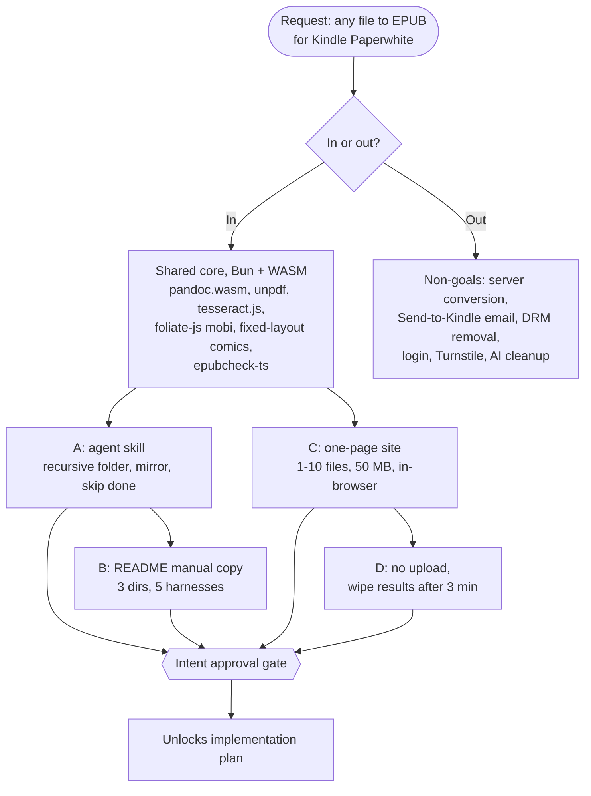

# Intent Lock Report: pubmy, any file to Kindle-ready EPUB

> Brainstorm-only session (2026-11-07). No implementation plan, code, git repo, worktree, or branch was written. Section 8 approved 2026-11-07 (verbatim below); the implementation plan starts only via the plan snippet.
> Skill path used: `/home/belajarcarabelajar/vivera/Super Ultra Code Plan Implementation.md` (first in the fallback chain), plus `sucp-rules` and `sucp-brainstorm` loaded with the Skill tool. Session checklist and verbatim grill log: `docs/code-plan/sessions/2026-11-07-pubmy-brainstorm/brainstorm-checklist.md`.

## 1. Goal & Context

- **Problem:** PDFs and other non-EPUB files read badly on a Kindle Paperwhite (fixed pages, small text, no reflow). The owner wants every file to end up as EPUB, which Send to Kindle accepts and reflows.
- **Desired outcome:** `pubmy`, one public MIT repo with (1) an agent skill that converts a whole folder to EPUB locally, usable in Claude Code, Antigravity, Cursor, OpenCode and Codex, and (2) a one-page website at `pubmy.belajarcarabelajar.com` that converts 1 to 10 files in the visitor's browser, with nothing uploaded and results wiped 3 minutes after they are ready.
- **Project overlay:** no repo yet (`~/Proyek/pubmy` absent, `gh repo view belajarcarabelajar/pubmy` not found, 2026-11-07). Machine facts: `bun` 1.4.4 pinned machine-wide (AGENTS.md 8.4); `cf` CLI for Cloudflare (4.1); heavy tests run through `colab-test` (A47). calibre, pandoc, LibreOffice, Java/epubcheck are NOT installed; `markitdown` and `tesseract` 5.5.4 are.
- **Requester intent (verbatim, opening message, abridged quotes):**
  - "sistem konversi dari berbagai file yang mana ujung-ujungnya itu harus wajib dikonversi menjadi EPUB" ... "Kindle Paperwhite, baik itu yang generasi 10, 11"
  - A: "kita bikin agent skill untuk konversi ini, dan itu bisa per batch ya ... user tinggal mencantumkan aja folder mana"
  - B: "instalasi agent skillsnya itu di Claude Code, di anti-gravity, di cursor, terus juga di open code, di codex"
  - C: "versi website yang sederhana gitu ya, hanya satu halaman saja ... mengupload ini secara satuan ataupun secara queue ... maksimal 10 file"
  - D: "ini temporary ya ... setelah 2-3 menit misalnya itu langsung akan dihapus dari server"
  - Name: "rename repo to: pubman" then "pubmy maksudnya"

## 2. Task List (A, B, C, D)

The user described four parts; the agent labelled them A-D and the grill locked each one.

| ID | Task (user wording) | Interpreted scope | In / Out | Notes |
|---|---|---|---|---|
| A | "agent skill untuk konversi ini ... per batch ... folder" | Skill + Bun CLI: recursive folder scan, output mirrored to `<folder>/pubmy-epub/`, skip files already converted, no file cap. Runs locally on the shared Bun + WASM core (same core as C). | In | Human-locked |
| B | "instalasi ... Claude Code, anti-gravity, cursor, open code, codex" | README with manual copy steps into 3 dirs that cover all 5 harnesses: `~/.claude/skills` (Claude Code), `~/.agents/skills` (Codex, Cursor, OpenCode), `~/.gemini/config/skills` (Antigravity). No installer script. | In | Human-locked (agent had recommended an installer) |
| C | "website ... satu halaman ... satuan ataupun queue ... maksimal 10 file" | Static page on Cloudflare Workers Free (static assets), conversion fully in the browser, 1-10 files, max 50 MB each, sequential queue, Indonesian + English toggle, Cloudflare Web Analytics only, no login, no Turnstile. | In | Human-locked |
| D | "temporary ... 2-3 menit ... dihapus dari server" | Reinterpreted after the in-browser decision: files never reach a server; converted EPUBs live only in tab memory and are revoked 3 min after each is ready, with a visible countdown. | In | Human-locked (round 3) |

Format coverage for A and C (round 1, round 4): PDF digital, PDF scanned (OCR `ind+eng`), DOCX/ODT/RTF/HTML/Markdown/TXT, MOBI/AZW3 (DRM-free, full support), CBZ/CBR comics (fixed-layout EPUB).

## 3. Scope Map

## 4. Non-Goals

- Server-side conversion (calibre, Docling, Cloud Run, Containers): Workers Free gives 10 ms CPU and 128 MB per request (developers.cloudflare.com/workers/platform/limits, updated 2026-10-29); owner chose in-browser.
- Emailing to Send to Kindle: owner chose "Download/file only".
- DRM removal of any kind: DRM files are detected and refused (legal, G7).
- Login, Turnstile, rate limiting: nothing server-side to protect.
- AI/LLM cleanup of output, KFX/AZW3/PDF output, native-tool "boost" path: not requested; single engine path.
- Tests on Paperwhite 11/12: only the owner's Paperwhite 10 is a device of record.
- Monetization, accounts, history: not requested.

## 5. Decisions & Trade-offs

| # | Decision | Options considered | Chosen + why | Who decided |
|---|---|---|---|---|
| D1 | Audience | personal first / public day one / personal only | Public from day one | Human-locked (agent recommended personal first) |
| D2 | v1 formats | PDF digital, scan, docs/web, MOBI/AZW3 + comics | All four groups | Human-locked |
| D3 | Where the skill converts | local / web API / both | Local machine | Human-locked |
| D4 | Delivery | file + email / file only / always email | File only | Human-locked |
| D5 | Website hosting | Cloud Run / CF Containers / own box / browser on Worker Free | Worker Free, conversion in browser (after a re-ask: Workers Free cannot run native engines) | Human-locked |
| D6 | Repo | public MIT / private / split | One public repo `pubmy`, MIT | Human-locked |
| D7 | UI language | ID+EN / ID / EN | Indonesian + English toggle | Human-locked |
| D8 | Skill engine | shared Bun+WASM core / native tools / both | Shared core, Bun + WASM | Human-locked |
| D9 | Turnstile | drop / keep | Drop | Human-locked |
| D10 | Retention | wipe at 3 min / until tab closes / none | Wipe from tab memory 3 min after ready | Human-locked |
| D11 | Domain | subdomain / new domain / workers.dev | `pubmy.belajarcarabelajar.com` | Human-locked |
| D12 | MOBI/AZW3 | beta / defer / full | Full support in v1 | Human-locked (agent recommended beta) |
| D13 | OCR languages | ind+eng / per file / eng | `ind+eng` | Human-locked |
| D14 | Folder mode | recursive mirror skip / top-level / cap 10 | Recursive, mirror to `<folder>/pubmy-epub/`, skip done, no cap | Human-locked |
| D15 | Acceptance | epubcheck + real Kindle / epubcheck / Kindle only | epubcheck + owner's Paperwhite 10 | Human-locked |
| D16 | Fixtures | public-domain + generated / + private / generated | Public-domain + generated | Human-locked |
| D17 | Skill install | installer / `npx skills add` / README manual copy | README manual copy | Human-locked (agent recommended installer) |
| D18 | Analytics | CF Web Analytics / none / conversion events | CF Web Analytics only | Human-locked |
| D19 | Per-file cap | 50 / 100 / 25 MB | 50 MB | Human-locked (round 2, still valid in-browser) |
| D20 | PDF engine | unpdf (MIT) + own layout heuristics / MuPDF.js (AGPL) | unpdf + own heuristics; AGPL would force the repo off MIT | Agent-default (needs confirmation) |
| D21 | Validator | epubcheck-ts in core + Java EPUBCheck cross-check on fixtures via `colab-test` | Both: browser/Bun gate plus Java check, since e999 tracks Java-epubcheck errors (harvard-edge/cs249r_book#1148, 2026-04-20) | Agent-default (needs confirmation) |
| D22 | Repo location | `~/Proyek/pubmy` + GitHub `belajarcarabelajar/pubmy` (public) | Same names as the product | Agent-default; creating the GitHub repo is asked separately in the plan phase |

## 6. Assumptions

- **pandoc.wasm writes EPUB 3 in browser and Bun.** README says binary output returns as a Blob; EPUB not yet tested. Falsified by: spike fails to produce a valid EPUB. Impact: write the EPUB packager in TS ourselves (pandoc only for HTML).
- **Each WASM asset fits Workers static assets (25 MiB per file).** pandoc.wasm reported ~16 MB (discourse.haskell.org 2026-02-05). Falsified by: real build > 25 MiB. Impact: split, or host the asset on R2.
- **Licensing works under MIT.** pubmy code is MIT; pandoc.wasm (GPL-2.0+) ships as a separate unmodified file with its notice and source link. Falsified by: a licence review that treats the site as one combined work. Impact: relicense to GPL or drop pandoc.wasm.
- **The browser handles 10 × 50 MB in a sequential queue.** Falsified by: tab crash on a low-RAM phone. Impact: lower the cap on mobile.
- **unpdf plus our own heuristics reflow single- and two-column text PDFs readably.** Tables come out best-effort. Falsified by: the owner rejecting Kindle samples. Impact: PDF quality is the main differentiator, so the plan scopes it as its own task.
- **foliate-js `mobi.js` can be repacked to valid EPUB for both MOBI6 and KF8.** Falsified by: a spike on fixtures. Impact: full MOBI support (D12) grows or slips; the owner is asked again.
- **libarchive.js handles CBR in browser and Bun.** It is 2024 and its licence is unconfirmed. Falsified by: licence or runtime check. Impact: CBR drops to CBZ-only, and the owner is asked.
- **Send to Kindle web upload (200 MB) is the manual path for acceptance tests.** EPUB via USB on a Paperwhite 10 is likely unsupported (unconfirmed).
- **Harness load claims rest on vendor docs only (G4, fetched 2026-11-07).** Each harness is verified on this machine where it is installed. The others stay labelled "not verified".
- **OCR speed per page and the `ind` traineddata size are unmeasured.** They are measured in the first spike.

## 7. Acceptance Criteria (observable, testable)

- [ ] AC-1 (A): `pubmy <folder>` converts every supported file under `<folder>` recursively into `<folder>/pubmy-epub/` with the same tree. A second run converts nothing new. It exits non-zero with a per-file report when any file fails.
- [ ] AC-2 (A, C): each fixture output passes `epubcheck-ts` with 0 errors, and Java EPUBCheck 5.x with 0 fatal and 0 errors (run via `colab-test`).
- [ ] AC-3 (A, C): one sample per format group goes to the owner's Paperwhite 10 via Send to Kindle, 5 or more files in all: PDF digital, PDF scanned, DOCX, MOBI/AZW3, CBZ. Each opens with no e999, the TOC works, and the text reflows. The owner confirms.
- [ ] AC-4 (C): the page accepts 1-10 files of up to 50 MB each and converts them one by one. The browser network log shows no request carrying file content. An 11th file or a file over 50 MB is refused with a message in the active language.
- [ ] AC-5 (D): 3 min after each EPUB is ready, its object URL is revoked and its download link disabled. A countdown is visible.
- [ ] AC-6 (A, C): a DRM-flagged MOBI/AZW3 (PalmDoc encryption field ≠ 0) is refused before any conversion.
- [ ] AC-7 (A, C): a scanned PDF is detected per page and OCR'd with `ind+eng`.
- [ ] AC-8 (B): the README copy steps put the skill in the 3 dirs. On this machine the skill is listed and triggered in each installed harness. Any harness not installed is labelled "not verified".
- [ ] AC-9 (C): the site is served from Workers Free static assets at `pubmy.belajarcarabelajar.com`. The UI toggles ID/EN. The only third-party script is Cloudflare Web Analytics.

## 8. Approval Gate

- [x] Human approves this intent lock before any plan is written, answered through the Confirmation Protocol (header `Intent`). Verbatim: "Approve, save in pubmy (Recommended)" (2026-11-07).
- [x] Approved scope (tasks A/B/C/D as locked): A, B, C, D all In, with the decisions D1-D22 above.
- [ ] Next step: invoke the plan snippet to generate the implementation plan from this lock. The plan should open with a spike on pandoc.wasm EPUB output, the asset size, the MOBI repack, and OCR speed.
