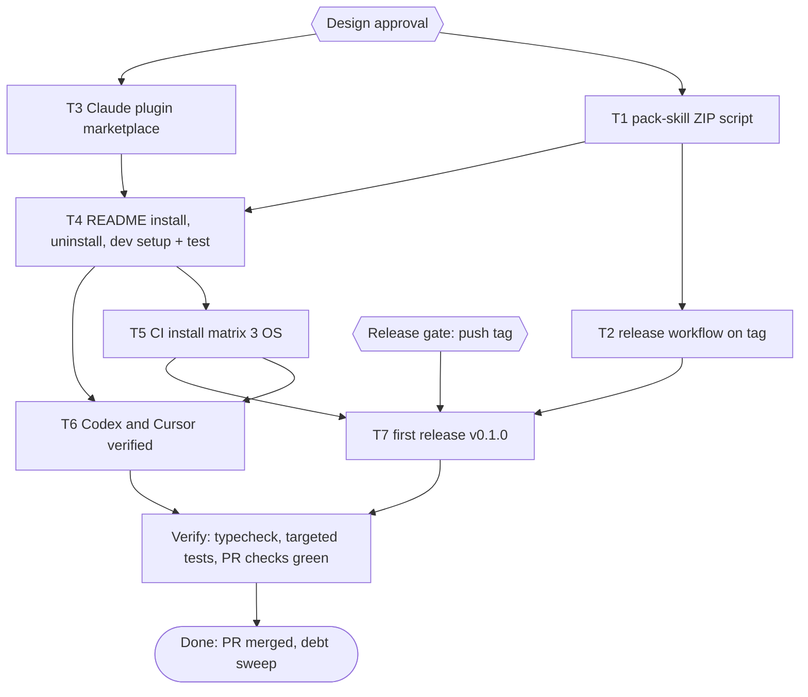

# pubmy install methods Implementation Plan

> For agentic workers: REQUIRED EXECUTION METHOD: delegated task execution. Steps use checkbox syntax.

**Goal:** Make every way of installing pubmy complete and proven: one-command installs, a skill-only ZIP, uninstall, developer setup, and verification on Windows, macOS, Codex and Cursor.

**Architecture:** Two install manifests are added beside the existing `skills/pubmy` folder (the `npx skills` CLI reads `skills/*/SKILL.md` as is; Claude Code reads `.claude-plugin/marketplace.json`). A Bun script packs the skill folder into `dist/pubmy-skill.zip`, and a tag-triggered GitHub Actions workflow attaches it to a Release. The README's own install and uninstall code blocks are executed by a test, and a CI matrix runs that test on Ubuntu, macOS and Windows, so the README cannot drift from what works.

**Tech Stack:** Bun 1.4.4 (workspaces, `bun:test`, `Bun.YAML`), fflate 0.8 (already a root devDependency), GitHub Actions, Claude Code plugin marketplace, vercel-labs `skills` CLI.

**Active Project Profile:** repo `/home/belajarcarabelajar/Proyek/pubmy`, remote `belajarcarabelajar/pubmy` (public), `main` at `2f5be4c`, clean. Bun monorepo (`packages/core`, `apps/cli`, `apps/web`), `packageManager: bun@1.4.4`. No `.github/` yet, no tags, no releases. Git author `Iwan Kurniawan <110369962+belajarcarabelajar@users.noreply.github.com>`. Sources: `package.json`, `apps/*/package.json`, `apps/cli/build.ts`, `README.md`, `MEMORY.md`.

**Project Commands:** `bun install --frozen-lockfile`; `bun run typecheck`; `bun test <file>` (run through `colab-test -C ~/Proyek/pubmy -- <cmd>`, A47); skill bundle `bun run --cwd apps/cli build`; web `bun run --cwd apps/web build`, `bun run --cwd apps/web check:assets`.

**Protected Boundaries:** `skills/pubmy/scripts/*` is generated by `apps/cli/build.ts` and is not edited by hand. The website deploy is out of scope. Pushing a tag and creating a Release is externally visible and runs only after its own gate (T7).

**Spec:** none (Bounded path); decisions recorded below.

**Scope:** `npx skills add` and Claude Code plugin install paths; skill-only ZIP via release workflow; uninstall per harness (bash and PowerShell, plus `npx skills remove` and `claude plugin uninstall`); developer setup section; CI install matrix on three systems; Codex and Cursor verified by the tools themselves; first release v0.1.0.

**Non-Goals:** a hand-written `install.sh`/`install.ps1` (owner chose `npx skills` + plugin); submission to Anthropic's plugin directory or skills.sh listing; npm package publish; changes to conversion code.

**Visual Map:**

**Reasoning Lenses:** intent (owner wants every install path complete, short replies), investigative (repo has no CI, tag or release; `npx skills` and plugin docs read 2026-11-07), analytical (README blocks executed by a test so docs and behaviour cannot drift), computational (ZIP layout `pubmy/...` deterministic), test-first, verification (CI matrix is the only Windows/macOS evidence available; no such machine here).

**Acceptance Criteria:**
- [x] AC-1: `bun scripts/pack-skill.ts` writes `dist/pubmy-skill.zip` whose entries all start with `pubmy/` and include `pubmy/SKILL.md` and `pubmy/scripts/pubmy.js`; unzipping it into a skills folder gives a working skill. (evidence: `bun test scripts/pack-skill.test.ts` exit 0, 5 pass, unzip-and-convert case)
- [ ] AC-2: pushing a tag `v*` runs a workflow that builds the ZIP and attaches it to a GitHub Release with that tag name.
- [x] AC-3: `claude plugin validate .` passes and `claude plugin marketplace add` + `claude plugin install pubmy@pubmy` from the repo directory installs a plugin whose skills list includes `pubmy`. (evidence: `claude plugin validate .` exit 0; `bun test scripts/plugin-manifest.test.ts` exit 0, 5 pass)
- [x] AC-4: README documents `npx skills add belajarcarabelajar/pubmy`, the Claude plugin commands, the ZIP download, uninstall for every install method (bash and PowerShell), and developer setup; every bash install and uninstall block runs green in a temp HOME on Linux. (evidence: `bun test scripts/readme-install.test.ts` exit 0, 6 pass)
- [x] AC-5: CI runs the README install test on ubuntu-latest, macos-latest and windows-latest (PowerShell blocks on Windows), plus a developer-setup job, on every PR. (evidence: `gh pr checks 14 --watch` exit 0 on run 42373221748)
- [ ] AC-6 (not met, owner chose no sign-in 2026-11-07): Codex and Cursor each quote the pubmy skill description when asked; README Verified table lists them and the three CI systems as verified, with the date.
- [ ] AC-7: release v0.1.0 exists with asset `pubmy-skill.zip`, and `https://github.com/belajarcarabelajar/pubmy/releases/latest/download/pubmy-skill.zip` returns 200.

**Traceability:**

| AC | Task | Check | Evidence |
|---|---|---|---|
| AC-1 | T1 | `bun test scripts/pack-skill.test.ts` | exit 0, entries checked, unzip-and-run case passes |
| AC-2 | T2 | `bun test scripts/workflows.test.ts -t release` | exit 0; real run proven in T7 |
| AC-3 | T3 | `claude plugin validate .` | `Validation passed`, install test in temp config dir |
| AC-4 | T4 | `bun test scripts/readme-install.test.ts` | exit 0, every block executed |
| AC-5 | T5 | `gh pr checks` | three OS jobs + dev job green |
| AC-6 | T6 | `codex exec` and `agent -p` transcripts | description quoted |
| AC-7 | T7 | `gh release view v0.1.0 -R belajarcarabelajar/pubmy` | asset listed, URL 200 |

**Assumptions & Open Questions:**
- Decisions by owner 2026-11-07: one-command = `npx skills` + Claude plugin; ZIP via GitHub Actions on tag; Windows/macOS via CI matrix; Codex/Cursor by installing the CLIs, owner logs in.
- Assumption: the plugin is the repo root (`source: "./"`), so the plugin skill is invoked as `pubmy:pubmy`; Claude Code clones the whole repo (small apart from the 25 MB skill).
- Measured 2026-11-07 (temp HOME, `npx skills add ./ --skill pubmy -a <agent> -g -y`, exit 0 each): the whole 25 MB folder is copied (`pubmy.js` byte-identical); `claude-code` → `~/.claude/skills/pubmy`, `codex`, `cursor`, `opencode`, `antigravity` → `~/.agents/skills/pubmy`; `npx skills remove pubmy -g -y` removes it. The Mintlify agents page (`~/.codex/skills`, `~/.cursor/skills`, `~/.gemini/antigravity/skills`) disagrees with the CLI; the measured paths win. Antigravity via `npx skills` lands in `~/.agents/skills`, not the `~/.gemini/config/skills` folder verified with `agy`, so T6 also checks whether `agy` reads `~/.agents/skills`.
- Measured: `claude plugin validate .` suggests the one-step install `/plugin install pubmy --marketplace belajarcarabelajar/pubmy` (Claude Code 2.1.275+); README uses it.
- Execution note: C2 (T3) subagent stopped on HTTP 429 (5-hour limit) before writing files; per A16 the parent finished T3 inline. The plugin test ran locally because it needs the `claude` binary, which Colab lacks.
- Resolved 2026-11-07: pubmy registered in vivera `plans.publish.json` and `plan.issues.json` (local, gitignored files; backups in `~/.cache/tmp/pubmy-install-methods/`); plan issue #13.

**Dependencies & Impact:** `apps/cli/test/bundle.test.ts` asserts README text (install dirs, harness names, no em dash) and must stay green. CI adds GitHub Actions minutes (free for public repos).

**Risks & Rollback:** a broken workflow only fails checks, never touches code; rollback = revert the commit. A bad release = `gh release delete v0.1.0 --cleanup-tag` (asked separately). Codex/Cursor installs are user-global tools outside the repo: uninstall `bun remove -g @openai/codex`, `rm ~/.local/bin/cursor-agent` and `~/.local/share/cursor-agent` (exact paths recorded at install).

**Security & Compatibility:** workflow `permissions: contents: write` only on the release job; install-check job `contents: read`. No secrets used besides the default `GITHUB_TOKEN`. Owner types Codex/Cursor logins; the agent never handles credentials.

**Operations & Rollout:** PR → CI matrix green → merge (owner) → T7 gate → tag push → release.

**CI/Review Gate:** new `install-check` workflow on PR; parent diff audit; independent reviewer before PR.

**Documentation:** README only (Install, One-command install, Download ZIP, Uninstall, Developer setup, Verified on).

**Definition of Done:** AC-1..AC-7 checked with evidence, typecheck exit 0, targeted tests exit 0, PR checks green, debt sweep run.

**Plan Status & Version:** Approved, v1.

**Reproducibility:** Bun 1.4.4, Node 22.20+ for `npx skills`, Claude Code CLI for T3, ZIP entries fixed mtime.

**Test Reliability:** tests use `mkdtemp` HOME/USERPROFILE and clean up; no network except `npx skills` in CI; Windows path separators handled with `node:path`.

**Privacy & Data Governance:** no user data; fixtures are generated text files.

**Dependencies & Supply Chain:** no new npm dependency (fflate already pinned). Actions pinned to major versions read from their READMEs at implementation time (`actions/checkout`, `oven-sh/setup-bun`, `actions/setup-node`).

**UX States:** N/A (docs and CI).

**Persistent State & Artifact Storage:** `dist/` (gitignored) for the ZIP.

**Entity & Sourcing Verification:** `npx skills` (github.com/vercel-labs/skills README, read 2026-11-07); Claude Code marketplace (code.claude.com/docs/en/plugins/create-marketplace, read 2026-11-07). Codex and Cursor CLI install commands are read from vendor docs at T6 start.

**Verification:** `bun run typecheck`; `bun test scripts/pack-skill.test.ts scripts/workflows.test.ts scripts/plugin-manifest.test.ts scripts/readme-install.test.ts apps/cli/test/bundle.test.ts -t readme`; `claude plugin validate .`; `gh pr checks`.

## Global Constraints

- No em dash in README or SKILL.md (existing test).
- Commands in README for users may use `npx` (users' tool); commands the plan runs use Bun.
- Git is parent-only; subagents edit files and run tests only.
- Commit messages conventional, no attribution lines.

## Session checklist

- [x] Plan validated (`ultra-plan-runner.mjs` exit 0, Validation: OK) and Design approved (owner, 2026-11-07)
- [x] Worktree claimed: `/mnt/belajarcarabelajar/pubmy-wt/pubmy-install-methods`, branch `2026-11-07-pubmy-install-methods/pubmy-install-methods` (claim ok)
- [x] T1 pack-skill ZIP (C1): RED exit 1 (module missing), GREEN `bun test scripts/pack-skill.test.ts` exit 0 (5 pass), `bun run typecheck` exit 0; parent re-run exit 0
- [x] T2 release workflow (C1): RED exit 1, GREEN `bun test scripts/workflows.test.ts -t release` exit 0 (2 pass); parent re-run of pack-skill + workflows + readme-install exit 0 (11 pass, 0 fail)
- [x] T3 Claude plugin: RED `bun test scripts/plugin-manifest.test.ts` exit 1 (5 fail), GREEN exit 0 (5 pass, 14 expect), `claude plugin validate .` exit 0, real `~/.claude/plugins` mtimes unchanged
- [x] T4 README + readme-install test: RED `colab-test -- bun test scripts/readme-install.test.ts` exit 1 (4 fail); GREEN `colab-test -- bun test scripts/readme-install.test.ts apps/cli/test/bundle.test.ts -t readme` exit 0 (8 pass, 0 fail; install, convert and uninstall blocks executed). Done inline by the parent (A16, after the C2 429).
- [x] T5 CI install matrix (C1): RED `bun test scripts/workflows.test.ts -t install` exit 1 (4 fail), GREEN `bun test scripts/workflows.test.ts` exit 0 (6 pass); fresh `bun run typecheck` exit 0. Note: `-t install` also matches the release test "installs with the pinned Bun", so the RED run shows 1 pass.
- [x] Parent diff audit + independent review: parent re-runs `colab-test -- bun test scripts/pack-skill.test.ts scripts/workflows.test.ts scripts/readme-install.test.ts apps/cli/test/cli.test.ts` exit 0 (53 pass, 0 fail), `colab-test -- bun run typecheck` exit 0; staid verdict `correct`, no blocking findings (risks: Windows leg unproven until CI, ZIP link 404 until T7, ZIP blocks not executed by a test); reviewer integrity: status + HEAD unchanged, only this plan file differed (parent edit)
- [x] PR #14 opened; first CI run: windows-latest failed (README parser read a `# comment` inside the bash block as a heading, so no PowerShell block was found); RED regression `bun test scripts/readme-install.test.ts -t 'readme block extraction'` exit 1 (2 fail), fix in `scripts/readme-install.test.ts` (track every fence), GREEN exit 0 (6 pass); commit 2dac7cc; `gh pr checks 14 --watch` exit 0 (install ubuntu, macos, windows and dev-setup pass)
- [x] T6: Codex 0.167.0 and Cursor `agent` 2026.11.05 installed (`--version` exit 0); owner chose not to sign in, so both stay `not verified` with that reason; README gains the per-method check table; `colab-test -- bun test scripts/readme-install.test.ts apps/cli/test/bundle.test.ts -t readme` exit 0 (10 pass)
- [ ] PR merged (owner)
- [ ] T7 release v0.1.0 after Release gate
- [x] Debt sweep (4 follow-ups selected and closed, see Follow-ups; ledger `docs/code-plan/2026-11-07-pubmy-install-methods-learning-ledger.md`, MEMORY.md M10 M11; runner log: T1-T5 SKIPPED-IDEMPOTENT, T6 PASSED, T7 FAILED-ISOLATED release not found; readiness NOT-READY exit 1)

## Task T1: pack-skill ZIP script

**Files:** Create `scripts/pack-skill.ts`, `scripts/pack-skill.test.ts`; Modify `.gitignore` (add `dist/`).
**Interfaces:** Produces `packSkill(outFile = "dist/pubmy-skill.zip"): Promise<string[]>` (returns entry names); CLI `bun scripts/pack-skill.ts [out]`.
**Behavior & Acceptance:** AC-1. Entries prefixed `pubmy/`, fixed mtime, no `.DS_Store`.
**Edge Cases:** missing `skills/pubmy/SKILL.md` → throw with path; output dir created.
**Deliberate Shortcuts:** None.
**Test Data & Determinism:** temp dir; unzip with fflate, run `bun <tmp>/pubmy/scripts/pubmy.js <tmp>/in` on a generated `.md` file, expect `.epub`.

- [x] Step 1: Write failing test (entries, unzip, convert)
- [x] Step 2: Run: `bun test scripts/pack-skill.test.ts` | expect exit 1 | retry 0
- [x] Step 3: Implement `scripts/pack-skill.ts` with fflate `zipSync`
- [x] Step 4: Run: `bun test scripts/pack-skill.test.ts` | expect exit 0 | retry 1
- [x] Step 5: Run: `bun run typecheck` | expect exit 0 | retry 0

## Task T2: release workflow on tag

**Files:** Create `.github/workflows/release-skill.yml`, `scripts/workflows.test.ts`.
**Behavior & Acceptance:** AC-2. On `push: tags: ["v*"]`: checkout, setup-bun, `bun install --frozen-lockfile`, `bun scripts/pack-skill.ts`, `gh release create "$GITHUB_REF_NAME" dist/pubmy-skill.zip --generate-notes` with `GH_TOKEN: ${{ github.token }}` and `permissions: contents: write`.
**Test:** `scripts/workflows.test.ts` parses YAML with `Bun.YAML.parse`, asserts trigger, permissions and that the steps call `scripts/pack-skill.ts` and `gh release create` with `dist/pubmy-skill.zip`.

- [x] Step 1: Write failing test `-t release`
- [x] Step 2: Run: `bun test scripts/workflows.test.ts -t release` | expect exit 1 | retry 0
- [x] Step 3: Write workflow
- [x] Step 4: Run: `bun test scripts/workflows.test.ts -t release` | expect exit 0 | retry 1

## Task T3: Claude plugin marketplace

**Files:** Create `.claude-plugin/marketplace.json` (name `pubmy`, owner Iwan Kurniawan, one plugin `pubmy`, `source: "./"`), `.claude-plugin/plugin.json` (name `pubmy`, description, version `0.1.0`, license MIT, repository URL), `scripts/plugin-manifest.test.ts`.
**Behavior & Acceptance:** AC-3. Entry name equals manifest name; source dir holds `skills/pubmy/SKILL.md`. Test also runs, when `claude` is on PATH, `claude plugin marketplace add <repo>` and `claude plugin install pubmy@pubmy` with `CLAUDE_CONFIG_DIR` set to a temp dir, then `claude plugin details pubmy` lists skill `pubmy`.
**Edge Cases:** `claude` absent (CI) → that case is skipped with a visible reason; manifest checks still run.

- [x] Step 1: Write failing test
- [x] Step 2: Run: `bun test scripts/plugin-manifest.test.ts` | expect exit 1 | retry 0
- [x] Step 3: Write both JSON files
- [x] Step 4: Run: `bun test scripts/plugin-manifest.test.ts` | expect exit 0 | retry 1
- [x] Step 5: Run: `claude plugin validate .` | expect exit 0 | retry 0

## Task T4: README install, uninstall, developer setup

**Files:** Modify `README.md`; Create `scripts/readme-install.test.ts`.
**Behavior & Acceptance:** AC-4. New README order under `## Install the skill`: One command (`npx skills add belajarcarabelajar/pubmy --skill pubmy -g`, Claude plugin commands), Download ZIP (`releases/latest/download/pubmy-skill.zip`), From a clone (existing copy blocks), Per-project install (existing). New `## Uninstall` (bash + PowerShell per harness folder, `npx skills remove pubmy -g`, `claude plugin uninstall pubmy@pubmy` and `claude plugin marketplace remove pubmy`). New `## Developer setup` (`bun install`, `bun run typecheck`, `bun test <file>`, `bun run --cwd apps/cli build`, `bun run --cwd apps/web build`, Java EPUBCheck cross-check).
**Test:** extracts the fenced `bash` blocks (Linux/macOS) or `powershell` blocks (Windows) under the install-from-clone and uninstall headings, runs them with `HOME`/`USERPROFILE` set to a temp dir and cwd = repo, asserts each harness folder has `pubmy/SKILL.md`, converts a generated `.md` with the installed `pubmy.js`, then runs the uninstall block and asserts the folders are gone.
**Precondition check before documenting `npx skills`:** run `bunx skills add <repo> --skill pubmy -a codex -g -y` with temp HOME and confirm `scripts/pubmy.js` was copied.

- [x] Step 1: Write failing test
- [x] Step 2: Run: `bun test scripts/readme-install.test.ts` | expect exit 1 | retry 0
- [x] Step 3: Rewrite README sections
- [x] Step 4: Run: `bun test scripts/readme-install.test.ts` | expect exit 0 | retry 1
- [x] Step 5: Run: `bun test apps/cli/test/bundle.test.ts -t readme` | expect exit 0 | retry 0

## Task T5: CI install matrix

**Files:** Create `.github/workflows/install-check.yml`; Modify `scripts/workflows.test.ts`.
**Behavior & Acceptance:** AC-5. On `pull_request` and `push` to `main`: job `install` with matrix `[ubuntu-latest, macos-latest, windows-latest]`: checkout, setup-bun, setup-node 22, `bun install --frozen-lockfile`, `bun test scripts/readme-install.test.ts`, `npx skills add ./ --skill pubmy -a codex -g -y` then check the copied `pubmy.js`. Job `dev-setup` on ubuntu: `bun install --frozen-lockfile`, `bun run typecheck`, `bun test apps/cli/test/cli.test.ts`. `permissions: contents: read`.

- [x] Step 1: Write failing test `-t install`
- [x] Step 2: Run: `bun test scripts/workflows.test.ts -t install` | expect exit 1 | retry 0
- [x] Step 3: Write workflow
- [x] Step 4: Run: `bun test scripts/workflows.test.ts -t install` | expect exit 0 | retry 1

## Task T6: Codex and Cursor verified

**Files:** Modify `README.md` (Verified on table).
**Preconditions:** install commands read from vendor docs; owner logs in to each CLI (agent never types credentials).
**Behavior & Acceptance:** AC-6. Copy skill to `~/.agents/skills/pubmy`; ask each tool to list skills and quote pubmy's description; record date and command in the table. Add rows for ubuntu, macOS and Windows from the T5 CI run.

- [x] Step 1: Install Codex CLI and Cursor CLI per vendor docs
- [x] Step 2: Run: `codex --version` | expect exit 0 | retry 0
- [x] Step 3: Run: `agent --version` (Cursor CLI binary, docs read 2026-11-07) | expect exit 0 | retry 0
- [x] Step 4: Owner logs in; ask each tool; save transcripts to `~/.cache/tmp/pubmy-install-methods/`
- [x] Step 5: Update README table; Run: `bun test scripts/readme-install.test.ts` | expect exit 0 | retry 0

## Task T7: first release v0.1.0

**Preconditions:** PR merged to `main`; Release gate answered (safe option first).
**Behavior & Acceptance:** AC-7. `git tag v0.1.0 <merge sha>` and `git push origin v0.1.0`; workflow attaches the ZIP.

- [ ] Step 1: Run: `gh release view v0.1.0 -R belajarcarabelajar/pubmy --json assets --jq '.assets[].name'` | expect exit 0 | retry 2

## Batch manifest

| Chunk | Owner | Files | Verify |
|---|---|---|---|
| C1 = T1 + T2 | subagent A | `scripts/pack-skill*.ts`, `.gitignore`, `.github/workflows/release-skill.yml`, `scripts/workflows.test.ts` (release cases) | `bun test scripts/pack-skill.test.ts`, `bun test scripts/workflows.test.ts -t release` |
| C2 = T3 | subagent B | `.claude-plugin/*`, `scripts/plugin-manifest.test.ts` | `bun test scripts/plugin-manifest.test.ts`, `claude plugin validate .` |
| C3 = T4 | subagent C (after C1, C2) | `README.md`, `scripts/readme-install.test.ts` | `bun test scripts/readme-install.test.ts` |
| C4 = T5 | subagent A reused (after C3) | `.github/workflows/install-check.yml`, `scripts/workflows.test.ts` (install cases) | `bun test scripts/workflows.test.ts -t install` |
| C5 = T6, T7 | parent (needs owner login and gates) | `README.md` table | as T6, T7 |

## Approval

- Design questions answered 2026-11-07 (see Assumptions).
- Design and plan approved by owner 2026-11-07 (Design gate, Approve).

## Follow-ups

- Done 2026-11-07: pubmy registered for plan publishing (owner approved).
- Debt sweep 2026-11-07, owner selected all four; done inline by the parent (single-file changes; A16 after the earlier 429):
  - [x] ZIP download blocks tested: `scripts/readme-install.test.ts` serves the packed ZIP on 127.0.0.1 and runs the README block; RED by mutating the unzip target in README (diff shown, run exit 1, `Expected: true Received: false`), README restored (`cmp` equal), GREEN exit 0.
  - [x] Antigravity: `agy -p` did not list a probe skill placed in `~/.agents/skills` (found only through the owner's custom GEMINI.md rule), while `pubmy` in `~/.gemini/config/skills` was listed; README now says so. Probe removed.
  - [x] Release test renamed (`sets up the pinned Bun, ...`), so `bun test scripts/workflows.test.ts -t install` selects only the 4 install tests (exit 0).
  - [x] Codex and Cursor CLIs removed (`bun remove -g @openai/codex`; `agent`, `cursor-agent` symlinks and `~/.local/share/cursor-agent` deleted); `which codex agent cursor-agent` exit 1 for all; README rows no longer claim the CLIs are installed.

## Closeout status

- Readiness 2026-11-07: `bun scripts/plan-closeout.mjs --readiness` NOT-READY (exit 1). Open: T7 (release v0.1.0, needs the merge), AC-2 and AC-7 (proven only by the first release), AC-6 (owner declined Codex and Cursor sign-in).
- Reopen trigger: after PR #14 merges and the `v0.1.0` tag runs `release-skill.yml`; then run T7's check and close the plan in that session.
