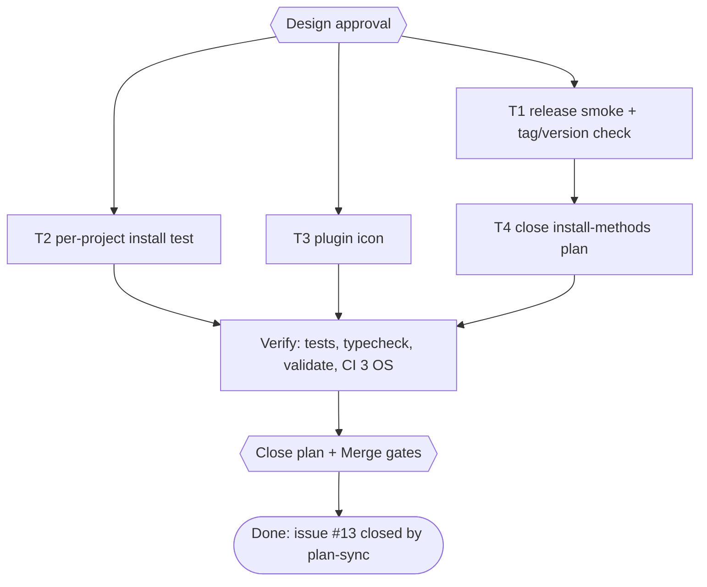

# pubmy release hardening Implementation Plan

> For agentic workers: REQUIRED EXECUTION METHOD: delegated task execution. Steps use checkbox syntax.

**Goal:** Make a pubmy release refuse to publish a broken skill ZIP or a tag that does not match the plugin version, test the per-project install blocks, give the plugin an icon, and close plan `2026-11-07-pubmy-install-methods` (issue #13) in the same PR.

**Architecture:** One Bun script, `scripts/release-check.ts <tag> <zip>`, runs in `release-skill.yml` between packing and `gh release create`: it fails unless the tag equals `v` + `.claude-plugin/plugin.json` `version`, and unless the packed ZIP, unzipped into a temp folder, converts a generated Markdown file. The README per-project blocks get the same execute-in-temp treatment as the home-folder blocks. The icon is an SVG source plus a 512 px PNG referenced from `plugin.json`.

**Tech Stack:** Bun 1.4.4, fflate 0.8, GitHub Actions, Claude Code plugin manifest, rsvg-convert (one-time PNG render).

**Active Project Profile:** repo `/home/belajarcarabelajar/Proyek/pubmy`, `main` at `9a8c994` (PR #14 merged), release `v0.1.0` published. Commands as in plan `2026-11-07-pubmy-install-methods`: tests through `colab-test -C <worktree> -- bun test <file>`, `bun run typecheck`; plugin tests locally (need `claude`).

**Project Commands:** `bun install --frozen-lockfile`; `bun run typecheck`; `bun test <file>`; `claude plugin validate .`.

**Protected Boundaries:** `skills/pubmy/scripts/*` generated, untouched. No new release or tag in this plan (the next release is a separate owner decision). Website untouched.

**Spec:** none (Bounded path).

**Scope:** release smoke test and tag/version check; per-project install test; plugin icon; close the install-methods plan.

**Non-Goals:** cutting `v0.1.1`; submitting to Anthropic's plugin directory; documentation, support, privacy or terms URLs in `plugin.json`.

**Visual Map:**

**Reasoning Lenses:** intent (owner chose all four; the closeout must ride in a real PR), investigative (Claude Code docs: `version` pins users until changed; `icon` is read only by Anthropic's directory), test-first, operations (a release must fail before publishing, not after), verification.

**Acceptance Criteria:**
- [x] AC-1: `bun scripts/release-check.ts v0.1.0 <zip>` exits 0 for a good ZIP and matching version; exits 1 naming both values when the tag differs from `plugin.json` `version`; exits 1 when the unzipped skill cannot convert a file.
- [x] AC-2: `release-skill.yml` runs `scripts/release-check.ts "$GITHUB_REF_NAME" dist/pubmy-skill.zip` after packing and before `gh release create`.
- [x] AC-3: `scripts/readme-install.test.ts` runs the README per-project bash (PowerShell on Windows) block with its placeholder replaced by a temp project folder, and both project folders hold `pubmy/SKILL.md`; the README no longer says only the home-folder install was tested.
- [x] AC-4: `plugin.json` `icon` points to `./assets/icon.png`, a 512x512 PNG; `claude plugin validate .` passes with no icon warning.
- [ ] AC-5: plan `2026-11-07-pubmy-install-methods` reaches readiness READY with T7 ticked from a runner log and is set `Complete` at the owner's `Close plan` answer; after merge `plan-sync` closes issue #13.

**Traceability:**

| AC | Task | Check | Evidence |
|---|---|---|---|
| AC-1 | T1 | `bun test scripts/release-check.test.ts` | exit 0, good, version-mismatch and broken-zip cases |
| AC-2 | T1 | `bun test scripts/workflows.test.ts -t release` | exit 0, step order asserted |
| AC-3 | T2 | `bun test scripts/readme-install.test.ts -t per-project` | exit 0 on Linux; CI on 3 OS |
| AC-4 | T3 | `claude plugin validate .` | Validation passed, no icon warning |
| AC-5 | T4 | `bun ~/vivera/scripts/plan-closeout.mjs --readiness docs/code-plan/plans/2026-11-07-pubmy-install-methods.md` | READY, then issue #13 CLOSED |

**Assumptions & Open Questions:**
- Docs read 2026-11-07 (code.claude.com plugin reference, copy fetched in the install-methods session): "Setting [version] pins the plugin to that version until you change it"; `icon` is read by Anthropic's directory only, path to an image inside the plugin.
- Icon design: no logo exists in the repo; a simple SVG is drawn and shown to the owner before commit.
- Readiness counts task step boxes only; AC-6 of the install-methods plan (Codex and Cursor sign-in, declined by the owner) is an open box outside task sections, so READY does not mean AC-6 is met. The `Close plan` question names AC-6 so the owner decides on it.
- The version rule means: before tagging `vX.Y.Z`, bump `plugin.json` `version` to `X.Y.Z` in a PR; the README developer setup says so.

**Dependencies & Impact:** `scripts/workflows.test.ts` release cases change; `scripts/readme-install.test.ts` grows; `plugin-manifest.test.ts` grows.

**Risks & Rollback:** all changes are scripts, tests, docs and manifests; revert the commits. A wrong release check only blocks a future release, never a published one.

**Security & Compatibility:** no secrets; release job permissions unchanged (`contents: write`).

**Operations & Rollout:** takes effect on the next `v*` tag.

**CI/Review Gate:** `install-check` on 3 OS; parent diff audit; independent review.

**Documentation:** README per-project paragraph and developer setup (version rule).

**Definition of Done:** AC-1..AC-5 with evidence, typecheck exit 0, CI green, plan Complete after owner gate, issue #13 closed after merge.

**Plan Status & Version:** Complete, v1.

**Reproducibility:** Bun 1.4.4; rsvg-convert only for the one-time icon render (the PNG is committed).

**Test Reliability:** temp folders per test, cleaned up; no network.

**Privacy & Data Governance:** N/A, no user data.

**Dependencies & Supply Chain:** no new dependency.

**UX States:** N/A.

**Persistent State & Artifact Storage:** `assets/icon.svg`, `assets/icon.png` committed.

**Entity & Sourcing Verification:** Claude Code plugin reference (see Assumptions).

**Verification:** `bun test scripts/release-check.test.ts scripts/workflows.test.ts scripts/readme-install.test.ts`; `bun test scripts/plugin-manifest.test.ts` (local); `bun run typecheck`; `claude plugin validate .`; `gh pr checks`.

## Global Constraints

- No em dash in README, manifests, commit messages.
- Git is parent-only.
- No tag, release or deploy in this plan.

## Session checklist

- [x] Plan validated (`ultra-plan-runner.mjs` exit 0) and Design approved (owner, 2026-11-07); issue #15
- [x] Worktree claimed: `/mnt/belajarcarabelajar/pubmy-wt/pubmy-release-hardening`
- [x] T1 release check (chef): RED exit 1, GREEN exit 0 (13 pass), typecheck exit 0; review fix R1-5 RED exit 1 then GREEN
- [x] T2 per-project test (nappy): RED exit 1 (README sentence), GREEN exit 0 (10 pass); bundle readme exit 0
- [x] T3 icon: owner approved the drawn icon; RED `bun test scripts/plugin-manifest.test.ts -t icon` exit 1 (icon undefined), GREEN `bun test scripts/plugin-manifest.test.ts` exit 0 (6 pass), `claude plugin validate .` exit 0 with no icon warning (local: needs `claude`)
- [x] T4 install-methods plan: closeout runner (T1-T5, T7 SKIPPED-IDEMPOTENT; T6 exit 127 after the CLI uninstall, hook updated), `plan-mark-done` ticked T7, readiness READY exit 0 (re-run READY), owner answered Close plan = Mark Complete; README release rule written
- [x] Parent diff audit + independent review: round 1 not correct (5 findings), round 2 correct; fresh Colab tests exit 0 (30 pass, 0 fail), typecheck exit 0, local plugin-manifest exit 0 (6 pass), readme tests exit 0 (11 pass)
- [x] PR #16 opened; `gh pr checks 16 --watch` exit 0 (install ubuntu, macos, windows incl. the per-project blocks, and dev-setup with the new release tests); release simulation on PR head e6217dc (local, Colab slots held by another session): `bun scripts/release-check.ts v0.1.0 dist/pubmy-skill.zip` exit 0, `... v0.1.1 ...` exit 1 naming both versions
- [ ] PR merged (owner), issue #13 closed by plan-sync
- [x] Debt sweep: owner chose F1 (install deps in the main checkout): `bun install --frozen-lockfile` in `~/Proyek/pubmy` exit 0; readiness of the install-methods plan on main without `--cwd` now runs T1-T5 as DONE (were OPEN on failed imports). plan-cost gap reported, not fixed (vivera tool). Ledger `docs/code-plan/2026-11-07-pubmy-release-hardening-learning-ledger.md`, MEMORY.md M12 M13)

## Task T1: release smoke test and tag/version check

**Files:** Create `scripts/release-check.ts`, `scripts/release-check.test.ts`; Modify `.github/workflows/release-skill.yml`, `scripts/workflows.test.ts`.
**Interfaces:** `checkVersion(tag: string, pluginJsonPath?): string | null` (null = ok, else message naming both values); `smokeZip(zipPath: string): Promise<void>` (throws with the converter output); CLI `bun scripts/release-check.ts <tag> <zip>`, exit 0 or 1.
**Behavior & Acceptance:** AC-1, AC-2.
**Test Data:** zips built with `packSkill` into temp dirs; broken zip = packSkill over a temp skill folder whose `scripts/pubmy.js` exits 1; plugin.json copy in a temp dir for the mismatch case.

- [x] Step 1: Write failing tests
- [x] Step 2: Run: `bun test scripts/release-check.test.ts` | expect exit 1 | retry 0
- [x] Step 3: Implement script; add workflow step after `bun scripts/pack-skill.ts`; extend release test for the order
- [x] Step 4: Run: `bun test scripts/release-check.test.ts scripts/workflows.test.ts` | expect exit 0 | retry 1
- [x] Step 5: Run: `bun run typecheck` | expect exit 0 | retry 0

## Task T2: per-project install test

**Files:** Modify `scripts/readme-install.test.ts` (new `describe("per-project install", ...)`), `README.md` (per-project paragraph only).
**Behavior & Acceptance:** AC-3. Placeholders `/path/to/project` (bash) and `C:\path\to\project` (PowerShell) replaced by a temp folder; assert `<tmp>/.claude/skills/pubmy/SKILL.md` and `<tmp>/.agents/skills/pubmy/SKILL.md`.

- [x] Step 1: Write failing test
- [x] Step 2: Run: `bun test scripts/readme-install.test.ts -t per-project` | expect exit 1 | retry 0
- [x] Step 3: Update README sentence
- [x] Step 4: Run: `bun test scripts/readme-install.test.ts` | expect exit 0 | retry 1

## Task T3: plugin icon

**Files:** Create `assets/icon.svg`, `assets/icon.png` (512x512, `rsvg-convert -w 512 -h 512`); Modify `.claude-plugin/plugin.json` (`"icon": "./assets/icon.png"`), `scripts/plugin-manifest.test.ts`.
**Behavior & Acceptance:** AC-4. Test reads the PNG header (signature and IHDR width/height 512).

- [x] Step 1: Write failing test `-t icon`
- [x] Step 2: Run: `bun test scripts/plugin-manifest.test.ts -t icon` | expect exit 1 | retry 0
- [x] Step 3: Draw SVG, render PNG, show the owner, set `icon`
- [x] Step 4: Run: `bun test scripts/plugin-manifest.test.ts` | expect exit 0 | retry 1
- [x] Step 5: Run: `claude plugin validate .` | expect exit 0, no icon warning | retry 0

## Task T4: close the install-methods plan

**Files:** Modify `docs/code-plan/plans/2026-11-07-pubmy-install-methods.md`, `README.md` (developer setup: bump `plugin.json` `version` before tagging).
**Behavior & Acceptance:** AC-5. Runner log from a detached NVMe worktree; `plan-mark-done --from`; hand ticks with evidence (PR #14 merged `9a8c994`, release run 42374289117, AC-2, AC-7); readiness READY; `Close plan` gate; `status: Complete`; record readiness and `plan-cost`.

- [x] Step 1: Run: `bun ~/vivera/scripts/plan-closeout.mjs --readiness docs/code-plan/plans/2026-11-07-pubmy-install-methods.md` | expect exit 0 | retry 0

## Batch manifest

| Chunk | Owner | Files | Verify |
|---|---|---|---|
| C1 = T1 | chef | `scripts/release-check*.ts`, `.github/workflows/release-skill.yml`, `scripts/workflows.test.ts` | `bun test scripts/release-check.test.ts scripts/workflows.test.ts` |
| C2 = T2 | nappy | `scripts/readme-install.test.ts`, `README.md` per-project paragraph | `bun test scripts/readme-install.test.ts` |
| C3 = T3 | parent (icon needs the owner's look before commit) | `assets/*`, `.claude-plugin/plugin.json`, `scripts/plugin-manifest.test.ts` | `bun test scripts/plugin-manifest.test.ts`, `claude plugin validate .` |
| C4 = T4 | parent (owner gate) | install-methods plan, README developer setup line | readiness READY |

## Approval

- Owner selected the four items 2026-11-07.
- Design and plan approved by owner 2026-11-07.

## Review ledger

| Round | Finding | Verdict | Action |
|---|---|---|---|
| 1 | R1-1 install-methods plan cannot reach READY (AC-6) | disputed: reviewer ran readiness without node_modules; with `--cwd` on an NVMe worktree readiness is READY exit 0; AC-6 is surfaced at the Close plan gate | plan Assumptions note |
| 1 | R1-2 README row says per-project blocks convert a file | fixed | row reworded |
| 1 | R1-3 new release tests not run in CI | fixed | dev-setup job runs release-check, workflows, pack-skill, plugin-manifest tests (RED then GREEN) |
| 1 | R1-4 T6 record loose | fixed | impact line and uninstall date in install-methods plan |
| 1 | R1-5 `vundefined` accepted; no recovery steps | fixed | guard + test (RED then GREEN); README recovery line |

## Follow-ups

- `plan-cost.mjs` counts no transcript for a claim behind an env prefix (install-methods plan reads n/a). defer: vivera tooling, outside this repo, upgrade when a vivera session touches `scripts/plan-cost.mjs`.
- The release guard has run only in simulation (v0.1.0 exit 0, v0.1.1 exit 1). defer: next release, upgrade trigger the owner asks for `v0.1.1`.

## Closeout status

- Closed 2026-11-07: `bun ~/vivera/scripts/plan-closeout.mjs --readiness <plan> --cwd <NVMe worktree at the PR head>` READY (exit 0), re-run READY right before the status change; owner answered `Close plan` with Mark Complete. `bun ~/vivera/scripts/plan-cost.mjs --plan 2026-11-07-pubmy-release-hardening`: 1 main transcript, 6 subagent runs, usd 26.89 (estimate; the tool's caveats apply). Left for after merge: tick `PR merged` and AC-5 are proven by `plan-sync` closing issues #13 and #15.
