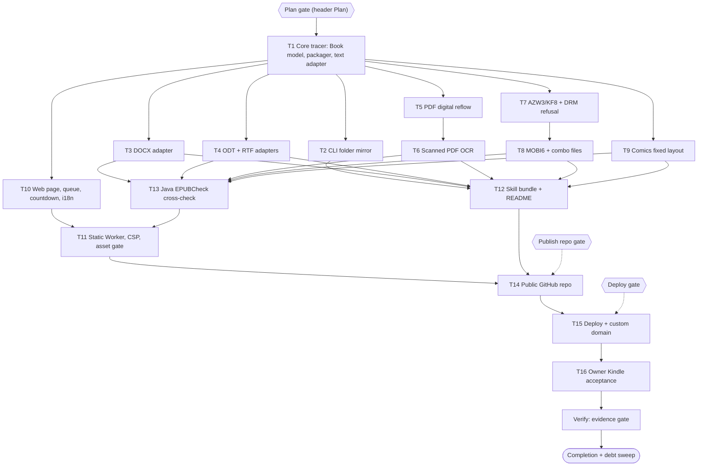

# pubmy v1 Implementation Plan

> For agentic workers: REQUIRED EXECUTION METHOD: delegated task execution (recommended) or inline plan execution. Steps use checkbox syntax.

**Goal:** Ship pubmy v1. Its core converts PDF, scanned PDF, DOCX/ODT/RTF/HTML/MD/TXT, MOBI/AZW3 and CBZ/CBR into EPUB 3 that passes validation. Two front ends use it: a folder CLI agent skill, and a one-page in-browser website at `pubmy.belajarcarabelajar.com`.

**Architecture:**
- One pure TypeScript core. Format detection picks one adapter per format family, which reads the file into a shared Book model. A single packager writes EPUB 3 with Kindle fixes, and `@likecoin/epubcheck-ts` gates the result.
- The CLI (Bun) and the web app (Web Worker in the browser) call the same `convert()`.
- The site is static assets on Cloudflare Workers Free with no server code.

**Tech Stack:**
- Bun 1.4.4 and TypeScript.
- Libraries, all permissive: unpdf (pdf.js), tesseract.js 7, mammoth, markdown-it, foliate-js `mobi.js` (vendored), linkedom, fflate, libarchive.js, `@likecoin/epubcheck-ts` 0.7.0.
- Dev only: pdf-lib and `@napi-rs/canvas` for fixture generation.
- Cloudflare `cf` CLI.

**Active Project Profile:**
- **Repo:** `/home/belajarcarabelajar/Proyek/pubmy`, branch `main`.
- **Commits:** `d45ef3a` (docs), `d659545` (Spec gate). Only docs and spike prototypes exist; there is no source code yet.
- **Toolchain:** `bun` 1.4.4 at `~/.bun/bin/bun` (AGENTS.md 8.4).
- **Not installed locally:** calibre, pandoc, Java.
- **Installed:** tesseract 5.5.4 (native baseline only), chromium, poppler `pdftoppm`.

**Project Commands:** each is defined by T1 or T10-T12 and does not exist yet.
- `bun install`
- `bun test <file>`
- `bun run typecheck` (`tsc --noEmit -p tsconfig.json`)
- `bun run --cwd apps/web build`
- `bun run --cwd apps/web check:assets`
- `bun run --cwd apps/cli build`
- `bun scripts/epubcheck-java.ts`
- **Heavy runs:** through `colab-test -C /home/belajarcarabelajar/Proyek/pubmy -- <command>` (AGENTS.md A47). The runner commands above stay wrapper-free.

**Protected Boundaries:**
- `docs/code-plan/intent-locks/`, `docs/code-plan/specs/` and `docs/code-plan/spikes/` are approved records. Do not rewrite them; add notes instead.
- No GPL, AGPL or source-available dependency may enter `packages/` or `apps/`.
- The core performs no network I/O, apart from lazy same-origin loads of its own assets: OCR data and wasm.

**Spec:** `docs/code-plan/specs/2026-11-07-pubmy-design.md` (Approved 2026-11-07). Intent Lock: `docs/code-plan/intent-locks/2026-11-07-pubmy-intent-lock.md`. Spike: `docs/code-plan/spikes/2026-11-07-pubmy-core/REPORT.md`.

**Scope:** tasks A-D of the Intent Lock and spec user stories 1-18.

**Non-Goals:**
- server-side conversion, uploads, R2;
- Send-to-Kindle email;
- DRM removal;
- login, Turnstile;
- EPUB input (skipped with a message);
- AI clean-up;
- non-EPUB output;
- pandoc.wasm;
- browser e2e as a gate (A42);
- GitHub Actions;
- Paperwhite 11/12 tests.

**Visual Map:**

**Reasoning Lenses:**
- **Intent:** every task traces to Intent Lock AC-1..AC-9.
- **Investigative:** decisions rest on spike evidence: P1 size 58,580,800 B; P2 4/4 valid; P3 1.9 s/page; P4 heading ratio 1.096.
- **Computational:**
  - PDF reading order uses the modal x-start column split, and a heading is any size above the body median on a short line.
  - Skip-on-rerun compares mtimes.
  - The countdown is driven by an injected clock.
- **Systems:** one core with two hosts, and a DOM adapter seam for browser vs Bun.
- **Trade-off:** small readers over pandoc (size, licence) at lower ODT/RTF fidelity. Full MOBI6 costs about 4-6 days.
- **Security/privacy:**
  - A CSP `connect-src` allowlist proves no upload.
  - DRM refusal comes before parsing.
  - Untrusted archives are size-capped, zip-bomb checked (total uncompressed ≤ 500 MB) and path-sanitised.
- **Compatibility:** EPUB 3 plus NCX. Kindle fixes come from the e999 evidence. Browsers lacking the `Iterator` global (Safari < 18.4, needed by unpdf) get a clear unsupported message.
- **Operations:**
  - Workers Free static assets only: no cron, D1 or R2. That respects the full cron/D1 quotas (AGENTS.md 4.1, 8.14) and C1, since nothing runs by itself.
  - Rollback is a redeploy of the previous version.

**Acceptance Criteria:**

- [x] AC-1: `pubmy <folder>` converts every supported file under `<folder>` recursively into `<folder>/pubmy-epub/` with the same tree. A second run converts nothing new. It exits 1 with a per-file report when any file fails, and 2 on a usage error.
- [x] AC-2: every fixture output passes epubcheck-ts with 0 errors, and Java EPUBCheck 5.x with 0 fatal and 0 errors.
- [ ] AC-3: one sample per format group is delivered via Send to Kindle to the owner's Paperwhite 10: PDF digital, PDF scanned, DOCX, MOBI/AZW3, CBZ. Each opens without e999, with a working TOC and reflowing text (comics: whole pages), confirmed by the owner.
- [x] AC-4: the page accepts 1-10 files ≤ 50 MB each and converts them sequentially. An 11th file or one over 50 MB is refused before reading, with a message in the active language. The CSP `connect-src` allows only `'self'` and the analytics beacon host.
- [x] AC-5: 3 minutes after each EPUB is ready, its object URL is revoked and its download disabled. The countdown is visible.
- [x] AC-6: a MOBI/AZW3 with a non-zero record-0 encryption field is refused with code `DRM` before any content parsing.
- [x] AC-7: an image-only PDF page is detected and OCR'd with `ind+eng`, and the text appears in the EPUB.
- [x] AC-8: the skill folder, copied per README into `~/.claude/skills`, `~/.agents/skills` and `~/.gemini/config/skills`, is listed in each harness installed on this machine. Any harness not installed is labelled "not verified" in the README.
- [x] AC-9: `https://pubmy.belajarcarabelajar.com` is served from Workers Free static assets, toggles ID/EN, and loads no third-party script other than Cloudflare Web Analytics.

**Traceability:**

| AC | Task | Check | Evidence |
|---|---|---|---|
| AC-1 | T2, T12 | `bun test apps/cli/test/cli.test.ts` and `bun test apps/cli/test/bundle.test.ts` | temp tree mirrored, rerun converts 0, exit codes 0/1/2 asserted |
| AC-2 | T1, T3, T4, T5, T6, T7, T8, T9, T13 | `bun test packages/core` and `bun scripts/epubcheck-java.ts` | every adapter test asserts `check.errors === 0`; Java run prints 0 fatal/0 errors per file |
| AC-3 | T16 | owner checklist in `docs/code-plan/progress/2026-11-07-pubmy-v1-kindle.md` | owner's answer per sample, recorded verbatim |
| AC-4 | T10, T11 | `bun test apps/web/test/queue.test.ts` and `bun test apps/web/test/headers.test.ts` | 11th and 51 MB files refused; `_headers` CSP parsed and asserted |
| AC-5 | T10 | `bun test apps/web/test/countdown.test.ts` | fake clock at 180 s calls `revokeObjectURL` once per item |
| AC-6 | T7 | `bun test packages/core/test/drm.test.ts` | synthetic encryption=2 header gives `code: "DRM"` and no adapter read |
| AC-7 | T6 | `bun test packages/core/test/scan.test.ts` | generated scan page text found in EPUB chapter, CER < 2 % |
| AC-8 | T12 | `bun test apps/cli/test/bundle.test.ts -t readme` plus manual listing per installed harness | README paths asserted; listing output recorded in T12 Review & Evidence |
| AC-9 | T11, T15 | `bun test apps/web/test/headers.test.ts -t live` | live response headers, `<html lang>` toggle, script origins |

**Assumptions & Open Questions:**
- **Bun shim gaps:** linkedom covers what foliate-js and the readers need in Bun. The spike needed stubs for `XMLSerializer`, `CSS.escape` and `textarea.value`.
- **Java on Colab:** the Colab runner has Java for EPUBCheck. If not, T13's precondition fails and the task stops. T13 then runs the jar on another machine with Java; nothing is installed locally without asking.
- **Asset compression:** Cloudflare serves static assets compressed. This does not matter for limits, because the largest planned asset is the OCR core at 2.9 MB.
- **CLI file reading:** mammoth and libarchive.js work on in-memory buffers in Bun (P4 proved libarchive.js; mammoth is unverified until T3).
- **Open:** none. Every decision is Human-locked in the Intent Lock and the spec gates.

**Dependencies & Impact:**
- npm packages are pinned by `bun.lock`.
- foliate-js is vendored at commit `78914aef4466eb960965702401634c2cb348e9b1` with its MIT licence.
- **Consumers:** skill users (copied folder), website visitors, and the shared Cloudflare zone `belajarcarabelajar.com` (one new DNS record).

**Risks & Rollback:**
- **PDF heuristics** may misorder complex layouts. Tables stay best-effort, and the fixture expectations name the known limits.
- **Real scans** OCR worse than synthetic pages. Mitigation: OCR confidence is reported per file.
- **MOBI6 effort** may overrun. T8 is isolated, so T7 still ships.
- **Rollback:**
  - site: redeploy the previous version or remove the custom domain;
  - repo: archive it on GitHub;
  - skill: users delete the folder.

**Security & Compatibility:**
- **Untrusted input:**
  - size caps are checked before reading;
  - archive entries are capped at 500 MB total uncompressed and 5,000 entries;
  - entry paths are normalised (no `..`);
  - XHTML is sanitised (scripts and event handlers stripped) before packaging;
  - the CSP has no `unsafe-eval` beyond what the wasm needs (`'wasm-unsafe-eval'`).
- **EPUB output:** EPUB 3 plus NCX.

**Operations & Rollout:**
- The site goes live only after T11 and T13 pass and the Deploy gate is approved.
- Post-deploy check: `bun test apps/web/test/headers.test.ts -t live`.
- Cloudflare Web Analytics is the only telemetry. No background jobs exist.

**CI/Review Gate:**
- Per task: its `run[]` exits as declared, plus `bun run typecheck`.
- Before T14:
  - `bun test` (whole repo, via `colab-test`);
  - `bun scripts/epubcheck-java.ts`;
  - an independent review of the diff (`staid`).

**Documentation:** README (T12): what pubmy does, supported formats, the privacy statement, install per harness, CLI usage, licences of bundled components, and DRM policy. `GLOSSARY.md` is kept in sync.

**Definition of Done:**
- All tasks PASSED, or NEEDS-AGENT tasks completed with recorded evidence.
- AC-1..AC-9 checked with the evidence named in Traceability.
- Debt sweep done and plan closeout answered.

**Plan Status & Version:** Approved 2026-11-07 (Plan gate: "Approve, start T1 now (Recommended)"), version 1.

**Reproducibility:**
- Bun 1.4.4 (`packageManager: bun@1.4.4`).
- Fixtures are generated by `fixtures/make-*.ts` or downloaded via `fixtures/fetch.ts` with sha256 pins in `fixtures/sources/*.json`. Generated and downloaded files go to `fixtures/out/` (git-ignored).

**Test Reliability:**
- No test touches the network except `fixtures/fetch.ts` (run once, cached) and the T15 `-t live` test.
- Countdown and queue tests use an injected clock.
- The OCR test pins tesseract.js data in a cache directory that it creates first (spike P3 finding).

**Privacy & Data Governance:**
- The website processes files only in the visitor's tab. Nothing is stored server-side, and there are no cookies. Analytics are page views only.
- The CLI writes only inside `<folder>/pubmy-epub/` and `~/.cache/pubmy`.

**Dependencies & Supply Chain:**
- Licences were checked on the npm registry 2026-11-07: mammoth BSD-2-Clause, markdown-it MIT, fflate MIT, linkedom ISC, unpdf MIT, tesseract.js Apache-2.0, epubcheck-ts BSD-3-Clause, libarchive.js MIT.
- foliate-js is MIT, pinned by SHA.
- T12 writes a `THIRD-PARTY-LICENSES` section in the README.

**UX States:**
- **Queue row:** idle, reading, converting with progress, ready with countdown, expired, refused (with reason code: TOO_LARGE, DRM, UNSUPPORTED, INVALID_EPUB, READ_FAILED, LIMIT_10).
- **Page:** empty-state copy; keyboard-operable drop zone and buttons; `aria-live` for status; ID/EN with `<html lang>`; a 360 px wide layout.

**Persistent State & Artifact Storage:** browser `localStorage` key `pubmy.lang` (`"id"` or `"en"`) only. EPUB blobs live in memory and are revoked by the countdown. The CLI caches OCR data at `~/.cache/pubmy/tesseract`.

**Entity & Sourcing Verification:**
- Cloudflare Workers limits: developers.cloudflare.com/workers/platform/limits (updated 2026-10-29).
- Send to Kindle formats and limits: amazon.com nodeId G5WYD9SAF7PGXRNA and G7NECT4B4ZWHQ8WV (seen 2026-11-07).
- e999 cause: github.com/harvard-edge/cs249r_book issue 1148 (2026-04-20).
- Harness skill dirs: vendor docs fetched 2026-11-07 (Intent Lock G4).

**Verification:**
- `bun test` (whole repo) via `colab-test`, exit 0.
- `bun run typecheck`, exit 0.
- `bun scripts/epubcheck-java.ts`, exit 0.
- `bun run --cwd apps/web check:assets`, exit 0.
- Live header test, exit 0.
- Owner's AC-3 record.

## Global Constraints

- Bun only: no `npm`, `npx` or `node` in scripts or docs.
- Per-file limit is 50 MB and per-batch limit is 10 files on the web. The CLI has no file cap.
- The retention window is 180 seconds after a result is ready.
- OCR languages are `ind+eng`, loaded only for image-only pages, with one worker by default.
- EPUB output must have 0 epubcheck-ts errors, or no file is produced (`INVALID_EPUB`).
- Every static asset must be ≤ 25 MiB, since the Workers static asset per-file limit is 25 MiB.
- Imperative source files stay ≤ 500 lines. Split by responsibility when a file grows past that.
- Commits are made by the parent only, staged by explicit path, on the session branch from `pr-registry claim`, never on `main`.

### Task T1: Core tracer (Book model, packager, text adapter)

**Files:**
- Create: `package.json` (workspaces `packages/*`, `apps/*`, `packageManager: bun@1.4.4`, script `typecheck`), `tsconfig.json`, `LICENSE` (MIT, Iwan Kurniawan, 2026), `packages/core/package.json`, `packages/core/src/{index,types,detect,dom,packager,kindle-fixes,validate}.ts`, `packages/core/src/adapters/text.ts`, `fixtures/fetch.ts`
- Test: `packages/core/test/text.test.ts`, `packages/core/test/packager.test.ts`

**Interfaces:**
- Consumes: none.
- Produces:
  - `convert(file: InputFile, ctx: Ctx): Promise<Result>`
  - types `Book`, `Adapter`, `Ctx`, `Result`, `Sniff`, `InputFile = { name: string; bytes: Uint8Array }`
  - `detect(bytes, name): Sniff`
  - `pack(book: Book): Uint8Array`
  - `validate(epub): Promise<{ errors: number; warnings: number; messages: string[] }>`
  - `registerAdapter(a: Adapter)`
  - `domFor(env: "browser" | "bun"): DomAdapter`

  All of these follow spec section Interfaces exactly.

**Preconditions:**
- [x] `bun --version` prints 1.4.4 (else `E_PRECOND_DEP`).
- [x] The session worktree exists from `bun ~/vivera/scripts/pr-registry.mjs claim --plan 2026-11-07-pubmy-v1 --session <slug> --worktree` (else `E_PRECOND_UPSTREAM`).

**Idempotency Check:** skip when `skip_if` exits 0.

**Behavior & Acceptance:** AC-2 for TXT, Markdown (markdown-it) and HTML input:
- one chapter per `h1`;
- nav plus `toc.ncx`;
- `dc:language` from the input or `"id"`;
- the Kindle fixes are applied: strip C0 control characters except tab/newline, rewrite `--` inside comments, self-close void tags, drop `<script>` and `on*` attributes.

An EPUB input returns `code: "UNSUPPORTED"` with the message key `already-epub`. A forced invalid Book (missing image href) returns `code: "INVALID_EPUB"` with no bytes.

**Edge Cases & Failure Behavior:**
- empty file gives `READ_FAILED`;
- unknown magic bytes plus unknown extension give `UNSUPPORTED`;
- non-UTF-8 TXT is decoded as windows-1252 when UTF-8 decoding yields replacement characters.

**Deliberate Shortcuts & Deferrals:** `defer: cover image is a generated title card SVG→PNG only when the input has none, ceiling = no custom cover upload; upgrade-trigger = owner asks for covers`.

**Dependencies & Risks:** epubcheck-ts 0.7.0 agrees with Java 95.9 %; T13 covers the gap.

**Review & Evidence:** RED then GREEN exit codes, the typecheck exit code, and a control: a test that corrupts the OPF must make `validate` report errors > 0.

**Reasoning Output:** the packager writes `mimetype` first and stored, as the EPUB OCF rule requires; spike P1 and P2 output confirmed it valid.

**Test Data & Determinism:** fixtures are built in-test from string literals. `fixtures/fetch.ts` verifies the sha256 of every entry in `fixtures/sources/*.json`, exits 1 on a mismatch, and accepts an empty folder.

- [x] Step 1: Write failing tests: TXT/MD/HTML convert valid, EPUB input refused, invalid Book refused, Kindle fixes on a crafted XHTML string.
- [x] Step 2: Run: verify fail | cmd: `bun test packages/core/test/text.test.ts packages/core/test/packager.test.ts` | expect: exit 1 | retry: 0 | on_fail: n/a
- [x] Step 3: Implement the minimal core. Lift the OCF writer from `docs/code-plan/spikes/2026-11-07-pubmy-core/p2-mobi-repack/core.ts`.
- [x] Step 4: Run: verify pass | cmd: `bun test packages/core/test/text.test.ts packages/core/test/packager.test.ts` | expect: exit 0 | retry: 1 | on_fail: FAILED, Error Ledger, halt dependants
- [x] Step 5: Run: `bun run typecheck` | expect: exit 0 | retry: 0
- [x] Step 6: Commit (parent): `git add` the listed paths plus `bun.lock`, then `git commit -m "feat(core): book model, EPUB packager, text adapter"`.

### Task T2: CLI folder mirror

**Files:** Create `apps/cli/package.json` (bin `pubmy`), `apps/cli/src/{main,walk,report}.ts`. Test `apps/cli/test/cli.test.ts`.

**Interfaces:**
- Consumes: `convert`, `domFor("bun")`.
- Produces: `run(argv: string[], io: { stdout; stderr; now?: () => number }): Promise<number>` (the exit code).

**Preconditions:** T1 tests pass (`E_PRECOND_UPSTREAM`).

**Behavior & Acceptance:** AC-1.
- Recursive walk, excluding `pubmy-epub/` and dotfiles. Output goes to `<folder>/pubmy-epub/<rel>/<name>.epub`.
- A file is skipped when the target mtime ≥ source mtime, unless `--force`.
- The report table has one row per file with status `converted`, `skipped`, `failed <code>` or `unsupported`.
- Exit 0 when no row failed, 1 when any row failed, 2 on usage errors (no folder, not a directory, unknown flag).
- `unsupported` files do not fail the run.

**Edge Cases:** two inputs mapping to the same output name (`a.pdf`, `a.docx`) produce `a.pdf.epub` and `a.docx.epub` (always `<name>.<ext>.epub`). A symlink loop is skipped once a real path repeats. An unreadable file reports `READ_FAILED`.

**Deliberate Shortcuts:** None.

**Review & Evidence:** test output for a temp tree with 2 levels, then a rerun showing 0 converted, then a touched source being reconverted.

**Test Data & Determinism:** a temp dir under `os.tmpdir()`, created and removed per test. mtimes are set explicitly with `utimes`.

- [x] Step 1: Write failing tests: mirror, skip, force, exit codes, name collision.
- [x] Step 2: Run: verify fail | cmd: `bun test apps/cli/test/cli.test.ts` | expect: exit 1 | retry: 0
- [x] Step 3: Implement `walk.ts`, `report.ts`, `main.ts`.
- [x] Step 4: Run: verify pass | cmd: `bun test apps/cli/test/cli.test.ts` | expect: exit 0 | retry: 1 | on_fail: FAILED, halt T12
- [x] Step 5: Run: `bun run typecheck` | expect: exit 0
- [x] Step 6: Commit (parent): `feat(cli): folder mirror with skip and exit codes`.

### Task T3: DOCX adapter

**Files:** Create `packages/core/src/adapters/docx.ts`, `fixtures/make-docx.ts` (writes a minimal DOCX with fflate: headings, a list, a table, a footnote, an image). Modify `packages/core/src/index.ts` (register) and `packages/core/package.json` (add `mammoth`). Test `packages/core/test/docx.test.ts`.

**Interfaces:**
- Consumes: `Adapter`, `Book`, `ctx.dom`.
- Produces: `docxAdapter: Adapter`.

**Behavior & Acceptance:** AC-2 for DOCX. Headings map to chapters and the TOC, and the footnote becomes a linked note. The table survives, and images become assets.

**Edge Cases:** a password-protected DOCX (CFB container, not ZIP) returns `READ_FAILED` with message key `encrypted-office`. A DOCX with no headings becomes one chapter titled from the file name.

**Deliberate Shortcuts:** `defer: Word equations (OMML) dropped to their text, ceiling = plain text; upgrade-trigger = owner reports a math-heavy DOCX`.

**Review & Evidence:** test asserts on chapter titles, `check.errors === 0`, and the presence of the footnote anchor.

- [x] Step 1: Write failing test plus fixture maker.
- [x] Step 2: Run: verify fail | cmd: `bun test packages/core/test/docx.test.ts` | expect: exit 1 | retry: 0
- [x] Step 3: Implement the adapter with mammoth `convertToHtml({ arrayBuffer })`, splitting the HTML into chapters at `h1`.
- [x] Step 4: Run: verify pass | cmd: `bun test packages/core/test/docx.test.ts` | expect: exit 0 | retry: 1
- [x] Step 5: Run: `bun run typecheck` | expect: exit 0
- [x] Step 6: Commit (parent): `feat(core): DOCX adapter`.

### Task T4: ODT and RTF adapters

**Files:** Create `packages/core/src/adapters/{odt,rtf}.ts`, `fixtures/make-{odt,rtf}.ts`. Modify `packages/core/src/index.ts`. Test `packages/core/test/{odt,rtf,detect}.test.ts`.

**Interfaces:** Produces `odtAdapter` and `rtfAdapter`. `detect()` distinguishes ZIP subtypes by `mimetype` entry or `[Content_Types].xml`: odt, docx, cbz, epub.

**Behavior & Acceptance:** AC-2 for ODT and RTF.
- **ODT:** the reader maps `content.xml` `text:h`, `text:p`, `text:list`, `table:table` and `draw:image` to XHTML.
- **RTF:** the reader handles `\par`, `\b`, `\i`, `\u` unicode escapes, `\'hh` code-page bytes, groups and `\pict` PNG/JPEG.

**Edge Cases:** RTF groups it does not know are skipped without failing. ODT styles are ignored except heading outline levels.

**Deliberate Shortcuts:** `defer: RTF tables rendered as paragraphs, ceiling = no table layout from RTF; upgrade-trigger = owner reports an RTF table document`.

- [x] Step 1: Write failing tests (ODT, RTF, detect matrix of magic bytes for all v1 formats).
- [x] Step 2: Run: verify fail | cmd: `bun test packages/core/test/odt.test.ts packages/core/test/rtf.test.ts packages/core/test/detect.test.ts` | expect: exit 1 | retry: 0
- [x] Step 3: Implement both readers, each under 500 lines.
- [x] Step 4: Run: verify pass | same cmd | expect: exit 0 | retry: 1
- [x] Step 5: Run: `bun run typecheck` | expect: exit 0
- [x] Step 6: Commit (parent): `feat(core): ODT and RTF adapters`.

### Task T5: PDF digital reflow

**Files:** Create `packages/core/src/adapters/pdf.ts`, `packages/core/src/pdf/layout.ts`, and `fixtures/make-pdf.ts`. That script uses pdf-lib (dev) to make a two-column page with a title, three section headings at body + 1 pt, and a rotated side stamp. Also create `fixtures/sources/arxiv.json` (arXiv 2302.13971v1, CC BY 4.0, sha256 pinned at first fetch). Modify `packages/core/src/index.ts` and `packages/core/package.json` (unpdf, pdf-lib dev). Test `packages/core/test/{pdf,pdf-layout}.test.ts`.

**Interfaces:** Produces `pdfAdapter` and `layoutPage(items: TextItem[], page: { width; height }): Block[]`, where `Block = { kind: "heading" | "para"; level?: 1 | 2; text: string }`. This is a pure function lifted from `spikes/.../p4-unpdf-cbr/src/layout.ts`.

**Behavior & Acceptance:** AC-2 for PDF.
- Item positions come from pdf.js `getTextContent`, so rotated items are dropped as stamps.
- Columns are split by the modal x-start.
- A heading is a size above the body median on a line of ≤ 12 words.
- PDF outline entries, when present, override heading detection for the TOC.
- Images are not extracted in v1 (see Shortcuts).

**Edge Cases:** pages with no text items are routed to the scan adapter (T6 wires this; T5 returns `UNSUPPORTED` with key `scanned-pdf` until then). Encrypted PDFs give `READ_FAILED`, key `encrypted-pdf`.

**Deliberate Shortcuts:** `defer: PDF images and tables not extracted, ceiling = text-only reflow; upgrade-trigger = owner's Kindle review (T16) flags missing figures`.

**Review & Evidence:**
- `pdf-layout.test.ts` asserts the reading order for the generated page and that the 3 headings are detected.
- `pdf.test.ts` converts the arXiv fixture to valid EPUB, and the first chapter title contains "Introduction".

- [x] Step 1: Write failing tests.
- [x] Step 2: Run: verify fail | cmd: `bun test packages/core/test/pdf.test.ts packages/core/test/pdf-layout.test.ts` | expect: exit 1 | retry: 0
- [x] Step 3: Implement the layout plus the adapter.
- [x] Step 4: Run: verify pass | same cmd | expect: exit 0 | retry: 1 | timeout 300 s
- [x] Step 5: Run: `bun run typecheck` | expect: exit 0
- [x] Step 6: Commit (parent): `feat(core): PDF reflow adapter`.

### Task T6: Scanned PDF OCR

**Files:** Create `packages/core/src/adapters/scan.ts` and `packages/core/src/ocr/load.ts`. Also create `fixtures/make-scan.ts`, which renders 2 pages of original Indonesian + English text with `@napi-rs/canvas` (dev), applies slight noise and tilt, and wraps them as an image-only PDF via pdf-lib. Modify `packages/core/src/adapters/pdf.ts` (route image-only pages) and `packages/core/package.json` (tesseract.js). Test `packages/core/test/scan.test.ts` and `packages/core/test/pdf.test.ts`.

**Interfaces:**
- `ctx.loadOcr(): Promise<{ recognize(png: Uint8Array): Promise<{ text: string; confidence: number }>; terminate(): Promise<void> }>`
- Bun implementation: tesseract.js node worker with `cachePath` `~/.cache/pubmy/tesseract`, created with `mkdir -p` first.
- Browser implementation: same-origin `corePath` and `langPath`.

**Behavior & Acceptance:** AC-7.
- `inspectPages` marks a page with `textLength 0` and `imageCoverage ≥ 0.9` as scanned.
- That page is rendered (pdf.js) and OCR'd with `ind+eng`, using one worker.
- Mixed PDFs keep text pages as text.
- The `Result` gets `ocr: { pages, meanConfidence }` for the report.

**Edge Cases:** OCR data cannot be fetched (offline browser) gives `READ_FAILED` with key `ocr-unavailable`. Confidence below 50 adds a warning to the report, but the result is not refused.

**Deliberate Shortcuts:** `defer: one OCR worker, ceiling = about 1.9 s/page (spike P3); upgrade-trigger = owner reports scans over 200 pages too slow, then allow 2 workers`.

**Test Data & Determinism:** CER is computed against the source strings and must be < 2 % (spike: ≤ 0.42 % degraded). The cache dir is created per run.

- [x] Step 1: Write failing tests.
- [x] Step 2: Run: verify fail | cmd: `bun test packages/core/test/scan.test.ts` | expect: exit 1 | retry: 0
- [x] Step 3: Implement the loader, the scan adapter and the PDF routing.
- [x] Step 4: Run: verify pass | cmd: `bun test packages/core/test/scan.test.ts packages/core/test/pdf.test.ts` | expect: exit 0 | retry: 1 | timeout 600 s
- [x] Step 5: Run: `bun run typecheck` | expect: exit 0
- [x] Step 6: Commit (parent): `feat(core): OCR for scanned PDF pages`.

### Task T7: AZW3/KF8 adapter and DRM refusal

**Files:** Create `packages/core/src/adapters/mobi/{index,kf8,drm}.ts`. Vendor `packages/core/vendor/foliate-mobi.js` from commit `78914aef4466eb960965702401634c2cb348e9b1` together with `packages/core/vendor/FOLIATE-LICENSE`. Create `fixtures/sources/gutenberg.json` (books 11 and 28885, `.kf8.images` and `.kindle.images`, sha256 pinned). Modify `packages/core/src/{index,dom}.ts` (linkedom shims: `DOMParser`, `XMLSerializer`, `CSS.escape`, entity decoding) and `packages/core/package.json` (linkedom, fflate). Test `packages/core/test/{mobi-kf8,drm}.test.ts`.

**Interfaces:** Produces `mobiAdapter` and `readDrmFlag(bytes): { encryption: number; exthDrm: boolean }`.

**Behavior & Acceptance:** AC-2 for AZW3 and AC-6.
- The DRM check runs on record 0 before any parse. A non-zero encryption field gives `code: "DRM"`.
- KF8 sections, CSS, images, TOC and metadata are repacked.
- The SVG wrapper pages that P2 dropped are kept as XHTML-embedded SVG.

**Edge Cases:** a truncated file gives `READ_FAILED`. A file that is not BOOKMOBI gives `UNSUPPORTED`.

**Deliberate Shortcuts:** None. Full support was Human-locked (D12).

**Review & Evidence:**
- Both Gutenberg AZW3 files give `check.errors === 0` and the TOC entry counts 16 and 4 (spike P2).
- The DRM test uses a synthetic header with encryption=2.

- [x] Step 1: Write failing tests.
- [x] Step 2: Run: verify fail | cmd: `bun test packages/core/test/mobi-kf8.test.ts packages/core/test/drm.test.ts` | expect: exit 1 | retry: 0
- [x] Step 3: Implement, lifting from `spikes/.../p2-mobi-repack/core.ts`.
- [x] Step 4: Run: verify pass | same cmd | expect: exit 0 | retry: 1 | timeout 300 s
- [x] Step 5: Run: `bun run typecheck` | expect: exit 0
- [x] Step 6: Commit (parent): `feat(core): AZW3 adapter with DRM refusal`.

### Task T8: MOBI6 and combo files

**Files:** Create `packages/core/src/adapters/mobi/mobi6.ts`. Modify `packages/core/src/adapters/mobi/index.ts`. Test `packages/core/test/mobi6.test.ts` (plus regression `mobi-kf8.test.ts`).

**Behavior & Acceptance:** AC-2 for MOBI6.
- Body-less sections are serialized by walking top-level nodes (P2 fix 1), and `<tt>` becomes `<code>` (P2 fix 2).
- Presentational attributes map to CSS classes: `align` to text-align, `width`/`height` to CSS, `font size` to relative em.
- `filepos` links are rewritten to anchors.
- Combo MOBI6+KF8 files prefer the KF8 part.

**Edge Cases:** a combo file whose KF8 part fails falls back to the MOBI6 part with a report warning.

**Deliberate Shortcuts:** None.

**Review & Evidence:** both Gutenberg MOBI6 files give `check.errors === 0`. Text length is within 1 % of the AZW3 of the same book (spike: 161,062 vs 161,671). A centered-paragraph fixture keeps `text-align: center`.

- [x] Step 1: Write failing tests.
- [x] Step 2: Run: verify fail | cmd: `bun test packages/core/test/mobi6.test.ts` | expect: exit 1 | retry: 0
- [x] Step 3: Implement.
- [x] Step 4: Run: verify pass | cmd: `bun test packages/core/test/mobi6.test.ts packages/core/test/mobi-kf8.test.ts` | expect: exit 0 | retry: 1
- [x] Step 5: Run: `bun run typecheck` | expect: exit 0
- [x] Step 6: Commit (parent): `feat(core): MOBI6 and combo files`.

### Task T9: Comics fixed layout

**Files:** Create `packages/core/src/adapters/comics.ts`, `fixtures/make-cbz.ts` (3 generated PNG pages), and `fixtures/sources/libarchive-rar.json` (libarchive `test_read_format_rar.rar.uu` and `test_read_format_rar5_compressed.rar.uu`, decoded by `fixtures/fetch.ts` when the entry has `"uudecode": true`). Modify `packages/core/src/{index,packager}.ts` (fixed-layout branch) and `packages/core/package.json` (libarchive.js). Test `packages/core/test/comics.test.ts` and `packages/core/test/packager.test.ts`.

**Behavior & Acceptance:** AC-2 for CBZ and CBR.
- Images are sorted by natural filename order, one image-only XHTML page each.
- The OPF sets `rendition:layout pre-paginated` and a viewport meta from the image size.
- `direction: "rtl"` sets `page-progression-direction="rtl"`. The CLI flag `--rtl` and a web toggle set it, and it defaults to ltr.
- Non-image entries are ignored.

**Edge Cases:** an archive with no images gives `UNSUPPORTED`, key `no-images`. Entries over the zip-bomb cap give `READ_FAILED`, key `archive-too-large`. Paths containing `..` are skipped.

**Deliberate Shortcuts:** `defer: no image resizing, ceiling = images as-is; upgrade-trigger = AC-3 shows comics over the 50 MB email limit or slow page turns`.

- [x] Step 1: Write failing tests (CBZ valid, RAR4/RAR5 fixtures valid, rtl flag in OPF, zip-bomb cap).
- [x] Step 2: Run: verify fail | cmd: `bun test packages/core/test/comics.test.ts` | expect: exit 1 | retry: 0
- [x] Step 3: Implement.
- [x] Step 4: Run: verify pass | cmd: `bun test packages/core/test/comics.test.ts packages/core/test/packager.test.ts` | expect: exit 0 | retry: 1
- [x] Step 5: Run: `bun run typecheck` | expect: exit 0
- [x] Step 6: Commit (parent): `feat(core): comics to fixed-layout EPUB`.

### Task T10: Web page, queue, countdown, i18n

**Files:** Create `apps/web/package.json` (scripts `build`), `apps/web/index.html`, `apps/web/build.ts` (`Bun.build`, worker entry, code-split adapters), and `apps/web/src/{main,worker,queue,countdown,i18n}.ts`. Test `apps/web/test/{queue,countdown,i18n}.test.ts`.

**Interfaces:**
- `createQueue({ maxFiles: 10, maxBytes: 50 * 1024 * 1024, convert, onChange })` returns `{ add(files: File[]): Refusal[]; items }`.
- `startCountdown(item, { ms: 180_000, now, setTimer, revoke })`.
- `t(key, lang)`, where `lang` is `"id"` or `"en"`.

**Behavior & Acceptance:** AC-4 (limits) and AC-5.
- Conversion runs in a Web Worker with `domFor("browser")`. Adapters load by dynamic import on first need.
- Each ready row shows mm:ss. At 0 the countdown calls `URL.revokeObjectURL`, disables the link and shows "Dihapus" or "Deleted".
- ID/EN comes from `navigator.language` and the stored `pubmy.lang`. A toggle button sets `<html lang>`.
- Every core error code has an ID and an EN string. The i18n test fails on any missing key.

**Edge Cases:**
- Adding files while the queue is full refuses only the overflow.
- Removing a row before it converts cancels it via `AbortSignal`.
- A browser without `Iterator` (unpdf requirement) shows the key `browser-unsupported` for PDFs only.

**Deliberate Shortcuts:** `defer: no "download all" ZIP, ceiling = per-file download; upgrade-trigger = owner asks`.

**Review & Evidence:** queue and countdown tests use a fake clock. The build exit code is recorded. A browser check happens only if the owner asks (A42).

- [x] Step 1: Write failing tests.
- [x] Step 2: Run: verify fail | cmd: `bun test apps/web/test` | expect: exit 1 | retry: 0
- [x] Step 3: Implement the page and modules.
- [x] Step 4: Run: verify pass | cmd: `bun test apps/web/test` | expect: exit 0 | retry: 1
- [x] Step 5: Run: `bun run --cwd apps/web build` | expect: exit 0
- [x] Step 6: Run: `bun run typecheck` | expect: exit 0
- [x] Step 7: Commit (parent): `feat(web): in-browser queue with retention countdown`.

### Task T11: Static Worker, CSP, asset gate

**Files:** Create:
- `apps/web/cloudflare.config.ts` (static assets only, custom domain `pubmy.belajarcarabelajar.com`). Before writing it, read `~/backups/cloudflare-cf-cli/NOTES.md` (AGENTS.md 4.1).
- `apps/web/public/_headers` with `Content-Security-Policy: default-src 'self'; script-src 'self' 'wasm-unsafe-eval' https://static.cloudflareinsights.com; connect-src 'self' https://cloudflareinsights.com; img-src 'self' blob: data:; worker-src 'self' blob:; object-src 'none'; base-uri 'none'`, plus `X-Content-Type-Options: nosniff` and `Referrer-Policy: no-referrer`.
- `apps/web/scripts/check-assets.ts` (fails on any file over 26,214,400 bytes).
- Tests `apps/web/test/{headers,assets}.test.ts`.

Modify `apps/web/package.json` (scripts `check:assets`) and `apps/web/index.html` (Web Analytics beacon snippet; its token is a public site token read from the dashboard by the owner).

**Behavior & Acceptance:** AC-4 (CSP) and AC-9 (static, analytics only).
- `headers.test.ts` parses `_headers` and asserts that `connect-src` contains only `'self'` and the beacon host.
- `-t live` fetches the live URL and asserts the same headers. It is skipped unless `PUBMY_LIVE=1`.
- `assets.test.ts` runs the size check on a fake 26 MB file (it must fail) and on `dist/` (it must pass).

**Edge Cases:** `cf` cannot express the static-asset-only Worker. In that case, record the measured `cf` error in Review & Evidence and use `wrangler` for this Worker, which AGENTS.md 4.1 allows for configs `cf` lacks.

**Deliberate Shortcuts:** None.

- [x] Step 1: Write failing tests.
- [x] Step 2: Run: verify fail | cmd: `bun test apps/web/test/headers.test.ts apps/web/test/assets.test.ts` | expect: exit 1 | retry: 0
- [x] Step 3: Implement the config, headers and check script.
- [x] Step 4: Run: `bun run --cwd apps/web build` | expect: exit 0
- [x] Step 5: Run: verify pass | cmd: `bun test apps/web/test/headers.test.ts apps/web/test/assets.test.ts` | expect: exit 0 | retry: 1
- [x] Step 6: Run: `bun run --cwd apps/web check:assets` | expect: exit 0
- [x] Step 7: Commit (parent): `feat(web): static Worker config, CSP and asset gate`.

### Task T12: Skill bundle and README

**Files:** Create:
- `apps/cli/build.ts`: `Bun.build` with target bun, single file into `skills/pubmy/scripts/pubmy.js`, with tesseract worker files copied beside it.
- `skills/pubmy/SKILL.md`: frontmatter `name: pubmy` and a `description` that triggers on "convert folder to EPUB", "Kindle", "ubah ke EPUB". The body says to check `bun --version`, run `bun <skill-dir>/scripts/pubmy.js <folder>`, summarise the report, and never retry a DRM refusal.
- `README.md`: what pubmy does, formats, privacy, install (copy commands for Linux/macOS and PowerShell into the 3 dirs), usage, licences, DRM policy.
- `apps/cli/test/bundle.test.ts`.

Modify `apps/cli/package.json` (script `build`).

**Behavior & Acceptance:** AC-1 through the bundle, and AC-8.
- The bundle test runs the built `pubmy.js` on a temp tree with one file per format and asserts the exit code and the mirror.
- `-t readme` asserts that the README lists the 3 dirs and the 5 harness names.

**Manual evidence (AC-8):** copy `skills/pubmy` into each dir. For each harness installed here, record its listing output:
- `claude` (prints its skill list);
- `opencode debug skill` or equivalent (check `opencode --help` first);
- `codex`, `cursor-agent`, `agy`, only if `command -v` finds them.

Harnesses not found are marked "not verified" in the README.

**Deliberate Shortcuts:** `defer: no install script, ceiling = manual copy per README (D17); upgrade-trigger = owner asks for an installer`.

- [x] Step 1: Write failing test.
- [x] Step 2: Run: verify fail | cmd: `bun test apps/cli/test/bundle.test.ts` | expect: exit 1 | retry: 0
- [x] Step 3: Implement the build, `SKILL.md` and README.
- [x] Step 4: Run: `bun run --cwd apps/cli build` | expect: exit 0
- [x] Step 5: Run: verify pass | cmd: `bun test apps/cli/test/bundle.test.ts` | expect: exit 0 | retry: 1 | timeout 300 s
- [x] Step 6: Manual AC-8 listing, recorded in this task's evidence.
- [x] Step 7: Commit (parent): `feat(skill): self-contained pubmy skill and README`.

### Task T13: Java EPUBCheck cross-check

**Files:** Create:
- `scripts/build-fixture-outputs.ts`: runs `fixtures/fetch.ts` and every `fixtures/make-*.ts`, then converts all fixtures into `fixtures/out/epub/`.
- `scripts/epubcheck-java.ts`: downloads the EPUBCheck 5.x release zip, verifies it against the sha256 pinned in `scripts/epubcheck-java.lock.json`, runs `java -jar epubcheck.jar` per file, and exits 1 on any fatal or error. `--check-only` exits 0 only when a previous run's report shows all files passing.
- `scripts/epubcheck-java.lock.json`.

Modify `package.json` (scripts).

**Preconditions:** `java -version` exits 0 on the runner (`E_PRECOND_DEP`). This runs through `colab-test` (A47), because Java is not installed locally.

**Behavior & Acceptance:** AC-2 (Java half): 0 fatal and 0 errors for every fixture output.

**On failure:** reopen the owning adapter task with the EPUBCheck message. Do not weaken the check.

- [x] Step 1: Run: `bun scripts/build-fixture-outputs.ts` | expect: exit 0 | timeout 900 s
- [x] Step 2: Run: `bun scripts/epubcheck-java.ts` | expect: exit 0 | retry: 1 | timeout 900 s
- [x] Step 3: Commit (parent): `test: Java EPUBCheck cross-check over fixtures`.

### Task T14: Public GitHub repo

**Files:** none (external action).

**Gate:** ask through the Confirmation Protocol alone, with the safe option first. The Facts line covers: repo `belajarcarabelajar/pubmy`, public, MIT, head commit, and the `git status` clean check.

**Steps after approval (parent only):**
- [x] `gh repo create belajarcarabelajar/pubmy --public --source . --remote origin`
- [x] `git push -u origin main` after the session PR is merged by the owner (merge is its own gate).

**Evidence:** `gh repo view belajarcarabelajar/pubmy --json visibility` prints `PUBLIC`.

### Task T15: Deploy and custom domain

**Files:** none (external action).

**Gate:** asked alone, with the safe option first. The Facts line covers: Worker name `pubmy`, custom domain `pubmy.belajarcarabelajar.com`, static assets only, no cron, D1 or R2.

**Steps after approval:**
- [x] Deploy with the command recorded in T11 Review & Evidence (`cf deploy` from `apps/web`, or the `wrangler` fallback).
- [x] Run: `PUBMY_LIVE=1 bun test apps/web/test/headers.test.ts -t live` | expect: exit 0.

**Rollback:** redeploy the previous version, or detach the custom domain.

### Task T16: Owner Kindle acceptance

**Files:** none. The record goes to `docs/code-plan/progress/2026-11-07-pubmy-v1-kindle.md`, written by the parent at the end of the task.

**Steps:**
- [ ] The parent prepares 5 or more sample EPUBs from fixtures, one per group: PDF digital, PDF scanned, DOCX, MOBI/AZW3, CBZ. It shows their names and sizes in chat.
- [ ] The owner sends them via Send to Kindle (web upload) to the Paperwhite 10.
- [ ] The parent asks per sample through AskUserQuestion: opens without e999, TOC works, text reflows (comics: whole pages). Answers are recorded verbatim.
- [ ] Any failure reopens the owning adapter task with the owner's words.

## Closeout status

Owner decision at the `Close plan` gate (2026-11-07): "Keep it open (Recommended)". Status `Verification`.

- **Readiness:** `bun ~/vivera/scripts/plan-closeout.mjs --readiness docs/code-plan/plans/2026-11-07-pubmy-v1.md` gave NOT-READY, exit 1 (2026-11-07).
  - T1-T12, T14, T15 are DONE.
  - T13 is OPEN locally, because Java is only on the Colab runner. There, `bun scripts/build-fixture-outputs.ts && bun scripts/epubcheck-java.ts` exited 0 with 14/14 EPUBs at 0 fatal, 0 error and 0 warning.
  - T16 is UNPROVEN.
- **Ticks:** `ultra-plan-runner.mjs --execute` recorded T1-T10 and T12 as SKIPPED-IDEMPOTENT (fresh `skip_if` exit 0). `plan-mark-done --from runner.log` ticked those. T11, T13, T14 and T15 were ticked with `--task` (asserted), with evidence in the PR #1 body, the live test (`PUBMY_LIVE=1 bun test apps/web/test/headers.test.ts`, exit 0) and `git ls-remote --exit-code origin HEAD`.
- **Acceptance:** AC-1, AC-2 and AC-4 to AC-9 are ticked from the evidence in the Traceability table and the PR #1 body. For AC-8, Claude Code, OpenCode and the Antigravity CLI each quoted the skill description, and Codex and Cursor are not installed. AC-3 stays open.
- **What remains:** T16 / AC-3. The owner sends the six samples in `~/Unduhan/pubmy-kindle-test/` through Send to Kindle to the Paperwhite 10 and reports them per format group. On 2026-11-07 the owner answered "Not tested yet" for every group.
- **Reopen trigger:** the owner's Kindle results. When every group opens without e999, set `Complete` after a fresh `--readiness` run. Any failure reopens the owning adapter task.

**Re-measured 2026-11-09** (found by `plan-closeout.mjs --audit` during the debt sweep of plan 2026-11-09-pubmy-ui-review-fixes; owner choice at that gate: "Record closeout status", status stays `Verification`). `bun ~/vivera/scripts/plan-closeout.mjs --readiness docs/code-plan/plans/2026-11-07-pubmy-v1.md --cwd <worktree>` gave NOT-READY, exit 1:

- T1 to T12 and T15 are DONE on fresh runs; the readiness runner now sends each `skip_if` through `colab-test`.
- T13 is OPEN: `bun scripts/epubcheck-java.ts --check-only` exited 1 on the Colab machine in 7.5 s. The cause was not investigated; the full Java check of the same script passed there the same day (EPUB made from the header-block fixture, fatal 0, error 0, warning 0).
- T14 is OPEN: `git ls-remote --exit-code origin HEAD` exited 128 on Colab ("Could not read from remote repository"). It was DONE when run locally on 2026-11-07, so this is the runner environment, not the repository.
- T16 is UNPROVEN and its 4 step boxes plus AC-3 are still open: the owner's Paperwhite 10 results are still missing.
- The reopen trigger above is unchanged. A `skip_if` for T13 and T14 that does not depend on the Colab machine (or a `--task` tick with the 2026-11-07 evidence) is part of the next closeout of this plan.

### Follow-ups (debt sweep 2026-11-07)

| Item | Selected | Result |
|---|---|---|
| Scope linkedom DOM globals to MOBI conversions | yes | `07d1db8`, dom-globals test 5 pass |
| Split the Node libarchive loader out of the browser path, drop the web build plugin | yes | `c0abcef`, dist has 0 references |
| `convert()` never rejects when validation throws (N2) | yes | `c0abcef` |
| Shared XML helpers, document `exthDrm` (N4/N1) | yes | `6409e58`; an out-of-range entity crash found on the way, fixed in `94639a7` |
| One browser smoke test on the live site | yes | Colab HeadlessChrome 157, exit 0. CBZ, scan and DOCX were ready; the test CBRs were refused with no-images; no uploads; one CSP report for Cloudflare's injected JS-detection script |
| CSP `frame-ancestors 'none'; form-action 'none'` (N5) | yes | `a7f20d1`, live after the next deploy |
| AC-8 harness check | yes (separate gate) | README "Verified on" table, `27f7175` |

### Backlog (not selected or out of scope)

- Cloudflare zone JS detection injects an inline script that pubmy's CSP blocks. This is a zone setting shared by every site, so it stays as is until the owner decides.
- The remaining copies of `esc` and `escAttr` in dom.ts, text.ts, scan.ts, rtf.ts, mobi6.ts and kf8.ts could import from `xml.ts`.
- vivera `pr-registry.mjs` accepted `state merged` without checking GitHub (L3 in the learning ledger). It belongs to the vivera repository.
- The plan's prose `defer:` items keep their triggers (cover card, OMML, RTF tables, PDF images and tables, OCR workers, comic resizing, download-all ZIP, installer). None has fired yet.
