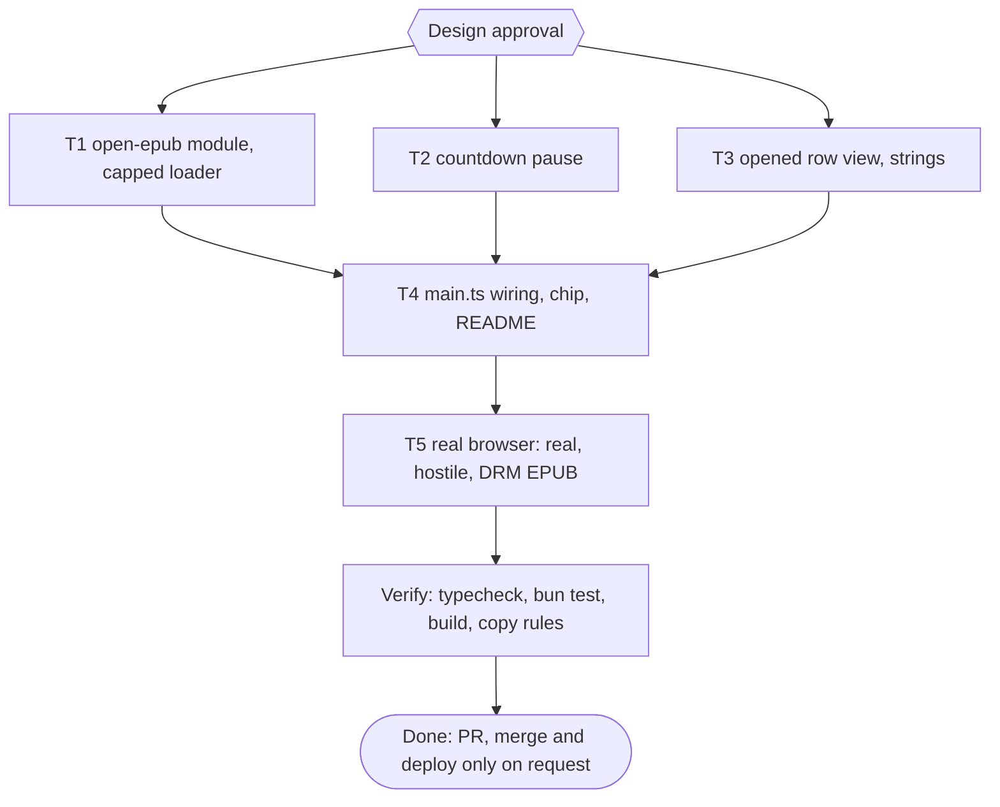
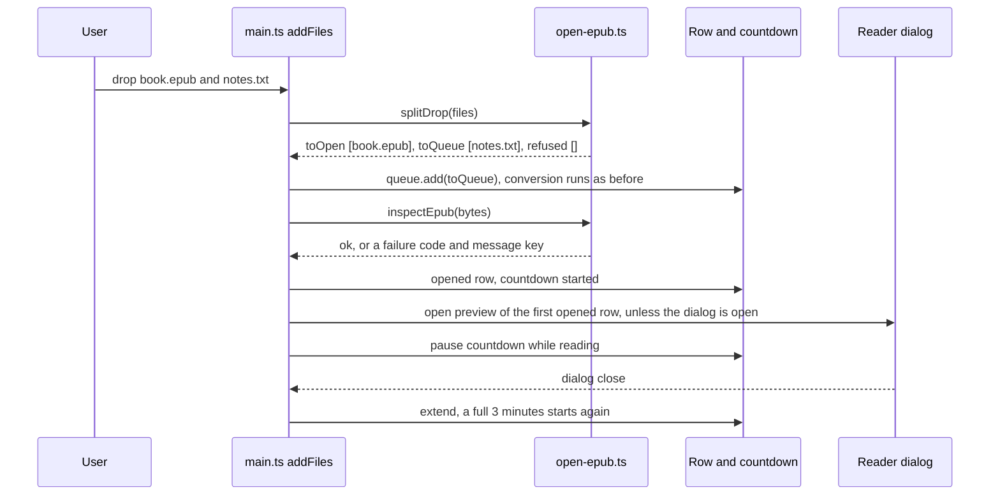

# pubmy EPUB opener Implementation Plan

> For agentic workers: REQUIRED EXECUTION METHOD: delegated task execution. T1, T2 and T3 have disjoint write scopes and run in parallel; T4 and T5 run after them. Steps use checkbox syntax.

**Goal:** A file with the `.epub` extension dropped on the website is not converted: it opens straight in the reader, so the site is also an EPUB opener.

**Architecture:** EPUB files are split off in `addFiles` before the conversion queue, because the queue runs one job at a time and an EPUB must not wait behind an OCR run. A new pure module (`open-epub.ts`) decides what is an EPUB, cheaply checks it (zip caps, container, DRM) and splits a drop. An opened EPUB is a row like a converted one, without the Download link, held by the existing countdown, which pauses while its reader is open. The reader, `preview-session.ts` and foliate are reused unchanged; core `convert()` and the CLI are untouched.

**Tech Stack:** Bun 1.4.4, TypeScript 7, `fflate` 0.8, foliate-js (vendored), `bun test`.

**Active Project Profile:** repo `pubmy` (root of the checkout), `main` at `0a979b8` (PR #25 merged). Web app `apps/web`. Verified from files read in this session: `packages/core/src/browser.ts:46`, `packages/core/src/detect.ts`, `packages/core/src/zip-caps.ts`, `apps/web/src/{main,queue,job,row,i18n,countdown,epub-loader,preview-session,reader,batch}.ts`, `apps/web/index.html`, `apps/web/public/_headers`, `apps/web/test/{theme,readme-web,build-output,i18n,queue,preview-wiring,wiring}.test.ts`, `README.md`. Commands (`package.json`, `apps/web/package.json`): `bun run typecheck`, `bun test <file>`, `bun build.ts <dir>` in `apps/web`; heavy runs go through `colab-test` (A47).

**Project Commands:** `bun run typecheck`; `bun test apps/web/test`; `bun test packages/core/test`; `cd apps/web && bun build.ts <scratch-dir>`; `bun ~/vivera/scripts/check-copy-rules.mjs --diff origin/main` (run from the repo, A27).

**Protected Boundaries:** `packages/core/src/**` (read only; only `packages/core/package.json` gains one export), `apps/web/vendor/foliate/**`, `apps/web/src/reader.ts`, `apps/web/src/preview-session.ts`, `apps/web/public/_headers` (the CSP stays as it is; a change needs a new decision), `skills/pubmy/**`, `apps/cli/**`.

**Spec:** none (Bounded path). Decisions recorded below.

**Scope:** (1) `.epub` (any case) or MIME `application/epub+zip` skips conversion; (2) cheap checks before opening: zip caps, `META-INF/container.xml`, DRM; (3) the first EPUB that opens in a drop opens its reader by itself, unless a reader is already open; (4) an opened row has no Download link, reads Baca/Read, and is left out of Download all and the Kindle hint; (5) the countdown pauses while the reader of an opened EPUB is open and restarts for 3 minutes when it closes; (6) the EPUB chip, strings in both languages, README and glossary; (7) one real-browser check with a real, a hostile and a DRM EPUB.

**Non-Goals:** opening an EPUB that is not named `.epub` and has no EPUB MIME type (it still goes to the converter); validating an opened EPUB for Kindle (an EPUBCheck report is a possible later feature); downloading an opened file (the user already has it); changing core `convert()`, its `already-epub` refusal, or what the CLI does with an EPUB; remembering a reading position or any book data between visits (nothing is stored); opening MOBI, PDF or other formats in the reader without conversion; a PWA file handler; changing the retention rule of converted EPUBs (a possible follow-up, asked as a peer in the debt sweep).

**Visual Map:**

**Reasoning Lenses:** intent (the owner wants the site to be an EPUB opener, not only a converter), investigative (what the code does today for an `.epub` upload), user-centered and accessibility (a modal that opens by itself, focus return, keys), systems (queue is sequential, countdown and preview own the bytes), security and privacy (an EPUB from outside now reaches an iframe that has `allow-scripts`), failure-oriented (DRM, zip bomb, invalid zip, 50 MB), test-first, verification.

**Acceptance Criteria:** see the list below; each has a row in the table.

**Traceability:** one row per AC; the Task cell names ids from `tasks[]`, the Check cell the command that proves it.

| AC | Task | Check | Evidence |
|---|---|---|---|
| AC-1 | T1 | `bun test apps/web/test/open-epub.test.ts` | exit 0 |
| AC-2 | T1 | `bun test apps/web/test/open-epub.test.ts` | exit 0 |
| AC-3 | T1 | `bun test apps/web/test/open-epub.test.ts apps/web/test/epub-loader.test.ts` | exit 0 |
| AC-4 | T2 | `bun test apps/web/test/countdown-pause.test.ts apps/web/test/countdown.test.ts` | exit 0 |
| AC-5 | T3 | `bun test apps/web/test/row-opened.test.ts apps/web/test/row.test.ts` | exit 0 |
| AC-6 | T3 | `bun test apps/web/test/i18n-opener.test.ts apps/web/test/i18n.test.ts` | exit 0 |
| AC-7 | T4 | `bun test apps/web/test/epub-open-wiring.test.ts` | exit 0 |
| AC-8 | T4 | `bun test apps/web/test/theme.test.ts apps/web/test/readme-opener.test.ts apps/web/test/readme-web.test.ts` | exit 0 |
| AC-9 | T5 | Chromium harness `check.mjs` against the built page | report with counts and screenshots read |
| AC-10 | T4 | `bun test apps/web/test/build-output.test.ts` | exit 0 |

**Assumptions & Open Questions:**
- Owner decisions (2026-11-09, asked through the question tool): (D1) the countdown pauses while the reader of an opened EPUB is open and restarts for 3 minutes when it closes; converted EPUBs keep the old rule. (D2) The first EPUB of each drop opens its reader by itself, not when a reader is already open. (D3) One real-browser check is wanted (A42 opt-in).
- My judgment, open to revision at the Design gate: an opened row has no Download link and is left out of Download all and the Kindle hint; at most 10 opened rows are held at once (LIMIT_10) and each file is at most 50 MB (TOO_LARGE), the same numbers as the queue; the page decides by extension or MIME on the main thread, because reading bytes through the worker would put the EPUB behind the one-at-a-time queue; real validity comes from the checks in T1 and from the reader itself.
- Measured, not assumed: today an `.epub` upload ends in "Gagal: File ini sudah EPUB." (`browser.ts:46`, `i18n.ts:35`), and `index.html:138` already lists `.epub` in `accept`. foliate prints `Unknown encryption algorithm` for anything but the two font obfuscations (`epub.js:620`) and leaves the content encrypted, so a DRM EPUB would show garbage unless refused first.
- Measured 2026-11-09 with `curl -sI https://pubmy.belajarcarabelajar.com/`: the live `content-security-policy` is the same string as `public/_headers` (`script-src 'self' 'wasm-unsafe-eval' https://static.cloudflareinsights.com`, `frame-src blob:`, `img-src 'self' blob: data:`), so a local run with `dist/_headers` tests what visitors get for the CSP; only Referrer-Policy differs, through the zone rule (M5), which does not matter here.
- Not yet measured: whether `script-src 'self'` stops scripts inside a book inside foliate's `sandbox="allow-same-origin allow-scripts"` blob iframe. foliate rewrites in-book resources to `blob:` URLs, so a packaged `<script src>` is a separate case from an inline script (T5 measures both, with a positive control: the same book on a page without the CSP must run the script, or the check proves nothing).
- Routing is by extension or MIME, as the owner asked ("ekstensinya EPUB"): a real EPUB renamed `.zip` still goes to the converter and ends in `already-epub`, and a PDF renamed `.epub` is refused by `inspectEpub` as unreadable.
- Owner may veto at the Design gate (each is my judgment): the tagline sentence (it sits beside the header wrap threshold tuned in PRs #24 and #25; the EPUB chip alone would cover discoverability), no Download on opened rows, opened rows left out of the ZIP and the Kindle hint, the 10-row and 50 MB limits.
- Open: the main-thread unzip of a large EPUB when the reader opens (cap 500 MB, 5000 entries) can freeze the tab for a moment; T5 times it on the real EPUB and records the number, no fix is planned unless it is bad.

**Dependencies & Impact:** `epub-loader.ts` is shared with converted EPUBs; `unzipCapped` drops directory entries and `..` paths, which foliate never reads. `theme.test.ts` deliberately listed `epub` as not advertised (it was refused); the opener reverses that, so the chip is added and the test changes with it. `build-output.test.ts:69` finds the core chunk by the string `already-epub`, which stays because core is untouched. `README.md` line 5 is pinned by `readme-web.test.ts` (`up to 10 files (50 MB each)`, `preview each EPUB`).

**Risks & Rollback:** security (T5) is the main risk: if a book script runs, T5 stops and the task returns to design; nothing in `vendor/foliate` or `_headers` is changed silently. A modal that opens by itself can surprise someone who dropped a mixed batch (D2 accepted). Rollback: revert the pull request; no data, headers or deploy state change before the owner asks for a deploy.

**Security & Compatibility:** an EPUB from outside is untrusted content. Checks before opening: zip caps (core `checkZipCaps`, 500 MB and 5000 entries), container present, DRM refused. The CSP and the iframe sandbox are unchanged and measured in T5 with a positive control. No network use is added; the book is read from memory. Compatibility: the `already-epub` message key and core refusal stay for the CLI and core tests.

**Operations & Rollout:** pull request only; merge and deploy happen on the owner's request. After a deploy: re-read the live CSP with `curl -sI` and compare it with `public/_headers` (a zone rule can change it, M5), then drop the real and the hostile EPUB on the live page once; the README sentence about scripts is about the CSP that was measured, so a changed live CSP voids it.

**CI/Review Gate:** parent diff audit and an independent reviewer (`staid`) before the pull request; copy rules check; unit gate through `colab-test`.

**Documentation:** README (Website line, Privacy bullet), GLOSSARY (two terms), the plan's learning ledger at close.

**Definition of Done:** AC-1 to AC-10 checked with evidence, `bun run typecheck` exit 0, `bun test apps/web/test` and `bun test packages/core/test` exit 0, build exit 0, copy rules exit 0, browser report read, pull request opened, debt sweep run.

**Plan Status & Version:** Approved, v1.

**Approval:** Design and plan approved by the owner on 2026-11-09 at the `Design` question (option "Setujui", the recommended one). Earlier answers the same day: D1 reading hold only for opened EPUBs, D2 first EPUB of each drop opens by itself, D3 one real-browser check. The tagline sentence, the no-Download and ZIP choices and the 10 and 50 MB limits were offered for veto and kept.

**Reproducibility:** Bun 1.4.4; Chromium via puppeteer-core (the `/usr/bin/chromium` binary), CSP taken from `dist/_headers`; the real EPUB is Project Gutenberg #1342 (`https://www.gutenberg.org/ebooks/1342.epub3.images`), downloaded into its own empty scratch directory and treated as untrusted data; the hostile and DRM EPUBs are built by the harness from `fflate`.

**Test Reliability:** unit tests are text or pure-function tests with no clock or network (the countdown takes its clock and timer as options). The reading hold is proven in the browser by leaving the reader open past 3 minutes once; the open and auto-open flow is run 3 times (M16).

**Privacy & Data Governance:** the file never leaves the tab. An opened EPUB is held in memory, kept while its reader is open, and wiped 3 minutes after the reader closes (D1); nothing is stored.

**Dependencies & Supply Chain:** no new package; `fflate` and `@pubmy/core` already in `apps/web`.

**UX States:** opening, ready to read, failed (DRM, unreadable, too large, over the limit), reader open (countdown paused), reader closed (countdown restarted), expired; mixed drop; a second drop while a reader is open; phone and desktop widths; id and en; keyboard and screen reader (live region announces the row).

**Persistent State & Artifact Storage:** none; in-memory rows only.

**Entity & Sourcing Verification:** the foliate encryption behaviour and the CSP and sandbox lines were read in the vendored source and `_headers`; script blocking is measured in T5, not assumed.

**Verification:** `bun run typecheck`; `bun test apps/web/test`; `bun test packages/core/test`; `cd apps/web && bun build.ts <scratch-dir>`; `bun ~/vivera/scripts/check-copy-rules.mjs --diff origin/main`; the Chromium harness (T5).

## Acceptance Criteria

- [ ] AC-1: `isEpubFile` is true for a name ending `.epub` in any letter case, or for MIME `application/epub+zip`, and false for `.pdf`, `.epub.txt`, and an empty name; `splitDrop` sends EPUBs to `toOpen` and every other file to `toQueue`, refuses an EPUB over `maxBytes` as `TOO_LARGE`, and refuses any EPUB beyond `maxHeld` held rows as `LIMIT_10`.
- [ ] AC-2: `inspectEpub` accepts a valid EPUB and one whose `encryption.xml` lists only the two font obfuscation algorithms; it refuses an empty file (`READ_FAILED`, `empty-file`), bytes that are not a zip, a zip with no `META-INF/container.xml` (`READ_FAILED`, `read-failed`), a zip over the entry or size cap (`READ_FAILED`, `archive-too-large`), and any other `EncryptionMethod` (`DRM`, `epub-drm`); it inflates nothing but the two `META-INF` entries.
- [ ] AC-3: `createEpubLoader` unzips through core `unzipCapped`: an archive over a given cap throws `archive-too-large`, and a normal EPUB loads exactly as before.
- [ ] AC-4: a countdown can be paused: no tick and no expiry fire while paused and `remaining` holds; `extend()` on a paused countdown restarts the full window; calling the stop function while paused still expires it at once.
- [ ] AC-5: a row with `kind: "opened"` has no `[data-action="download"]` link, its preview button reads `t("read")` and keeps `data-action="preview"`, and it keeps the clock, the Extend entry and Remove; a row without `kind` is byte for byte what it was.
- [ ] AC-6: `read`, `opened` and `epub-drm` exist in both languages; the tagline names the opener in both languages; `already-epub` stays; the `i18n` parity test still passes.
- [ ] AC-7: `main.ts` sends EPUBs through `splitDrop` and `inspectEpub` and never through the queue; opens the first EPUB that passes in a drop when no reader is open; pauses the countdown when an opened row's reader opens and extends it when the dialog closes; counts only converted rows for Download all and the Kindle hint; and gives opened rows ids that cannot collide with queue ids.
- [ ] AC-8: `index.html` shows an EPUB chip and the chip test accepts it (12 chips); the README Website line keeps its pinned text and adds the opener, and the Privacy bullet states the reading hold.
- [ ] AC-9: in Chromium, (a) a real EPUB dropped alone opens its reader by itself, shows contents and a first page, shows no Download link and no failed row, and next page works; (b) the same drop 3 times gives the same result; (c) a book that tries inline script, packaged script file, SVG script, `onerror`, meta refresh and a `javascript:` link runs none of them under the real CSP, and each sentinel that is set on the copy of the page without the CSP (positive control) shows which routes the CSP is what stops, with no outside request and no navigation; (d) a DRM-style EPUB gives the DRM text and no dialog; (e) a mixed drop converts the text file while the EPUB opens; (f) a second drop while the reader is open does not replace the book; (g) the reader stays open past 3 minutes and the row clock restarts at 03:00 when it closes; (h) no console or CSP error other than the expected violation reports of (c); (i) the header with the longer tagline, in Indonesian and in English (the English title is the wide one), has no horizontal overflow and keeps the language button in the title row above 25rem of brand width, at 390, 640, 641 and 1280 px, the widths PRs #24 and #25 tuned; if the tagline is vetoed at the gate this item drops out.
- [ ] AC-10: the built page still ships its Indonesian text in place, the worker core chunk is still found by `already-epub`, and the build exits 0.

## Global Constraints

- No em dash in new copy or code comments.
- Git is parent-only; subagents edit files and run tests only (`sucp-rules` Git Ownership).
- Commit messages are conventional, with no attribution lines.
- A new test file starts every task's `skip_if` and RED step (M15).
- Heavy runs go through `colab-test` (A47); a local fallback is targeted (A12).
- First edit after the Design gate: the `GLOSSARY.md` terms (`sucp-brainstorm`, Project Glossary).

## Session checklist

- [x] Plan validated (`Validation: OK`, runner exit 0) and Design approved (owner, option "Setujui", 2026-11-09)
- [x] Worktree claimed via `pr-registry claim --worktree` from `origin/main` (exit 0): `/mnt/belajarcarabelajar/pubmy-wt/pubmy-epub-opener`, branch `2026-11-09-pubmy-epub-opener/pubmy-epub-opener`; plan file moved into it
- [x] GLOSSARY.md terms written (first edit): Opened EPUB, Reading hold, Retention window reworded
- [x] T1, T2, T3 dispatched in parallel (disjoint write scopes), RED then GREEN; each report re-checked by the parent (diff read, tests re-run), evidence below
- [x] T4 main.ts wiring: RED then GREEN
- [x] Independent review of T1 to T4 (`staid`, 7 findings); findings 1 and 2 confirmed by the parent's own repro and fixed (3 commits), the rest listed under Evidence for the owner
- [ ] T5 real-browser check (3 EPUBs, 3 repeats, 3 minute hold): partly run (groups a, c, d, e, f, g, i of the harness, see Evidence); the hold past 190 s and the converted-preview baseline for the foliate error are NOT run yet
- [ ] Parent diff audit of the whole change before the PR (T1 to T4 audited per chunk)
- [ ] Verify: typecheck, tests, build, copy rules
- [ ] PR opened
- [ ] Debt sweep

## Task T1: open-epub module and capped loader

**Files:** Create `apps/web/src/open-epub.ts`, `apps/web/test/open-epub.test.ts`; Modify `apps/web/src/epub-loader.ts`, `packages/core/package.json`, `GLOSSARY.md`; Test (must stay green) `apps/web/test/epub-loader.test.ts`, `apps/web/test/preview-session.test.ts`.
**Interfaces (Produces, T4 consumes):**
- `export const EPUB_MIME = "application/epub+zip"`
- `export function isEpubFile(f: { name: string; type?: string }): boolean` (extension `.epub`, case-insensitive, or `type === EPUB_MIME`)
- `export type Inspect = { ok: true } | Extract<Result, { ok: false }>` with `Result` from `@pubmy/core`
- `export function inspectEpub(bytes: Uint8Array): Inspect`, in this order: empty is `READ_FAILED` `empty-file`; first four bytes not `PK\x03\x04` is `READ_FAILED` `read-failed`; core `checkZipCaps(bytes)`, where a `PubmyError` becomes its own code and message and any other throw `READ_FAILED` `read-failed`; `unzipSync` with a filter that reads only `META-INF/container.xml` and `META-INF/encryption.xml`; no container is `READ_FAILED` `read-failed`; any `EncryptionMethod` `Algorithm` other than `http://www.idpf.org/2008/embedding` and `http://ns.adobe.com/pdf/enc#RC` is `DRM` with message `epub-drm`.
- `export function splitDrop<F extends { name: string; size: number; type?: string }>(files: F[], o: { maxBytes: number; maxHeld: number; held: number }): { toQueue: F[]; toOpen: F[]; refused: Refusal[] }` with `Refusal` from `queue.ts`; an EPUB over `maxBytes` is `TOO_LARGE`; once `held + toOpen.length` reaches `maxHeld`, further EPUBs are `LIMIT_10`; order of `toOpen` and `toQueue` follows the drop.
- `createEpubLoader(epub: Uint8Array, limits?: Limits)` keeps its other behaviour and unzips through `unzipCapped` from `@pubmy/core/zip-caps`; `packages/core/package.json` gains `"./zip-caps": "./src/zip-caps.ts"`.
- `GLOSSARY.md`: **Opened EPUB** (an EPUB the visitor dropped, read in the page without conversion) and **Reading hold** (the countdown of an opened EPUB stops while its reader is open and restarts at 3 minutes when it closes); the **Retention window** entry says "converted or opened EPUB" and drops "downloadable".
**Behavior & Acceptance:** AC-1, AC-2, AC-3.
**Edge Cases:** `Foo.EPUB`, `a.epub.txt`, a MIME-only match with no extension; a zip that lies about sizes is the same limit core already accepts for DOCX and CBZ (`unzipCapped` re-checks real sizes); `encryption.xml` with a namespace prefix on `EncryptionMethod`; an `encryption.xml` with only font obfuscation passes; a truncated zip throws inside fflate and becomes `read-failed`.
**Deliberate Shortcuts & Deferrals:** None.
**Test Data & Determinism:** fixtures built in the test with `pack()` from `@pubmy/core/browser` and `zipSync` from `fflate` (as `epub-loader.test.ts` does); the bomb case passes small `limits` instead of building 500 MB.

## Task T2: countdown pause

**Files:** Create `apps/web/test/countdown-pause.test.ts`; Modify `apps/web/src/countdown.ts`; Test `apps/web/test/countdown.test.ts`.
**Interfaces (Produces, T4 consumes):** `Countdown` gains `pause(): void`: cancels the pending tick, keeps `item.remaining` as it was at the pause, fires no `onTick` and no expiry until resumed; `extend()` on a paused countdown sets a full window from now, ticks, and resumes; calling the countdown itself (stop) while paused still expires it once. `startCountdown` keeps its signature and options.
**Behavior & Acceptance:** AC-4.
**Edge Cases:** pause twice; pause after expiry does nothing; pause at the exact deadline tick; `extend()` after expiry still does nothing; the wall-clock deadline logic is untouched for a countdown that is never paused.
**Deliberate Shortcuts & Deferrals:** None.
**Test Data & Determinism:** the existing fake `now` and `setTimer` options; no real timer.

## Task T3: opened row view and strings

**Files:** Create `apps/web/test/row-opened.test.ts`, `apps/web/test/i18n-opener.test.ts`; Modify `apps/web/src/row.ts`, `apps/web/src/i18n.ts`; Test `row.test.ts`, `row-menu.test.ts`, `row-progress.test.ts`, `refusal-row.test.ts`, `i18n.test.ts`.
**Interfaces (Produces, T4 consumes):**
- `RowView.kind?: "converted" | "opened"` (absent means `"converted"`). `"opened"`: no `<a data-action="download">`; the preview button text is `t("read", lang)`, aria-label `<read> <name>`, `data-action="preview"` unchanged (main.ts and the focus logic query it); the clock, the `...` menu with Extend, and Remove stay as they are. `ready.download` is ignored for an opened row.
- i18n keys, both languages: `read` ("Baca" / "Read"), `opened` ("Siap dibaca" / "Ready to read"), `epub-drm` ("EPUB ini dilindungi DRM, jadi tidak bisa dibuka." / "This EPUB is DRM-protected, so it cannot be opened."). `tagline` gains one short sentence: id "File EPUB dibuka untuk dibaca." and en "EPUB files open for reading." `already-epub` stays.
**Behavior & Acceptance:** AC-5, AC-6.
**Edge Cases:** an expired opened row (preview disabled, no clock, Remove only); focus restoration for the preview and remove controls on an opened row; `build.ts` fills `data-i18n` from `t()` in Indonesian, so the tagline must stay plain text with no `<` or `&`.
**Deliberate Shortcuts & Deferrals:** None.
**Test Data & Determinism:** linkedom document as in `row.test.ts`.

## Task T4: main.ts wiring, EPUB chip, README

**Files:** Create `apps/web/test/epub-open-wiring.test.ts`, `apps/web/test/readme-opener.test.ts`; Modify `apps/web/src/main.ts`, `apps/web/index.html`, `apps/web/test/theme.test.ts`, `README.md`; Test `wiring.test.ts`, `preview-wiring.test.ts`, `menu-wiring.test.ts`, `batch-bar.test.ts`, `batch.test.ts`, `readme-web.test.ts`, `build-output.test.ts`.
**Interfaces (Consumes):** `isEpubFile`, `splitDrop`, `inspectEpub` (T1); `Countdown.pause`, `extend` (T2); `RowView.kind`, keys `read`, `opened`, `epub-drm` (T3).
**Behavior:**
- `Row` gets `kind: "converted" | "opened"`. `addFiles` calls `splitDrop(files, { maxBytes: 50 MB, maxHeld: 10, held })`, where `held` counts opened rows not yet expired, sends `toQueue` to `queue.add` as today, merges `refused` into `lastRefusals`, and opens `toOpen` one after another in drop order.
- Opening one file: read the bytes, `inspectEpub`; on failure show a failed row whose text is `failureText(code, message, lang)` and announce it; on success build a row with `kind: "opened"`, a queue-shaped item `{ id, name, file, status: "ready" }` whose `id` is a negative counter (queue ids start at 1), a countdown over `{ epub: bytes }` with no `url`, and status text `t("opened")`.
- Auto-open: the first opened row of the drop calls `openPreview(row)` unless `dialog.open` (D2).
- Reading hold (D1): `openPreview` calls `row.stop?.pause()` for an opened row right after `dialog.showModal()`, so every failure path (the mount throws, or `preview.open` returns false) still ends in `dialog.close()`; the dialog `close` handler calls `row.stop?.extend()` for an opened row. A paused row can therefore never hold its bytes for good.
- `downloadAllBtn` entries and `refreshBatch`'s ready count, and so the Kindle hint, count `kind === "converted"` rows only. `render` passes `kind` to `renderRow`. `removeRow` works unchanged for a negative id.
- `index.html`: an `EPUB` chip in `.chips`; the `accept` list is unchanged; the static `<meta name="description">` (line 7, found by T3, same class as the tagline, no test pins it) gets `, atau buka EPUB untuk dibaca` before its final period. `theme.test.ts`: `epub` leaves `NOT_ADVERTISED` and the chip count is 12.
- README: the Website line adds that an EPUB dropped on it opens in the reader instead of being converted, keeping `up to 10 files (50 MB each)` and `preview each EPUB`; the Privacy bullet says an opened EPUB is kept while its reader is open and wiped 3 minutes after it closes; no em dash.
**Behavior & Acceptance:** AC-7, AC-8, AC-10.
**Edge Cases:** a drop of only EPUBs and no queue file; a failed first EPUB then a good second one (the second auto-opens); two drops in a row (the second does not auto-open while the reader of the first is open); Remove on an opened row; language toggle re-renders opened rows; `main.ts` stays under 500 lines.
**Deliberate Shortcuts & Deferrals:** the DOM glue in `main.ts` is proven by anchored text checks plus the real-browser run (T5), as for the preview and the overflow menu; `defer: unit test of main.ts, upgrade when main.ts can be imported without the live DOM`.
**Test Data & Determinism:** `main.ts` and `index.html` read as text; README read as text.

## Task T5: real-browser proof

**Files:** Modify `README.md` (one sentence, only if the script check passes). The harness `check.mjs` and its EPUBs live in a per-session scratch directory outside the repository and are not committed.
**Steps (the parent runs them; opted in by the owner, A42):**
- [ ] Where it runs: locally, by necessity: the build output and the Chromium that loads it must be on the same machine, which `colab-test` cannot give. The build step is written `HEAVY_LOCAL="build output is served to the local Chromium for the browser check (A47)" bun build.ts <scratch>/dist` (run in `apps/web`), and the harness file is named `opener-harness.mjs`, not `check`. Check `free -m` and leftover `chromium` processes first (A12); stop a run that fails at once with `ConnectionClosedError` (A12).
- [ ] Serve the page with the headers from `dist/_headers`, and a second copy without the CSP header (positive control).
- [ ] Download the Gutenberg #1342 EPUB into its own empty directory; build with `fflate` a hostile EPUB that tries every route to run code: an inline `<script>`, a packaged `<script src="x.js">` (an in-book file), an `<svg>` with `<script>`, ``, `<meta http-equiv="refresh">` to an outside host, an `<a href="javascript:...">`, each setting its own sentinel on `window` and trying to change `parent.document.title`; and a DRM-style EPUB (`encryption.xml` with `aes128-cbc`).
- [ ] Run AC-9 (a) to (i); repeat (a) three times; the hold (g) waits more than 190 s with the reader open, then closes it and reads the row clock; record counts, timings (unzip time of the real EPUB), and read the screenshots.
- [ ] If the hostile book runs a script under the real CSP: stop, record it, return to design. Do not edit `vendor/foliate` or `_headers`.
- [ ] If it does not run there and does run on the control copy: add one sentence to the README Privacy bullet that scripts inside an EPUB do not run, with the date and browser version.
**Behavior & Acceptance:** AC-9.
**Edge Cases:** the harness must report the real exit code of its own process (capture `$?` before any pipe, A2); a pass count alone is not evidence.
**Deliberate Shortcuts & Deferrals:** Chromium only; `defer: Firefox and Safari, upgrade when a visitor reports a reader problem there`.

## Evidence

(Filled in as tasks finish; each entry names the command and its exit code. All runs go through `colab-test -C <worktree> --`.)

- **T2 countdown pause** (`nappy`, parent audit by diff and re-run): RED `bun test apps/web/test/countdown-pause.test.ts` exit 1, 8 fail, every one `countdown.pause is not a function`. GREEN `bun test apps/web/test/countdown-pause.test.ts apps/web/test/countdown.test.ts` exit 0, 17 pass, 0 fail (agent run and the parent's own re-run). Diff: `paused` flag, `tick` returns early when paused, `pause()` cancels the timer, `extend()` clears `paused`.
- **T3 opened row and strings** (`hoggy`, parent audit): RED exit 1, 14 pass, 10 fail at their assertions (`Expected: "Read"  Received: "Preview"`, missing keys). GREEN `bun test` of the two new files plus `row`, `row-menu`, `row-progress`, `refusal-row`, `i18n` tests exit 0, 75 pass, 0 fail (agent run and the parent's own re-run). Found by T3 and handled in T4: the static meta description in `index.html`. Left as is, no real path reaches it: for an opened row, a focus on `download` falls back to Remove, which sits in the closed popover.
- **T1 open-epub module and capped loader** (`chef`, parent audit): RED with a throwing stub, `bun test apps/web/test/open-epub.test.ts` exit 1, 40 fail, 2 pass; mutation check (`filter: () => true`) turned "inflates nothing beyond the two META-INF entries" red, restored and confirmed. GREEN `bun test apps/web/test/open-epub.test.ts apps/web/test/epub-loader.test.ts apps/web/test/preview-session.test.ts` exit 0, 55 pass, 0 fail; `bun run typecheck` exit 0 (agent runs; the parent re-ran both on the worktree with T1, T2 and T3 present: tests exit 0 with 55 pass, typecheck exit 0). Added by T1 beyond the contract: a missing `Algorithm` attribute counts as DRM; `unzipCapped` drops directory entries and `..` paths.

- **T4 main.ts wiring, chip, README** (implementer, parent audit by diff and re-run; commit `5e3e93f`): RED `colab-test -- bun test` over the two new files plus `theme.test.ts` exit 1, 29 pass, 33 fail, every failure at an assertion. GREEN the same files plus `readme-web.test.ts` exit 0, 67 pass, 0 fail; `bun test apps/web/test` exit 0, 397 pass, 1 skip (live-site `connect-src`, needs `PUBMY_LIVE=1`), 0 fail, 36 files; `bun run typecheck` exit 0. Build (local, `HEAVY_LOCAL`, from a temporary NVMe worktree with its own `node_modules`) exit 0.
- **Browser check, partly run** (Chromium 156.0.8078.79 (Arch package) headless via `puppeteer-core`, harness `opener-harness.mjs` in scratch, build of `5e3e93f`, real Gutenberg #1342 EPUB, 63 contents entries, 112,502 chars of text after paging). Passed: opens by itself 114 to 143 ms after the drop, no Download link, preview button reads `Read`, next page works, three runs the same (AC-9 a, b); six script routes (inline, packaged file, SVG, `onerror`, `javascript:` link, meta refresh) each run on the copy served without CSP and none runs under the real CSP, no request left the browser, the page title was not changed (AC-9 c; `harness-ci` exit 0, 34 pass, 0 fail, positive control "6 routes ran on the control"); DRM EPUB gives the DRM text and no dialog (d); a PDF header under an `.epub` name gives a failed row (extra); mixed drop converts the text file while the EPUB opens, a failed first EPUB then a good second one opens the second, a second drop while a reader is open does not replace the book (AC-9 e, f); header at 390, 640, 641 and 1280 px in both languages: no overflow, the language button stays in the title row from 641 px up (AC-9 i; the English tagline takes 3 lines at 641 px and up, one more than before). NOT run: the hold past 190 s and the 03:00 restart on close (AC-9 g), the console check for the converted preview baseline.
- **Open: foliate `columnize` null-body error** (`Cannot destructure property 'style' of 't' as it is null`, in `vendor/foliate` paginator, which is protected): the page error appeared in 1 of 8 idle, 2 of 8 paged and 2 of 8 slow opens of the real EPUB (about 21 % overall, `repeat-open.mjs`, exit 0). The book still opened every time. Whether converted previews show it too is not measured (no baseline), so it cannot be blamed on the opener yet. Patching vendor code needs an owner decision.
- **Review of T1 to T4** (`staid`): finding 1, a regex over `encryption.xml` that is quadratic on unclosed `EncryptionMethod` tags; finding 2, `unzipSync` inflating a `META-INF` entry whose central directory lies about its size (parent repro: declared 100 bytes, really 60 MB, 1785 ms on the main thread). Both confirmed by the parent before any fix. Not fixed, for the owner: finding 3 (defense in depth: deny scripts in the reader through `book.transformTarget`, in protected `reader.ts`), finding 5 (a book that passes `inspectEpub` but fails to mount only closes the dialog, the row stays "Ready to read"), finding 6 (D2 edge: a slow large first file), finding 7 (the regex and an XML parser can differ on comments, CDATA and UTF-16; do not "fix" with a lazy `[\s\S]*?` comment stripper, it is quadratic again), and a related one: `createEpubLoader` (`unzipCapped`) can still inflate a lying bomb on the main thread when the reader opens.
- **Review fixes** (implementer, parent audit; commits `46353fe`, `7af84cc`, `3d63334`): `encryption.xml` is scanned with `/<(?:[\w.-]+:)?EncryptionMethod(?=[\s/>])[^<>]*>/g` (linear); a `META-INF` entry over 16 KiB compressed or 128 KiB declared is refused as `READ_FAILED`, never treated as absent, so a DRM book cannot slip through; the `opening` counter is released for files an early stop skipped (`left` plus an outer `finally`); the README Privacy bullet says the countdown of an opened EPUB stops while its reader is open. RED `colab-test -- bun test` of `open-epub`, `epub-open-wiring`, `readme-opener` exit 1, 84 pass, 11 fail; GREEN exit 0, 95 pass, 0 fail; `bun test apps/web/test` exit 0, 409 pass, 1 skip, 0 fail, 36 files (the parent's own run too); `bun run typecheck` exit 0. Parent probe against the committed code (`verify-review.mjs`, exit 0): 10,000 and 20,000 unclosed tags are refused in 0 ms, 5,000 are accepted in 2 ms, a 60 MB entry with a lying size is refused in 0 ms. Residual, measured (`residual.mjs`, exit 0): an entry that stays under the 16 KiB compressed cap and lies about its size still costs up to about 450 ms of main-thread time (15 MB inflated from a 15.6 KB zip; fflate writes into a buffer of the declared size, so memory stays small but the whole stream is still decoded). The `META_MAX_TEXT` (1 MB) check in `inspectEpub` can never fire, because the output is cut at the declared size, which is at most 128 KiB; it is harmless dead code, a candidate for the debt sweep.

## Closeout status

Open.
