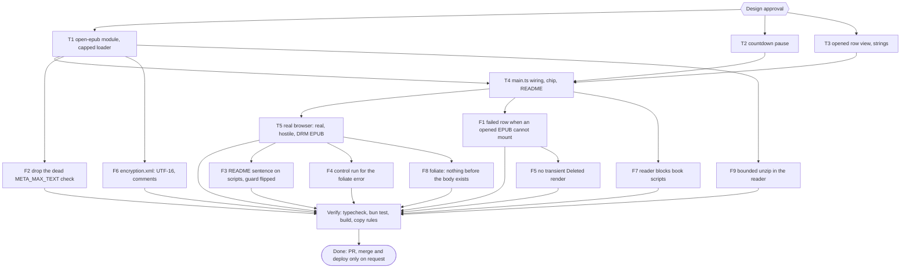
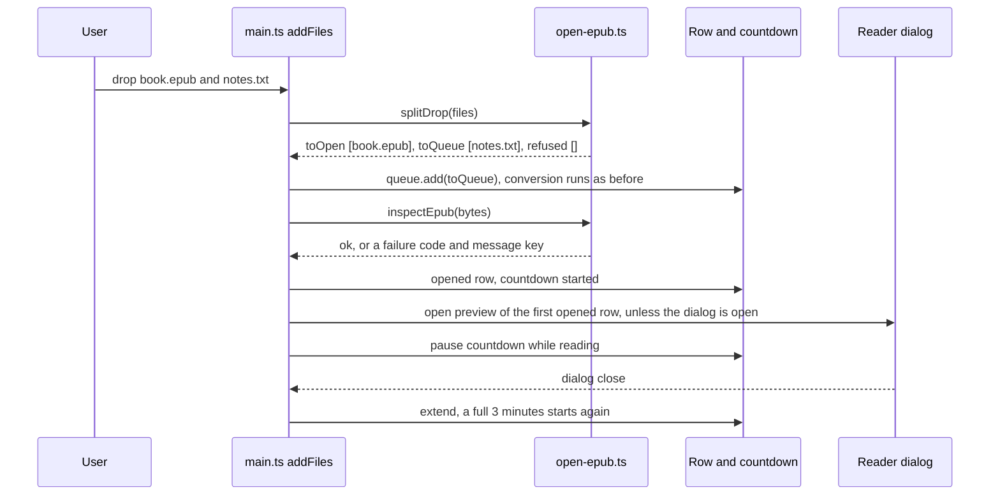

# pubmy EPUB opener Implementation Plan

> For agentic workers: REQUIRED EXECUTION METHOD: delegated task execution. T1, T2 and T3 have disjoint write scopes and run in parallel; T4 and T5 run after them. Steps use checkbox syntax.

**Goal:** A file with the `.epub` extension dropped on the website is not converted: it opens straight in the reader, so the site is also an EPUB opener.

**Architecture:** EPUB files are split off in `addFiles` before the conversion queue, because the queue runs one job at a time and an EPUB must not wait behind an OCR run. A new pure module (`open-epub.ts`) decides what is an EPUB, cheaply checks it (zip caps, container, DRM) and splits a drop. An opened EPUB is a row like a converted one, without the Download link, held by the existing countdown, which pauses while its reader is open. The reader, `preview-session.ts` and foliate are reused unchanged; core `convert()` and the CLI are untouched.

**Tech Stack:** Bun 1.4.4, TypeScript 7, `fflate` 0.8, foliate-js (vendored), `bun test`.

**Active Project Profile:** repo `pubmy` (root of the checkout), `main` at `0a979b8` (PR #25 merged). Web app `apps/web`. Verified from files read in this session: `packages/core/src/browser.ts:46`, `packages/core/src/detect.ts`, `packages/core/src/zip-caps.ts`, `apps/web/src/{main,queue,job,row,i18n,countdown,epub-loader,preview-session,reader,batch}.ts`, `apps/web/index.html`, `apps/web/public/_headers`, `apps/web/test/{theme,readme-web,build-output,i18n,queue,preview-wiring,wiring}.test.ts`, `README.md`. Commands (`package.json`, `apps/web/package.json`): `bun run typecheck`, `bun test <file>`, `bun build.ts <dir>` in `apps/web`; heavy runs go through `colab-test` (A47).

**Project Commands:** `bun run typecheck`; `bun test apps/web/test`; `bun test packages/core/test`; `cd apps/web && bun build.ts <scratch-dir>`; `bun ~/vivera/scripts/check-copy-rules.mjs --diff origin/main` (run from the repo, A27).

**Protected Boundaries:** `packages/core/src/**` (read only; only `packages/core/package.json` gains one export), `apps/web/vendor/foliate/**`, `apps/web/src/reader.ts` (the owner lifted these three, for F9, F8 and F7 only, on 2026-11-09), `apps/web/src/preview-session.ts`, `apps/web/public/_headers` (the CSP stays as it is; a change needs a new decision), `skills/pubmy/**`, `apps/cli/**`.

**Spec:** none (Bounded path). Decisions recorded below.

**Scope:** (1) `.epub` (any case) or MIME `application/epub+zip` skips conversion; (2) cheap checks before opening: zip caps, `META-INF/container.xml`, DRM; (3) the first EPUB that opens in a drop opens its reader by itself, unless a reader is already open; (4) an opened row has no Download link, reads Baca/Read, and is left out of Download all and the Kindle hint; (5) the countdown pauses while the reader of an opened EPUB is open and restarts for 3 minutes when it closes; (6) the EPUB chip, strings in both languages, README and glossary; (7) one real-browser check with a real, a hostile and a DRM EPUB.

**Non-Goals:** opening an EPUB that is not named `.epub` and has no EPUB MIME type (it still goes to the converter); validating an opened EPUB for Kindle (an EPUBCheck report is a possible later feature); downloading an opened file (the user already has it); changing core `convert()`, its `already-epub` refusal, or what the CLI does with an EPUB; remembering a reading position or any book data between visits (nothing is stored); opening MOBI, PDF or other formats in the reader without conversion; a PWA file handler; changing the retention rule of converted EPUBs (a possible follow-up, asked as a peer in the debt sweep).

**Visual Map:**

**Reasoning Lenses:** intent (the owner wants the site to be an EPUB opener, not only a converter), investigative (what the code does today for an `.epub` upload), user-centered and accessibility (a modal that opens by itself, focus return, keys), systems (queue is sequential, countdown and preview own the bytes), security and privacy (an EPUB from outside now reaches an iframe that has `allow-scripts`), failure-oriented (DRM, zip bomb, invalid zip, 50 MB), test-first, verification.

**Acceptance Criteria:** see the list below; each has a row in the table.

**Traceability:** one row per AC; the Task cell names ids from `tasks[]`, the Check cell the command that proves it.

| AC | Task | Check | Evidence |
|---|---|---|---|
| AC-1 | T1 | `bun test apps/web/test/open-epub.test.ts` | exit 0 |
| AC-2 | T1 | `bun test apps/web/test/open-epub.test.ts` | exit 0 |
| AC-3 | T1 | `bun test apps/web/test/open-epub.test.ts apps/web/test/epub-loader.test.ts` | exit 0 |
| AC-4 | T2 | `bun test apps/web/test/countdown-pause.test.ts apps/web/test/countdown.test.ts` | exit 0 |
| AC-5 | T3 | `bun test apps/web/test/row-opened.test.ts apps/web/test/row.test.ts` | exit 0 |
| AC-6 | T3 | `bun test apps/web/test/i18n-opener.test.ts apps/web/test/i18n.test.ts` | exit 0 |
| AC-7 | T4 | `bun test apps/web/test/epub-open-wiring.test.ts` | exit 0 |
| AC-8 | T4 | `bun test apps/web/test/theme.test.ts apps/web/test/readme-opener.test.ts apps/web/test/readme-web.test.ts` | exit 0 |
| AC-9 | T5 | Chromium harness `check.mjs` against the built page | report with counts and screenshots read |
| AC-10 | T4 | `bun test apps/web/test/build-output.test.ts` | exit 0 |
| AC-11 | F1 | `bun test apps/web/test/epub-open-wiring.test.ts`, then the Chromium check `nomount-check.mjs` | exit 0; 14 browser checks pass, 6 fail on the build from before F1 |
| AC-12 | F2 | `git grep -q META_MAX_TEXT -- apps/web/src` exits 1, `bun test apps/web/test/open-epub.test.ts` | exit 0 |
| AC-13 | F3 | `bun test apps/web/test/readme-opener.test.ts apps/web/test/readme-web.test.ts` | exit 0 |
| AC-14 | F4 | `control-open.mjs` against the built page, `plain.epub` opened 24 times | counts recorded |
| AC-15 | F5 | `bun test apps/web/test/epub-open-wiring.test.ts` | exit 0 |
| AC-16 | F6 | `bun test apps/web/test/open-epub.test.ts` | exit 0 |
| AC-17 | F7 | `bun test apps/web/test/book-csp.test.ts apps/web/test/reader-scripts-wiring.test.ts`, then `f7-check.mjs` and `f7-check2.mjs` in Chromium and Firefox with and without the CSP | exit 0; routes that ran: 8 before, 1 without the CSP, 0 with it |
| AC-18 | F8 | `bun test apps/web/test/foliate-patch.test.ts`, then `control-open.mjs` on the real EPUB, 36 opens | exit 0; page errors 8 of 36 before, 0 of 36 after |
| AC-19 | F9 | `bun test packages/core/test/zip-caps.test.ts apps/web/test/epub-loader.test.ts` | exit 0; a lying entry is refused in under 300 ms |

**Assumptions & Open Questions:**
- Owner decisions (2026-11-09, asked through the question tool): (D1) the countdown pauses while the reader of an opened EPUB is open and restarts for 3 minutes when it closes; converted EPUBs keep the old rule. (D2) The first EPUB of each drop opens its reader by itself, not when a reader is already open. (D3) One real-browser check is wanted (A42 opt-in).
- My judgment, open to revision at the Design gate: an opened row has no Download link and is left out of Download all and the Kindle hint; at most 10 opened rows are held at once (LIMIT_10) and each file is at most 50 MB (TOO_LARGE), the same numbers as the queue; the page decides by extension or MIME on the main thread, because reading bytes through the worker would put the EPUB behind the one-at-a-time queue; real validity comes from the checks in T1 and from the reader itself.
- Measured, not assumed: today an `.epub` upload ends in "Gagal: File ini sudah EPUB." (`browser.ts:46`, `i18n.ts:35`), and `index.html:138` already lists `.epub` in `accept`. foliate prints `Unknown encryption algorithm` for anything but the two font obfuscations (`epub.js:620`) and leaves the content encrypted, so a DRM EPUB would show garbage unless refused first.
- Measured 2026-11-09 with `curl -sI https://pubmy.belajarcarabelajar.com/`: the live `content-security-policy` is the same string as `public/_headers` (`script-src 'self' 'wasm-unsafe-eval' https://static.cloudflareinsights.com`, `frame-src blob:`, `img-src 'self' blob: data:`), so a local run with `dist/_headers` tests what visitors get for the CSP; only Referrer-Policy differs, through the zone rule (M5), which does not matter here.
- Not yet measured: whether `script-src 'self'` stops scripts inside a book inside foliate's `sandbox="allow-same-origin allow-scripts"` blob iframe. foliate rewrites in-book resources to `blob:` URLs, so a packaged `<script src>` is a separate case from an inline script (T5 measures both, with a positive control: the same book on a page without the CSP must run the script, or the check proves nothing).
- Routing is by extension or MIME, as the owner asked ("ekstensinya EPUB"): a real EPUB renamed `.zip` still goes to the converter and ends in `already-epub`, and a PDF renamed `.epub` is refused by `inspectEpub` as unreadable.
- Owner may veto at the Design gate (each is my judgment): the tagline sentence (it sits beside the header wrap threshold tuned in PRs #24 and #25; the EPUB chip alone would cover discoverability), no Download on opened rows, opened rows left out of the ZIP and the Kindle hint, the 10-row and 50 MB limits.
- Open: the main-thread unzip of a large EPUB when the reader opens (cap 500 MB, 5000 entries) can freeze the tab for a moment; T5 times it on the real EPUB and records the number, no fix is planned unless it is bad.

**Dependencies & Impact:** `epub-loader.ts` is shared with converted EPUBs; `unzipCapped` drops directory entries and `..` paths, which foliate never reads. `theme.test.ts` deliberately listed `epub` as not advertised (it was refused); the opener reverses that, so the chip is added and the test changes with it. `build-output.test.ts:69` finds the core chunk by the string `already-epub`, which stays because core is untouched. `README.md` line 5 is pinned by `readme-web.test.ts` (`up to 10 files (50 MB each)`, `preview each EPUB`).

**Risks & Rollback:** security (T5) is the main risk: if a book script runs, T5 stops and the task returns to design; nothing in `vendor/foliate` or `_headers` is changed silently. A modal that opens by itself can surprise someone who dropped a mixed batch (D2 accepted). Rollback: revert the pull request; no data, headers or deploy state change before the owner asks for a deploy.

**Security & Compatibility:** an EPUB from outside is untrusted content. Checks before opening: zip caps (core `checkZipCaps`, 500 MB and 5000 entries), container present, DRM refused. The CSP and the iframe sandbox are unchanged and measured in T5 with a positive control. No network use is added; the book is read from memory. Compatibility: the `already-epub` message key and core refusal stay for the CLI and core tests.

**Operations & Rollout:** pull request only; merge and deploy happen on the owner's request. After a deploy: re-read the live CSP with `curl -sI` and compare it with `public/_headers` (a zone rule can change it, M5), then drop the real and the hostile EPUB on the live page once; the README sentence about scripts is about the CSP that was measured, so a changed live CSP voids it.

**CI/Review Gate:** parent diff audit and an independent reviewer (`staid`) before the pull request; copy rules check; unit gate through `colab-test`.

**Documentation:** README (Website line, Privacy bullet), GLOSSARY (two terms), the plan's learning ledger at close.

**Definition of Done:** AC-1 to AC-10 checked with evidence, `bun run typecheck` exit 0, `bun test apps/web/test` and `bun test packages/core/test` exit 0, build exit 0, copy rules exit 0, browser report read, pull request opened, debt sweep run.

**Plan Status & Version:** InProgress, v1 (follow-ups F1 to F9 added 2026-11-09).

**Approval:** Design and plan approved by the owner on 2026-11-09 at the `Design` question (option "Setujui", the recommended one). Earlier answers the same day: D1 reading hold only for opened EPUBs, D2 first EPUB of each drop opens by itself, D3 one real-browser check. The tagline sentence, the no-Download and ZIP choices and the 10 and 50 MB limits were offered for veto and kept. Follow-ups F1 to F4 were selected by the owner at the debt sweep question on 2026-11-09, which also kept this plan and `2026-11-07-pubmy-v1` open. F5 and F6 were done after the owner asked whether the deferred items could be done too; F7, F8 and F9 touch protected files and were approved by the owner's answer "Deny scripts in the reader, Guard foliate columnize, Bound reader unzip in core" (all three), which lifts the protection for those three files only.

**Reproducibility:** Bun 1.4.4; Chromium via puppeteer-core (the `/usr/bin/chromium` binary), CSP taken from `dist/_headers`; the real EPUB is Project Gutenberg #1342 (`https://www.gutenberg.org/ebooks/1342.epub3.images`), downloaded into its own empty scratch directory and treated as untrusted data; the hostile and DRM EPUBs are built by the harness from `fflate`.

**Test Reliability:** unit tests are text or pure-function tests with no clock or network (the countdown takes its clock and timer as options). The reading hold is proven in the browser by leaving the reader open past 3 minutes once; the open and auto-open flow is run 3 times (M16).

**Privacy & Data Governance:** the file never leaves the tab. An opened EPUB is held in memory, kept while its reader is open, and wiped 3 minutes after the reader closes (D1); nothing is stored.

**Dependencies & Supply Chain:** no new package; `fflate` and `@pubmy/core` already in `apps/web`.

**UX States:** opening, ready to read, failed (DRM, unreadable, too large, over the limit), reader open (countdown paused), reader closed (countdown restarted), expired; mixed drop; a second drop while a reader is open; phone and desktop widths; id and en; keyboard and screen reader (live region announces the row).

**Persistent State & Artifact Storage:** none; in-memory rows only.

**Entity & Sourcing Verification:** the foliate encryption behaviour and the CSP and sandbox lines were read in the vendored source and `_headers`; script blocking is measured in T5, not assumed.

**Verification:** `bun run typecheck`; `bun test apps/web/test`; `bun test packages/core/test`; `cd apps/web && bun build.ts <scratch-dir>`; `bun ~/vivera/scripts/check-copy-rules.mjs --diff origin/main`; the Chromium harness (T5).

## Acceptance Criteria

- [x] AC-1: `isEpubFile` is true for a name ending `.epub` in any letter case, or for MIME `application/epub+zip`, and false for `.pdf`, `.epub.txt`, and an empty name; `splitDrop` sends EPUBs to `toOpen` and every other file to `toQueue`, refuses an EPUB over `maxBytes` as `TOO_LARGE`, and refuses any EPUB beyond `maxHeld` held rows as `LIMIT_10`.
- [x] AC-2: `inspectEpub` accepts a valid EPUB and one whose `encryption.xml` lists only the two font obfuscation algorithms; it refuses an empty file (`READ_FAILED`, `empty-file`), bytes that are not a zip, a zip with no `META-INF/container.xml` (`READ_FAILED`, `read-failed`), a zip over the entry or size cap (`READ_FAILED`, `archive-too-large`), and any other `EncryptionMethod` (`DRM`, `epub-drm`); it inflates nothing but the two `META-INF` entries.
- [x] AC-3: `createEpubLoader` unzips through core `unzipCapped`: an archive over a given cap throws `archive-too-large`, and a normal EPUB loads exactly as before.
- [x] AC-4: a countdown can be paused: no tick and no expiry fire while paused and `remaining` holds; `extend()` on a paused countdown restarts the full window; calling the stop function while paused still expires it at once.
- [x] AC-5: a row with `kind: "opened"` has no `[data-action="download"]` link, its preview button reads `t("read")` and keeps `data-action="preview"`, and it keeps the clock, the Extend entry and Remove; a row without `kind` is byte for byte what it was.
- [x] AC-6: `read`, `opened` and `epub-drm` exist in both languages; the tagline names the opener in both languages; `already-epub` stays; the `i18n` parity test still passes.
- [x] AC-7: `main.ts` sends EPUBs through `splitDrop` and `inspectEpub` and never through the queue; opens the first EPUB that passes in a drop when no reader is open; pauses the countdown when an opened row's reader opens and extends it when the dialog closes; counts only converted rows for Download all and the Kindle hint; and gives opened rows ids that cannot collide with queue ids.
- [x] AC-8: `index.html` shows an EPUB chip and the chip test accepts it (12 chips); the README Website line keeps its pinned text and adds the opener, and the Privacy bullet states the reading hold.
- [x] AC-9: in Chromium, (a) a real EPUB dropped alone opens its reader by itself, shows contents and a first page, shows no Download link and no failed row, and next page works; (b) the same drop 3 times gives the same result; (c) a book that tries inline script, packaged script file, SVG script, `onerror`, meta refresh and a `javascript:` link runs none of them under the real CSP, and each sentinel that is set on the copy of the page without the CSP (positive control) shows which routes the CSP is what stops, with no outside request and no navigation; (d) a DRM-style EPUB gives the DRM text and no dialog; (e) a mixed drop converts the text file while the EPUB opens; (f) a second drop while the reader is open does not replace the book; (g) the reader stays open past 3 minutes and the row clock restarts at 03:00 when it closes; (h) no console or CSP error other than the expected violation reports of (c); (i) the header with the longer tagline, in Indonesian and in English (the English title is the wide one), has no horizontal overflow and keeps the language button in the title row above 25rem of brand width, at 390, 640, 641 and 1280 px, the widths PRs #24 and #25 tuned; if the tagline is vetoed at the gate this item drops out.
- [x] AC-10: the built page still ships its Indonesian text in place, the worker core chunk is still found by `already-epub`, and the build exits 0.
- [x] AC-11: an opened EPUB that passes `inspectEpub` but cannot be mounted ends as a failed row with the existing `READ_FAILED` text (not "Ready to read", not "Deleted"), announced through the live region, with no Read button and no clock, its bytes dropped, Remove working, and a good EPUB dropped next still opens by itself; a converted row keeps the generic preview-failed announcement.
- [x] AC-12: `inspectEpub` has no `META_MAX_TEXT` constant or check (it could never fire: the output is cut at the declared size, at most 128 KiB); the compressed and declared caps stay.
- [x] AC-13: the README Privacy bullet ends with one sentence that names the date, the browser version, the Content Security Policy and the six routes tried, claims no other browser, and the test that forbade the word "script" is replaced by tests that pin those facts.
- [x] AC-14: the foliate `columnize` error rate is measured on a control that differs from the real book only in the book: a small EPUB opened through the opener 24 times, and on a converted preview 24 times; the counts are in the plan and the pull request body.
- [x] AC-15: a mount failure of an opened row never renders a Deleted row or announces "Deleted": the countdown is called first, but the row no longer takes its tick and the real failure text is the first thing announced and shown.
- [x] AC-16: `inspectEpub` reads an `encryption.xml` that starts with a UTF-16 byte order mark (either order) and refuses DRM in it; comments and CDATA are dropped in one linear pass; an unterminated opener keeps the rest of the file in view; a comment inside a tag counts as DRM (it fails closed).
- [x] AC-17: the reader refuses script resources of a book (`load` event, `isScript`) and gives every page of the book (`data` event, `blockBookScripts`) a head that opens with `script-src 'none'; object-src 'none'`, checked with the browser's own parser, else a blank page; in Chromium and Firefox on a copy served without the CSP header only the routes a meta policy cannot reach still run (a standalone SVG page; a meta refresh makes its request), and under the real CSP none runs.
- [x] AC-18: the vendored paginator does not render or report a position for a section that has no body yet (two early returns, listed in `PATCHES.md`); 36 opens of the real EPUB give 0 page errors and 0 non-opens.
- [x] AC-19: `createEpubLoader` unzips through `unzipBounded`, which refuses an entry as soon as its real output passes the size it declares (`archive-too-large`), refuses ZIP64, spanned archives, methods other than stored and deflate and data outside the file as `read-failed`, and returns the same files as `unzipCapped` for an honest zip.

## Global Constraints

- No em dash in new copy or code comments.
- Git is parent-only; subagents edit files and run tests only (`sucp-rules` Git Ownership).
- Commit messages are conventional, with no attribution lines.
- A new test file starts every task's `skip_if` and RED step (M15).
- Heavy runs go through `colab-test` (A47); a local fallback is targeted (A12).
- First edit after the Design gate: the `GLOSSARY.md` terms (`sucp-brainstorm`, Project Glossary).

## Session checklist

- [x] Plan validated (`Validation: OK`, runner exit 0) and Design approved (owner, option "Setujui", 2026-11-09)
- [x] Worktree claimed via `pr-registry claim --worktree` from `origin/main` (exit 0): `/mnt/belajarcarabelajar/pubmy-wt/pubmy-epub-opener`, branch `2026-11-09-pubmy-epub-opener/pubmy-epub-opener`; plan file moved into it
- [x] GLOSSARY.md terms written (first edit): Opened EPUB, Reading hold, Retention window reworded
- [x] T1, T2, T3 dispatched in parallel (disjoint write scopes), RED then GREEN; each report re-checked by the parent (diff read, tests re-run), evidence below
- [x] T4 main.ts wiring: RED then GREEN
- [x] Independent review of T1 to T4 (`staid`, 7 findings); findings 1 and 2 confirmed by the parent's own repro and fixed (3 commits), the rest listed under Evidence for the owner
- [x] T5 real-browser check (3 EPUBs, 3 repeats, 3 minute hold): run in full, see Evidence
- [x] Debt sweep (owner chose F1 to F4, 2026-11-09), follow-ups executed as real work: RED then GREEN, parent audit, browser check; both plans kept open at the `Close plan` question
- [x] F5 to F9 done as real work: RED then GREEN, parent diff audit of each, commits checked with `git show --name-only`, browser runs recorded in Evidence
- [x] Parent diff audit of the whole change (read the full source diff at f61f7d6, the follow-ups per chunk)
- [x] Verify: typecheck, tests, build, copy rules (fresh at `49ff051`, see Evidence)
- [x] PR opened: #27 (`belajarcarabelajar/pubmy`, head `9becfbc`, mergeable, not draft), recorded in the registry as `open`

## Task T1: open-epub module and capped loader

**Files:** Create `apps/web/src/open-epub.ts`, `apps/web/test/open-epub.test.ts`; Modify `apps/web/src/epub-loader.ts`, `packages/core/package.json` (one export, `./zip-caps`), `GLOSSARY.md`; Test `epub-loader.test.ts`, `preview-session.test.ts`.
**Interfaces (Produces):** `EPUB_MIME`, `isEpubFile`, `Inspect`, `inspectEpub(bytes)` (empty is `empty-file`; not a zip or no container is `read-failed`; core `checkZipCaps`; only the two `META-INF` entries are inflated; any `EncryptionMethod` other than the two font obfuscations is `DRM`/`epub-drm`), `splitDrop(files, {maxBytes, maxHeld, held})` (`TOO_LARGE`, `LIMIT_10`, drop order kept); `createEpubLoader` unzips through `unzipCapped`; GLOSSARY terms Opened EPUB and Reading hold.
**Behavior & Acceptance:** AC-1, AC-2, AC-3. **Deliberate Shortcuts & Deferrals:** None. Full approved text: `docs/code-plan/2026-11-09-pubmy-epub-opener-evidence.md`, section "Task bodies T1 to T5 as approved".

## Task T2: countdown pause

**Files:** Create `apps/web/test/countdown-pause.test.ts`; Modify `apps/web/src/countdown.ts`; Test `countdown.test.ts`.
**Interfaces (Produces):** `Countdown.pause()`: cancels the pending tick, keeps `remaining`, fires no tick and no expiry until resumed; `extend()` on a paused countdown starts a full window and resumes; the stop call while paused still expires it once.
**Behavior & Acceptance:** AC-4. **Deliberate Shortcuts & Deferrals:** None. The fake `now` and `setTimer` options are used, no real timer.

## Task T3: opened row view and strings

**Files:** Create `apps/web/test/row-opened.test.ts`, `apps/web/test/i18n-opener.test.ts`; Modify `apps/web/src/row.ts`, `apps/web/src/i18n.ts`; Test the row and i18n tests.
**Interfaces (Produces):** `RowView.kind?: "converted" | "opened"`; an opened row has no Download link, its preview button reads `t("read")` and keeps `data-action="preview"`; keys `read`, `opened`, `epub-drm` in both languages; the tagline gains one sentence naming the opener (plain text, no `<` or `&`).
**Behavior & Acceptance:** AC-5, AC-6. **Deliberate Shortcuts & Deferrals:** None.

## Task T4: main.ts wiring, EPUB chip, README

**Files:** Create `apps/web/test/epub-open-wiring.test.ts`, `apps/web/test/readme-opener.test.ts`; Modify `apps/web/src/main.ts`, `apps/web/index.html`, `apps/web/test/theme.test.ts`, `README.md`; Test the wiring, batch, readme and build-output tests.
**Behavior:** `Row.kind`; `addFiles` splits the drop with `splitDrop` (50 MB, 10 held rows), sends `toQueue` to the queue as before and opens `toOpen` one after another; an opened row has a negative id, a countdown over `{ epub: bytes }` and the text `t("opened")`; a failed check is a failed row with `failureText`; the first opened row of a drop opens by itself unless the dialog is open (D2); `openPreview` pauses the countdown right after `showModal()` and the dialog `close` handler extends it (D1); Download all and the Kindle hint count converted rows only; the `EPUB` chip (12 chips) and the meta description; README Website line and Privacy bullet.
**Behavior & Acceptance:** AC-7, AC-8, AC-10. **Deliberate Shortcuts & Deferrals:** the DOM glue is proven by anchored text checks plus the browser run (T5); `defer: unit test of main.ts, upgrade when main.ts can be imported without the live DOM`.

## Task T5: real-browser proof

**Files:** Modify `README.md` (one sentence, only if the script check passes); the harness `opener-harness.mjs` and its EPUBs live in a per-session scratch directory, not in the repository.
**Steps (the parent ran them; opted in by the owner, A42):**
- [x] Ran locally, by necessity (build output and Chromium on one machine): `HEAVY_LOCAL=<reason> bun build.ts <scratch>/dist` in `apps/web`; `free -m` and leftover `chromium` processes checked first (A12).
- [x] Served the page with the headers of `dist/_headers` and a second copy without the CSP header (positive control); real Gutenberg #1342 EPUB, a hostile EPUB for six routes (inline, packaged file, SVG, `onerror`, meta refresh, `javascript:` link) and a DRM-style EPUB, all built or downloaded into their own scratch directory.
- [x] Ran AC-9 (a) to (i), (a) three times, the hold (g) past 190 s; counts, timings and screenshots are in Evidence.
- [x] If the hostile book runs a script under the real CSP: stop and return to design. Not triggered. If it runs on the control copy only: one README sentence, done in F3.
**Behavior & Acceptance:** AC-9. **Deliberate Shortcuts & Deferrals:** Chromium only; `defer: Firefox and Safari, upgrade when a visitor reports a reader problem there`. Full approved text: `docs/code-plan/2026-11-09-pubmy-epub-opener-evidence.md`, section "Task bodies T1 to T5 as approved".

## Task F1: failed row when an opened EPUB cannot mount

**Files:** Modify `apps/web/src/main.ts`, `apps/web/test/epub-open-wiring.test.ts`; Test `apps/web/test/preview-wiring.test.ts`.
**Interfaces:** `failOpened(row)` in `main.ts`, called from the catch branch of `openPreview` for `row.kind === "opened"` after `dialog.close()`: sets `item.status = "failed"` and `item.result = { ok: false, code: "READ_FAILED", message: "read-failed" }`, calls the countdown (drops the bytes), then clears `row.ready` and `row.stop`, announces `<name>: <row text>` and renders. A converted row keeps the generic `preview-failed` announcement.
**Behavior & Acceptance:** AC-11.
**Edge Cases:** the dialog `close` handler still runs once afterwards and finds no countdown; `heldCount()` stops counting the row; focus falls back to Remove through `renderRow`; `preview.open` returning false is not a failure and stays as it was.
**Deliberate Shortcuts & Deferrals:** the countdown call renders a transient Deleted row that the next render replaces in the same task; `defer: reorder so no transient render, upgrade when a screen reader is seen to read "Deleted" first`.
**Test Data & Determinism:** anchored text checks as in T4, plus the Chromium check `nomount-check.mjs` with two books that pass `inspectEpub` and fail to mount (package file missing; package file not XML).

## Task F2: drop the dead `META_MAX_TEXT` check

**Files:** Modify `apps/web/src/open-epub.ts`; Test `apps/web/test/open-epub.test.ts`.
**Interfaces:** `inspectEpub` loses the `META_MAX_TEXT` constant and the `Object.values(meta).some(...)` clause; the compressed (16 KiB) and declared (128 KiB) caps and the `oversize` refusal stay.
**Behavior & Acceptance:** AC-12.
**Edge Cases:** none: the output is cut at the declared size, at most 128 KiB, so a 1 MB text check could not fire (measured: a 15 MB entry declared as 100 bytes returned `ok` and was cut, not refused by this check).
**Deliberate Shortcuts & Deferrals:** None.
**Test Data & Determinism:** the existing `open-epub` tests are the guard; no new test for a deletion.

## Task F3: README sentence on scripts, guard flipped

**Files:** Modify `README.md`, `apps/web/test/readme-opener.test.ts`; Test `apps/web/test/readme-web.test.ts`.
**Interfaces:** the Privacy bullet ends with: "In a check on 2026-11-09 in Chromium 156, none of six ways a book can run a script (inline, packaged file, SVG, `onerror`, `javascript:` link, meta refresh) ran under the page's Content Security Policy." The test that forbade the word "script" is replaced by tests that pin the date, the browser version, the policy and the count by fact, that the sentence is last, and that Firefox, Safari, "all browsers" and "always" do not appear.
**Behavior & Acceptance:** AC-13.
**Edge Cases:** the older test that pinned the reading-hold sentence as the last sentence now checks it is present and before the script sentence; a changed live CSP voids the sentence (see Operations & Rollout).
**Deliberate Shortcuts & Deferrals:** None.
**Test Data & Determinism:** README read as text.

## Task F4: control run for the foliate error

**Files:** none (a measurement; the harness stays in scratch).
**Behavior & Acceptance:** AC-14. The same three modes (idle, paged, slow) times 8 runs: `plain.epub` opened through the opener; and a converted preview of a text file of the same size as the real book's text.
**Edge Cases:** one earlier attempt of this script timed out once waiting 30 s for the dialog (memory about 1.5 GB available, other jobs running); 25 later runs never reproduced it, so it is recorded as unexplained, not as a pass.
**Deliberate Shortcuts & Deferrals:** `defer: no machine proof (the run lives in scratch), upgrade trigger: a committed browser test if the owner turns e2e on (A42)`.
**Test Data & Determinism:** none; counts are recorded in Evidence.

## Task F5: no transient Deleted render

**Files:** Modify `apps/web/src/main.ts`, `apps/web/test/epub-open-wiring.test.ts`; Test `apps/web/test/preview-wiring.test.ts`.
**Interfaces:** in `startRetention`'s `onTick`, after `preview.onTick(it)`, `if (row.ready !== ready) return;`. `failOpened` takes `const countdown = row.stop; row.ready = undefined; row.stop = undefined; countdown?.();` before it announces and renders, so the tick the countdown fires finds a row that no longer owns it.
**Behavior & Acceptance:** AC-15. Removes the `defer` recorded under F1.
**Edge Cases:** a retention tick of a converted row still reaches `preview.onTick`; a second call of the stop function is a no-op.
**Deliberate Shortcuts & Deferrals:** None. `main.ts` is 449 lines, under the 500 line trigger.
**Test Data & Determinism:** anchored text checks as in T4.

## Task F6: encryption.xml, UTF-16 and comments

**Files:** Modify `apps/web/src/open-epub.ts`, `apps/web/test/open-epub.test.ts`.
**Interfaces:** `decodeXml(bytes)` honours a UTF-16 byte order mark (FF FE, FE FF) through `TextDecoder`; `stripCommentsAndCdata(xml)` is one `indexOf` pass; `usesDrm` scans the stripped text with the regex of the review fix, unchanged.
**Behavior & Acceptance:** AC-16. Review finding 7.
**Edge Cases:** an unterminated `<!--` or `<![CDATA[` stops the stripping and keeps the rest; an opener inside a stripped stretch is searched again from the new position; the lazy `[\s\S]*?` stripper stays banned (quadratic on an unclosed file).
**Deliberate Shortcuts & Deferrals:** `defer: UTF-16 without a byte order mark, upgrade trigger: a DRM book that opens` (XML requires the mark, so a parser also reads it as UTF-8).
**Test Data & Determinism:** pure functions; timing cases use an unclosed-opener file of 5,000 and 20,000 markers.

## Task F7: the reader blocks book scripts

**Files:** Create `apps/web/src/book-csp.ts`, `apps/web/test/book-csp.test.ts`, `apps/web/test/reader-scripts-wiring.test.ts`; Modify `apps/web/src/reader.ts` (protected; the owner lifted the protection for this task, see Approval).
**Interfaces:** `isBookMarkup(type)`, `plainMarkupType(type)`, `blockBookScripts(text, type, parse)` in `book-csp.ts`. In `mountReader`, before `renderer.open(book)`: a `load` listener on `book.transformTarget` sets `detail.allow = false` when `detail.isScript`; a `data` listener replaces `detail.data` with a page whose head opens with `<meta http-equiv="Content-Security-Policy" content="script-src 'none'; object-src 'none'">` and sets `detail.type` to the plain type (a charset in the type would override the checked text). A linear scan only proposes where the meta goes; the page is parsed with `DOMParser` and kept only when its root is html, its head opens with the policy and no XSLT instruction is in the prolog. Anything else, a page over 8 MiB or a parse that throws becomes a blank page that carries the policy. Types are read as a browser reads them (parameters, case): HTML and the three XML types; SVG and the rest are untouched.
**Behavior & Acceptance:** AC-17. Review finding 3, then the independent read of `441fe0d` (three holes in the first scan, reproduced).
**Edge Cases:** a Blob page is read as text first; a chapter over 8 MiB, or one the scan and the parser read differently, shows blank; the check cannot see engine differences between `DOMParser` and a frame (`noscript`).
**Deliberate Shortcuts & Deferrals:** `defer: a standalone SVG page of a book and a meta refresh stay covered by the page CSP only, upgrade trigger: any change to the CSP`.
**Test Data & Determinism:** pure tests with the policy written out in the test and a stand-in parser where linkedom is not a faithful HTML parser; 1 s bounds on 8 MB inputs; wiring tests anchored on the listeners; Chromium and Firefox runs in Evidence.

## Task F8: foliate does nothing before the body exists

**Files:** Create `apps/web/vendor/foliate/PATCHES.md`, `apps/web/test/foliate-patch.test.ts`; Modify `apps/web/vendor/foliate/paginator.js` (protected; lifted for this task).
**Interfaces:** `View.render(layout)` returns when `!this.document?.body`; `Paginator.#afterScroll(reason)` returns when `!this.#view?.document?.body`. Both are marked `pubmy patch` in the source and described in `PATCHES.md` (symptom, cause, patch, pin).
**Behavior & Acceptance:** AC-18. Root cause measured: `#createView()` makes the new view the current one before its iframe has loaded, so the resize observer and the debounced scroll callback reach code that reads a body that is null.
**Edge Cases:** nothing is lost: the iframe's `load` handler renders again and `#display()` awaits the load before `scrollToAnchor`, which reports the position.
**Deliberate Shortcuts & Deferrals:** `defer: a view that is not ready is guarded at two call sites, not by a readiness flag in the paginator, upgrade trigger: a third site that reads a body too early`.
**Test Data & Determinism:** text-anchored tests (the paginator cannot run under Bun); the behaviour is the browser count in Evidence.

## Task F9: bounded unzip in the reader

**Files:** Modify `packages/core/src/zip-caps.ts` (protected; lifted for this task), `packages/core/test/zip-caps.test.ts`, `apps/web/src/epub-loader.ts`, `apps/web/test/epub-loader.test.ts`.
**Interfaces:** `unzipBounded(bytes, limits)` in `zip-caps.ts`: reads the central directory itself, checks `checkCaps` on the declared sizes, and inflates each deflate entry with fflate's `Inflate` in 4 KiB pieces, throwing `archive-too-large` as soon as the output passes the declared size or the room left under `maxBytes`; stored entries must fit their declared size; ZIP64, spanned archives, a method other than 0 or 8, and data outside the file throw `read-failed`, never a fall back to the unbounded path. `createEpubLoader` calls it; `unzipCapped` and `checkZipCaps` are unchanged.
**Behavior & Acceptance:** AC-19. fflate's `unzipSync` cuts the output at the declared size but still decodes the whole stream, so the cost of a lying entry was CPU time.
**Edge Cases:** a data descriptor leaves the local header sizes at 0, so the central directory sizes are used; the piece size is 4 KiB because 16 KiB measured 446 ms for the first piece of a lying entry; names decode as fflate does (UTF-8 only with flag bit 11, else Latin-1).
**Deliberate Shortcuts & Deferrals:** `defer: encrypted entries differ from unzipCapped (read-failed), upgrade trigger: a real EPUB that fails to open for that reason`.
**Test Data & Determinism:** fixtures built with fflate and with Python's `zipfile` on a non-seekable stream (data descriptor); a mutation check of five changes at once with the diff against a pristine copy.

## Evidence

Each entry names the command and its exit code; tests and typecheck ran through `colab-test -C <worktree> --`. Full entries for T1 to T5 and F1 to F4, and the commands and logs for F5 to F9: `docs/code-plan/2026-11-09-pubmy-epub-opener-evidence.md`.

- **T1 to T4** (parent audit by diff and re-run; RED at assertions each): GREEN T1 exit 0, 55 pass; T2 exit 0, 17 pass; T3 exit 0, 75 pass; T4 `bun test apps/web/test` exit 0, 397 pass, 1 skip; `bun run typecheck` exit 0; local build exit 0 (`HEAVY_LOCAL`, temporary NVMe worktree).
- **T5 browser** (Chromium 156.0.8078.79, `puppeteer-core`, real Gutenberg #1342 EPUB, build of `f61f7d6`, `harness_final_exit=0`): 83 pass, 0 fail. Opens by itself 113 to 142 ms after the drop, three times; reader open past 190 s, clock 02:59 after closing, row wiped 3 minutes later; six script routes ran on the control copy and none under the real CSP; a DRM EPUB gave the DRM text and no dialog.
- **Review of T1 to T4** (`staid`, 7 findings): 1 (quadratic regex) and 2 (a lying size cost 1785 ms for 60 MB declared as 100 bytes) confirmed by the parent and fixed in `46353fe`, `7af84cc`, `3d63334` (RED exit 1, 84 pass, 11 fail; GREEN exit 0, 95 pass). Finding 5 became F1, 7 F6, 3 F7, the reader-unzip finding F9; 6 stays in the backlog.
- **F1** `6bc853d`: tests exit 0, 41 pass; `nomount-check.mjs` exit 0, 14 checks pass for two books that pass `inspectEpub` and fail to mount (6 fail before F1). **F2** `8855a4e`: no `META_MAX_TEXT` left, tests exit 0, 64 pass. **F3** `409cda2`: `readme-opener`, `readme-web` exit 0, 17 pass.
- **F4 control run:** `plain.epub` through the opener, 24 runs: 0 page errors, 0 non-opens; a converted preview of the book's own text, 24 runs: 0 page errors; the real 63-chapter EPUB about 5 of 24 before F8. One earlier 30 s non-open never reproduced in 25 later runs: unexplained.
- **F5** `96db185`: wiring tests exit 0, 43 pass; `apps/web/test` exit 0, 442 pass, 1 skip; typecheck exit 0.
- **F6** `e817ed5`: `open-epub.test.ts` exit 0, 73 pass; `apps/web/test` exit 0, 442 pass.
- **F8** `0f276ba`, `9c406fd`: `foliate-patch.test.ts` RED exit 1 (2 of 4 fail, then 2 of 7 fail for the second guard, each at its assertions), GREEN exit 0, 7 pass. Browser (`control-open.mjs`, the real EPUB, 12 opens each in idle, paged and slow mode, 36 in all): page errors 8 of 36 unpatched, 5 of 36 with the first guard, **0 of 36 with both**, and 0 of 36 failed to open (`f8b_control_exit=0`; `repeat-open.mjs` also 0 of 36, exit 0).
- **F9** `ea64d34`, then `fa8ba05` (entry names decode as fflate does after the independent read found a Latin-1 regression: RED 3 of 40 fail, GREEN exit 0, 40 pass): RED against a stub exit 1, 23 pass, 13 fail; GREEN exit 0, 35 pass; a mutation check of five changes at once (diffed against a pristine copy, restored) exit 1, 24 pass, 11 fail. A 64 MB entry declared as 1,024 bytes (Colab pool): `unzipCapped` returned without an error after 3.9 to 5.3 s, `unzipBounded` refused it as `archive-too-large` in 143 to 188 ms (7 runs). 16 KiB pieces measured 446 ms for the first piece, so the piece is 4 KiB.
- **F7** `441fe0d`, then `aa6c9b1` after an independent read (`staid`, read-only): three holes in the first scan, reproduced with the real function and, for two, in Chromium (a media type with a parameter and an XHTML root that is not html ran their script on a copy without the CSP header). Now the page is verified with `DOMParser` and fails closed, types are normalized, the blob type loses its charset, XSLT is refused. RED 18 of 47 then 4 of 54 fail at assertions, GREEN exit 0, 54 pass. Browser (`f7-check.mjs`, `f7-check2.mjs`; Chromium 156 and Firefox 159): without the CSP header 8 of 8 routes ran before F7, 1 ran with the first F7 (plus 2 of the 4 bypass books), **1 ran at `aa6c9b1` (the standalone SVG page) and 0 of the 4 bypass books**; real CSP: 0 ran, 0 requests.
- **Browser, full harness** (`opener-harness.mjs`, `harness_*_exit=1`): at `441fe0d` 78 pass, 5 fail; at `aa6c9b1` (groups a, c, d, e, f, i) 72 pass, 5 fail. The 5 are always the "route runs on the control copy" checks for inline, file, `onerror`, `javascript:` and SVG: F7 stops them on the control copy too, so they cannot pass. Everything else passes. Real EPUB, Chromium: drop-to-open 114 to 128 ms and longest task 78 to 91 ms at `441fe0d`, 130 to 176 ms and 85 to 109 ms at `aa6c9b1` (one more parse per page). Firefox 159: evidence file.
- **Whole repo** (parent runs): at `6bb4942` `bun test` exited 1, 945 pass, 1 fail: a 40 MB scan test took 180 ms against a bound of 100 ms while other jobs ran on the pool; `de2dee1` gave the timing bounds room. **At `aa6c9b1`** (last code or test change): `bun test` exit 0, 972 pass, 2 skip (live-site `connect-src`, `claude plugin install`, both env-gated), 0 fail, 75 files; `bun run typecheck` exit 0; build exit 0; `--readiness` `NEEDS-HUMAN` (exit 3, see Closeout status).

## Follow-up backlog (debt sweep, 2026-11-09)

Items the owner did not select or that need a decision. Each has a `defer:` line; none is asked again in this session.

- Review finding 6: whether the first EPUB of a drop auto-opens is decided after the file has been read. `defer: design choice, upgrade trigger: a report that a dropped EPUB did not open by itself.`
- A book whose spine item is a standalone SVG page: its inline script runs on a page served without the CSP header, and foliate's paginator throws on it (`querySelectorAll` of null, an SVG document has no body); the same errors appeared before F7 (`hostile-svgdoc.epub`). A meta refresh in a book still makes its request without the CSP; only the frame moves (no top navigation in the sandbox; the page title did not change). `defer: the page CSP covers both, upgrade trigger: any change to the CSP, or a report of a blank SVG page.`
- F7: a page over 8 MiB, or one the scan and the parser read differently, shows blank; `DOMParser` and a frame can differ (`noscript`); a type outside HTML, XML and SVG that a browser sniffs as HTML is not covered. `defer: the page CSP covers these, upgrade trigger: a real book that shows blank, or a CSP change.`
- F9: encrypted entries differ from `unzipCapped` (`read-failed`). F6: UTF-16 without a byte order mark is read as UTF-8. `defer: upgrade trigger: a real EPUB that fails to open (F9) or a DRM book that opens (F6).`
- English tagline takes 3 lines from 641 px up. `defer: wording is the owner's, upgrade trigger: owner veto.`
- Unit test of `main.ts`. `defer: upgrade when main.ts can be imported without the live DOM.`
- Safari (not testable here). Firefox 159 measured once, same as Chromium (evidence file); README still names Chromium only. `defer: upgrade trigger: a Safari or Firefox report, or the owner widens the README.`
- The one unexplained 30 s non-open (F4).

## Closeout status

Closed 2026-11-12 (owner decision, third `Close plan` question): PR #27 merged to `main` on 2026-11-09 (merge commit `69025e7`), so the opening work is delivered. T5 and F4 stay `UNPROVEN` exactly as recorded below: their evidence is a real-browser run in scratch, not a machine proof, and the owner accepted that gap rather than holding the issue open.

- **Readiness at `aa6c9b1`, `bun scripts/plan-closeout.mjs --readiness`:** `NEEDS-HUMAN` (exit 3): every task `DONE` by its own `skip_if` except T5 and F4 `UNPROVEN` (no machine proof: the browser runs live in scratch); no open boxes, no open `NOW` follow-ups.
- **What remains:** review of PR #27, then merge and deploy only on the owner's request; after a deploy re-read the live CSP with `curl -sI`, compare it with `public/_headers`, and drop the real and a hostile EPUB on the live page once. After the merge, from the main checkout: `graphify update .`, `bun ~/vivera/scripts/graphify-sync.mjs --root "$(pwd)"`, then `--check`.
- **Reopen trigger:** when the pull request merges, run `--readiness` again and ask the `Close plan` question with the owner's decision on T5 and F4.
