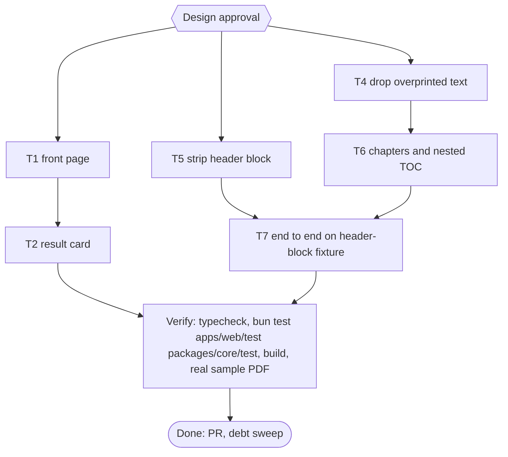

# pubmy UI review fixes Implementation Plan

> For agentic workers: REQUIRED EXECUTION METHOD: delegated task execution. Steps use checkbox syntax.

**Goal:** Fix what is true in two owner-pasted UI reviews of the pubmy web page (front page, result card) and the PDF conversion defects the second review exposed; the preview dialog waits for the other live session's PR.

**Architecture:** Two independent lanes. Web lane (T1, T2) is sequential because both edit `apps/web/index.html` and `apps/web/src/i18n.ts`. The preview dialog (review point C) is not in this plan: live session `pubmy-d5` owns it in `/mnt/belajarcarabelajar/pubmy-wt/pubmy-web-preview-immersive` (plan 2026-11-09-pubmy-web-preview-immersive, uncommitted edits to the same preview CSS and the Contents button), so it is a follow-up here (A30). Core lane: T4 (overprinted duplicate text items) and T5 (running header block that sits just below the 10 percent band) are independent; T6 (chapters and nested TOC) follows T4 because both edit `packages/core/src/adapters/pdf.ts`; T7 proves the lane end to end on a generated mimic of the sample PDF.

**Tech Stack:** Bun 1.4.4 (`bun:test`, linkedom), TypeScript 7, pdf.js through unpdf, pdf-lib for fixtures, fflate. No UI framework, no new dependency.

**Active Project Profile:** repo `/home/belajarcarabelajar/Proyek/pubmy`, `main` clean at `021b213` (PR #18 merged). Bun monorepo (`packages/core`, `apps/cli`, `apps/web`). Verified from files read: `apps/web/{index.html,build.ts,src/{row,main,reader,countdown,batch,i18n}.ts}`, `packages/core/src/{adapters/pdf.ts,pdf/{layout,running}.ts,types.ts,packager.ts}`, `test/{theme,wiring,row-progress,batch,batch-bar,pdf-running}.test.ts`, `GLOSSARY.md`, `MEMORY.md` (M1 to M16). Tests run through `colab-test -C ~/Proyek/pubmy -- <cmd>` (A47); local fallback is targeted (A12).

**Project Commands:** `bun test <files>`, `bun run typecheck`, `bun run --cwd apps/web build`, `bun ~/vivera/scripts/check-copy-rules.mjs --diff origin/main`.

**Protected Boundaries:** `skills/pubmy/scripts/*` (generated), `apps/web/vendor/foliate`, the live deploy (out of scope), the original sample PDF in `~/Unduhan` (copy it, never edit it), and the user's PDF never enters the repo.

**Spec:** none (Bounded path); decisions recorded below.

**Scope:** (A) front page: formats listed once, chips as passive text, privacy badge as wide as the drop zone, thinner dashed border, language button with globe icon, logo aligned to the top; (B) result card: tick glyph for Ready, framed Preview and menu buttons with the menu last in the row, countdown wording, Clear all as a small muted button shown from 2 rows; (D) PDF adapter: overprinted duplicate text dropped, header rows just below the band stripped, unnumbered headings smaller than the numbered ones folded into their chapter and listed as nested TOC entries.

**Non-Goals:** the preview dialog (Contents button icon, mid-tone stage between the dark chrome and the white page; moved to the follow-up backlog because session `pubmy-d5` is editing the same lines), reading themes (sepia or dark page), wider page arrows, any change to the 180 s retention or what is deleted, e2e or browser runs (A42), deploy, a nested TOC for numbered sub-sections (arXiv keeps its flat list), OCR, math crops.

**Visual Map:**

**Reasoning Lenses:** intent, investigative (root causes measured on the real PDF), user-centered and accessibility (44 px targets, icons aria-hidden, labels in spans), systems (index.html and i18n.ts shared across web tasks, pdf.ts shared across core tasks), test-first, verification (real-file proof, M6).

**Acceptance Criteria:**
- [x] AC-1: the `tagline` strings (id and en) and the `<meta name="description">` name no document format; the chips are the only format list and still equal the `accept` extensions (11 chips). (evidence: `bun test apps/web/test/front-page.test.ts apps/web/test/theme.test.ts` exit 0)
- [x] AC-2: chips read as passive text (no pill border, no button-like background) under a visible "supported formats" label with an id and en string; the privacy badge is a full-width block with centred text; the drop zone border is `1px dashed`; the logo is top-aligned with the title block. (evidence: `bun test apps/web/test/front-page.test.ts` exit 0)
- [x] AC-3: the language toggle holds a globe icon beside a label span, the icon survives `applyLang`, the toggle stays at least 44 px tall and keeps its `aria-label`. (evidence: `bun test apps/web/test/front-page.test.ts apps/web/test/wiring.test.ts` exit 0)
- [x] AC-4: a ready row's badge glyph is a tick, not `+`; Preview and the menu trigger have a visible frame (no underline link look); the menu trigger is the last control in the row and the countdown sits before it; the countdown copy says the result is cleared from memory (id and en), never "deleted" or "Auto-deleted". (evidence: `bun test apps/web/test/result-card.test.ts apps/web/test/row-progress.test.ts apps/web/test/row.test.ts apps/web/test/row-menu.test.ts` exit 0)
- [x] AC-5: Clear all is a small muted button (not the accent colour) and is hidden below 2 rows; Download all is unchanged (shown from 2 ready rows). (evidence: `bun test apps/web/test/result-card.test.ts apps/web/test/batch.test.ts apps/web/test/batch-bar.test.ts` exit 0)
- [x] AC-7: `dropOverprints` removes a text item that another item overprints (same size, same baseline within 0.5 pt, start within 1 pt, its text equal to or a prefix of the other's) and keeps the longer one, and the adapter applies it before running-line stripping. (evidence: `bun test packages/core/test/pdf-overprint.test.ts packages/core/test/pdf.test.ts` exit 0)
- [x] AC-8 (narrowed after review round 1, finding R1): `stripRunning` also removes an item only as a continuation of the header or footer block its band rule already removed on that side of that page: unrotated, in the top or bottom 15 percent, within 5 percent of the page height of that block, containing a letter, and repeating at the same position (2 pt) with the same digit-normalised text on at least `max(3, floor(pages / 2))` pages. Per-page data rows and repeated text in the middle of a page stay. (evidence: `bun test packages/core/test/pdf-running-block.test.ts packages/core/test/pdf-running.test.ts` exit 0)
- [x] AC-9: in a PDF without an outline whose numbered headings share one size, an unnumbered heading set smaller than that size stays inside the preceding chapter as a sub-heading with an anchor and is a nested `children` entry of that chapter in the TOC; unnumbered headings at the numbered size stay chapters; documents without numbered headings and the arXiv fixture are unchanged. (evidence: `bun test packages/core/test/pdf-chapters.test.ts packages/core/test/pdf.test.ts` exit 0)
- [x] AC-10: the generated mimic of the sample (header block drawn on pages 2 to N, page 2 drawn twice, three heading sizes) converts to an EPUB with no doubled token, no `dari N` text and a nav of the numbered chapters plus the trailing large unnumbered one, each demoted heading nested; the real sample PDF, converted from a scratch copy, shows the same, and the arXiv fixture (the only other real PDF the repo uses) converts with identical chapter parts, nav titles and, after normalising the random uid, `toc.ncx`. (evidence: `bun test packages/core/test/pdf-header-block.test.ts` exit 0, plus the real-file log under Session checklist)

**Traceability:**

| AC | Task | Check | Evidence |
|---|---|---|---|
| AC-1 | T1 | `bun test apps/web/test/front-page.test.ts apps/web/test/theme.test.ts` | exit 0 |
| AC-2 | T1 | `bun test apps/web/test/front-page.test.ts` | exit 0 |
| AC-3 | T1 | `bun test apps/web/test/front-page.test.ts apps/web/test/wiring.test.ts` | exit 0 |
| AC-4 | T2 | `bun test apps/web/test/result-card.test.ts apps/web/test/row-progress.test.ts apps/web/test/row.test.ts apps/web/test/row-menu.test.ts` | exit 0 |
| AC-5 | T2 | `bun test apps/web/test/result-card.test.ts apps/web/test/batch.test.ts apps/web/test/batch-bar.test.ts` | exit 0 |
| AC-7 | T4 | `bun test packages/core/test/pdf-overprint.test.ts packages/core/test/pdf.test.ts` | exit 0 |
| AC-8 | T5 | `bun test packages/core/test/pdf-running-block.test.ts packages/core/test/pdf-running.test.ts` | exit 0 |
| AC-9 | T6 | `bun test packages/core/test/pdf-chapters.test.ts packages/core/test/pdf.test.ts` | exit 0 |
| AC-10 | T7 | `bun test packages/core/test/pdf-header-block.test.ts` and the real-file log | exit 0 |

**Assumptions & Open Questions:**
- Owner approved scope A to D and unit-test-only verification in chat on 2026-11-09 (after a triage table of both reviews).
- Correction to the triage, measured afterwards on the real sample: the doubled text is not faux bold. Page 2 of the PDF draws its header table twice at identical positions (14 exact-duplicate item keys); pages 3 to 9 draw it once. The leaked `: N dari 9` and `(DTD)` come from the last header row, which sits at y 751 to 753 on a 841.89 pt page, 4 to 6 pt below the 10 percent band that `stripRunning` reads (`BAND = 0.1`). The monospace claim of the first review is wrong (system-ui since the first commit).
- Assumption (my judgment): Clear all hides below 2 rows, because with one row the row's own Remove does the same; this reverses AC-6 of plan 2026-11-09-pubmy-web-ui-polish on purpose. The owner can veto at the Design gate.
- Assumption (my judgment): only the Ready glyph changes (`+` to a tick); the other glyphs are not criticised and stay.
- Found at approval time: live session `pubmy-d5` (plan 2026-11-09-pubmy-web-preview-immersive, worktree `pubmy-web-preview-immersive`, uncommitted) already gives the preview Contents button an icon and rewrites the preview CSS. T3 (Contents icon and mid-tone stage) is therefore out of this plan; the owner approved A to D before this was known.
- Unresolved on purpose: why page 6's header block reached the book as a chapter in the full adapter run while a direct `stripRunning` probe stripped it. T5 and T7 settle it on the real sample; if T5 and T4 do not remove it, T7 stops and records the cause instead of guessing.
- The sample PDF is the owner's own university document; it is read from a scratch copy and never committed. Regression against the repo's real PDFs (arXiv 2302.13971 from `fixtures/sources/arxiv.json`, converted by `bun scripts/build-fixture-outputs.ts`) compares chapter text before and after.

**Dependencies & Impact:** `row.test.ts` and `row-menu.test.ts` assert the countdown text, `row-progress.test.ts` the glyph, `batch.test.ts` and `batch-bar.test.ts` the Clear all thresholds: T2 updates exactly those assertions and nothing else. `layout.ts` output is asserted block by block, so T6 adds its data without changing the shape existing assertions compare (T6 chooses between an optional field and a parallel list, and proves the 40 layout assertions unchanged).

**Risks & Rollback:** web lane is visual only; rollback = revert the PR. Core lane changes what every PDF conversion drops or splits: an over-eager rule would delete real text (mitigated by T4 equal-or-prefix match at one baseline and T5 repetition-by-position on at least half the pages, both with keep-tests) or merge real chapters (mitigated by T6 demoting only unnumbered headings smaller than every numbered one). Rollback = revert the PR; no data migration.

**Security & Compatibility:** no new network use; icons are inline SVG covered by `img-src 'self' data:` and the existing no-inline-style rule; EPUB output stays valid for Kindle (anchors on `h2` ids are plain XHTML; EPUBCheck Java cross-check M3 is run on the real sample output).

**Operations & Rollout:** PR, CI, merge by owner, deploy only on explicit request.

**CI/Review Gate:** parent diff audit and an independent reviewer before the PR.

**Documentation:** README checked for UI or format claims at T1 (`rg -n -i 'tagline|TXT, Markdown' README.md`); MEMORY.md lesson at the debt sweep.

**Definition of Done:** AC-1 to AC-5 and AC-7 to AC-10 checked with evidence, typecheck exit 0, `bun test apps/web/test packages/core/test` exit 0, web build exit 0, copy rules exit 0, real-file log recorded, PR opened, debt sweep run.

**Plan Status & Version:** Approved (owner, 2026-11-09, with T3 moved to the follow-up backlog), v1.

**Reproducibility:** Bun 1.4.4; tests through `colab-test` (A47). Real-file proof: copy `~/Unduhan/User_Manual_SATU_Certificate_Mahasiswa.pdf` into `~/.cache/tmp/pubmy-ui-review-<session>/in/` and run `bun apps/cli/src/main.ts <that dir>`.

**Test Reliability:** DOM tests use linkedom, CSS rules are read from the shipped `index.html` as text; PDF tests build their input with pdf-lib, so no network (the existing `pdf.test.ts` fetches arXiv as before).

**Privacy & Data Governance:** the page still uploads nothing; the retention copy now says so. The sample PDF stays local and out of git.

**Dependencies & Supply Chain:** no new package.

**UX States:** empty, waiting, converting, ready, failed, expired (Deleted), refused, batch bar hidden below its thresholds, narrow screens (the header stacks).

**Persistent State & Artifact Storage:** none.

**Entity & Sourcing Verification:** item positions and the header block layout were read from pdf.js on the real sample (`getTextContent`, 9 pages, view 595.28 x 841.89); WCAG contrast is computed in the tests from the CSS values.

**Verification:** `bun run typecheck`; `bun test apps/web/test packages/core/test`; `bun run --cwd apps/web build`; the real-file log.

## Global Constraints

- No em dash in new copy or code comments.
- Git is parent-only; subagents edit files and run tests only.
- Labelled elements stay empty in `index.html` (the build fills `data-i18n`); an icon is a sibling of the label span.
- Every new colour or key exists in both the light and the dark token blocks and in id and en.
- New tests live in NEW files for the first RED (M15); existing assertions change only where listed under each task.
- No e2e or browser runs unless the owner asks (A42).
- Commit messages conventional, no attribution lines.

## Session checklist

- [x] Plan validated (`ultra-plan-runner.mjs` exit 0, Validation: OK) and Design approved (owner)
- [x] Worktree claimed with `wt-new` on `/mnt/belajarcarabelajar/pubmy-wt/`
- [x] T1, T4, T5 dispatched in parallel (disjoint files); T2 after T1; T6 after T4; T7 after T5 and T6
- [x] Parent diff audit per task; independent review before the PR (two rounds, final verdict `correct`; round 1 P1 fixed by narrowing AC-8)
- [x] Real-file log, measured with one script on both EPUBs (sample PDF from a scratch copy; base = main at `7eb0883`, after = this branch): chapter files 10 to 8; nav entries 10 to 9 with one nested; doubled words 1 to 0; `(DTD)` 9 to 0; `USER MANUAL` 4 to 0; `Halaman :` 1 to 0; `dari <n>` 9 to 1 (genuine body text). arXiv 2302.13971: 14 chapter parts and nav titles identical to base, `toc.ncx` identical after uid normalisation. EPUBCheck Java 5.4.0 on the EPUB made from `makeHeaderBlockPdf()`: fatal 0, error 0, warning 0. Final run on `abb3851`: typecheck exit 0, `bun test packages/core/test apps/web/test` 702 pass, 1 skip, 0 fail, web build exit 0, copy-rules clean (1511 lines, 10 commit messages). Runner `--execute`: six tasks `SKIPPED-IDEMPOTENT`, exit 0
- [ ] PR opened, debt sweep, closeout

## Task T1: front page

**Files:** Create `apps/web/test/front-page.test.ts`; Modify `apps/web/index.html`, `apps/web/src/i18n.ts`, `apps/web/src/main.ts`.
**Interfaces:** i18n gains `formats-label` (id "Format yang didukung", en "Supported formats"); `tagline` becomes format-free (id "Ubah dokumen, e-book, dan komik jadi EPUB 3 yang lolos Send to Kindle.", en "Turn documents, e-books and comics into EPUB 3 that passes Send to Kindle."); the meta description loses its list the same way. The language toggle becomes `<button id="lang"><svg aria-hidden/></button>`; `applyLang` sets the span's text, the button's `aria-label` and `lang`.
**Behavior & Acceptance:** AC-1 to AC-3. `front-page.test.ts` asserts: no document-format word (TXT, MD, Markdown, HTML, DOCX, ODT, RTF, PDF, MOBI, AZW3, CBZ, CBR) in either tagline or in the meta description (the output format EPUB stays: both say "EPUB 3"); the chips list has a label element tied by `aria-labelledby`; `.chip` has no `border` and no pill radius in the CSS; `.privacy-badge` is `display:flex`; `.drop` border is `1px dashed`; `#lang` has an `svg[aria-hidden]` sibling of the label span and `min-height:44px` (from the shared button rule); `main.ts` writes the label through the span and never `textContent` on the button.
**Edge Cases:** the label span is empty in source (the toggle text is set by JS, as today, so no-JS shows only the icon); `.brand` aligns to the top; the narrow-screen rule that stacks the header keeps working.
**Deliberate Shortcuts:** None.
**Test Data & Determinism:** `index.html`, `i18n.ts` and `main.ts` read as text, linkedom for the DOM.

## Task T2: result card

**Files:** Create `apps/web/test/result-card.test.ts`; Modify `apps/web/index.html`, `apps/web/src/row.ts`, `apps/web/src/i18n.ts`, `apps/web/src/batch.ts`, `apps/web/test/row.test.ts`, `apps/web/test/row-menu.test.ts`, `apps/web/test/row-progress.test.ts`, `apps/web/test/batch.test.ts`, `apps/web/test/batch-bar.test.ts`.
**Interfaces:** `GLYPHS.ready` becomes a tick (U+2713); `expires-in` becomes id "Hasil dihapus dari memori dalam" and en "Cleared from memory in"; `batchView(rows, ready).clearAll` is `rows >= 2`; row order is Download, Preview, countdown, menu trigger, with the countdown taking the free space so the trigger sits at the right end.
**Behavior & Acceptance:** AC-4, AC-5. Preview and the menu trigger get a 1px frame (`.row-actions button.ghost` loses the underline); `#clear-all` is muted (`--muted` text, `--border` frame, smaller padding); focus restoration and file-named `aria-label`s unchanged.
**Edge Cases:** an expired row keeps no countdown and no menu; the Clear all focus fallback to Choose still works when it hides at 1 row.
**Deliberate Shortcuts:** None.
**Test Data & Determinism:** linkedom document as in `row.test.ts`; CSS rules from `index.html`.

## Task T4: drop overprinted text

**Files:** Create `packages/core/src/pdf/overprint.ts`, `packages/core/test/pdf-overprint.test.ts`; Modify `packages/core/src/adapters/pdf.ts`.
**Interfaces:** `dropOverprints(items: TextItem[]): TextItem[]` (pure): an item is dropped when another item has the same font size (0.1 pt), a baseline within 0.5 pt, a start x within 1 pt, and its trimmed text equals or is a prefix of the other's; for equal text the first stays. `read()` applies it where `found` is built, after the crop and script marking that rely on item indices.
**Behavior & Acceptance:** AC-7. Tests: exact duplicate collapses; `":"` under `": 2 dari 9"` is dropped and the longer stays; a faux-bold copy 0.4 pt to the right collapses; the same word 10 pt apart on one line stays; two equal short items at different baselines stay; order of the survivors unchanged.
**Edge Cases:** an item with empty text is left to the existing filters; rotated items are compared like the rest.
**Deliberate Shortcuts:** `defer: O(n squared) comparison per page (a page has at most a few thousand items), a bucket by rounded baseline when a measured page is slow`.
**Test Data & Determinism:** hand-made `TextItem` lists.

## Task T5: strip the header block below the band

**Files:** Create `packages/core/test/pdf-running-block.test.ts`; Modify `packages/core/src/pdf/running.ts`.
**Interfaces:** `stripRunning` keeps its signature. New rule beside the line rule: for every unrotated item in the top or bottom 15 percent of the page, key = digit-normalised lower-case text + x and y rounded to 2 pt; a key present on at least `max(3, floor(pages / 2))` pages is running and its items go. The page-count guard (fewer than 3 pages unchanged) stays.
**Behavior & Acceptance:** AC-8. Tests: a header table whose last row sits 5 pt below the 10 percent band goes on every page, page number included; a line repeated in the middle of the page stays; the same text at a different y on each page stays; the existing five `pdf-running.test.ts` cases stay green unchanged.
**Edge Cases:** an item that repeats identically on half the pages in the 10 to 15 percent zone is by definition a template element; a body line there that happens to repeat at the same position on half the pages would go (accepted, see shortcuts).
**Deliberate Shortcuts:** `defer: 2 pt rounding can split a key across a rounding edge, a neighbour-bucket lookup when a real PDF shows it`.
**Test Data & Determinism:** hand-made pages, 600 x 800 as in the existing running tests.

## Task T6: chapters and nested TOC

**Files:** Create `packages/core/test/pdf-chapters.test.ts`; Modify `packages/core/src/adapters/pdf.ts`, `packages/core/src/pdf/layout.ts`.
**Interfaces:** the layout step also reports each heading block's font size (an optional field on `PageBlock`, or a parallel array; T6 picks the one that leaves the 40 layout assertions unchanged and says which). `boundaries()`, with no PDF outline: among headings from the first numbered one on, an unnumbered heading whose size is below the smallest numbered heading size minus 0.5 pt is not a chapter start. `render()` gives such a heading `<h2 id="s<k>">`; `read()` sets `book.toc` to chapters with `children: [{ title, href: "<chapter>#s<k>" }]` only when at least one heading was demoted, else leaves `toc: []`.
**Behavior & Acceptance:** AC-9. Tests (generated PDFs): numbered 13 pt headings plus an 11 pt unnumbered heading between sections 3 and 4 give chapters 1 to N without it and one nested child under 3; a trailing unnumbered heading at 13 pt stays a chapter; the arXiv-like case (numbered sub-sections smaller than numbered sections) is unchanged; a PDF with an outline is unchanged; no numbered headings is unchanged.
**Edge Cases:** a demoted heading before any chapter heading opens chapter 1 as before; the nav and NCX of the packager already nest `children`.
**Deliberate Shortcuts:** `defer: nested TOC for numbered sub-sections, when the owner asks for it (arXiv keeps its flat list)`.
**Test Data & Determinism:** pdf-lib generated pages with explicit font sizes.

## Task T7: end to end on the header-block fixture

**Files:** Create `fixtures/make-pdf-header-block.ts`, `packages/core/test/pdf-header-block.test.ts`.
**Interfaces:** `makeHeaderBlockPdf(): Promise<Uint8Array>` builds a 9-page A4 PDF: page 1 a cover without the header, pages 2 to 9 a header table (rows at y 814, 798, 783, 767, 752, 751 on 841.89) with a page number row "Halaman : N dari 9", page 2 drawing the whole header twice (the second time with the page number), numbered 13 pt headings, one 11 pt unnumbered heading and one trailing 13 pt unnumbered heading.
**Behavior & Acceptance:** AC-10. The test converts it with the PDF adapter and asserts: no doubled token, no `dari`, no header words in any chapter, and the nav equals the numbered chapters plus the trailing chapter with the 11 pt heading nested.
**Edge Cases:** none beyond the fixture.
**Deliberate Shortcuts:** None. RED is shown by running the new test against a scratch checkout of `main` (it fails there), not by a RED step in `run[]`, because it is written last.
**Test Data & Determinism:** generated, no network.

## Follow-up backlog

- Preview dialog softening (review point C): a mid-tone `--pv-stage` between the dark bar and the white page, tokens in both theme blocks, and the Contents toggle icon if the other session's PR did not land it: `defer: start after PR of plan 2026-11-09-pubmy-web-preview-immersive merges (session pubmy-d5 owns the preview CSS), rebase first`.
- Merge note: this branch edits `apps/web/index.html` (header, chips, row and batch CSS), `apps/web/src/i18n.ts` (tagline, new `formats-label`, `expires-in`) and `apps/web/src/main.ts` (`applyLang`); the other branch edits the preview CSS, the preview keys and `main.ts` lines 98 to 135. Different hunks; whichever merges second rebases and re-runs `bun test apps/web/test`.
