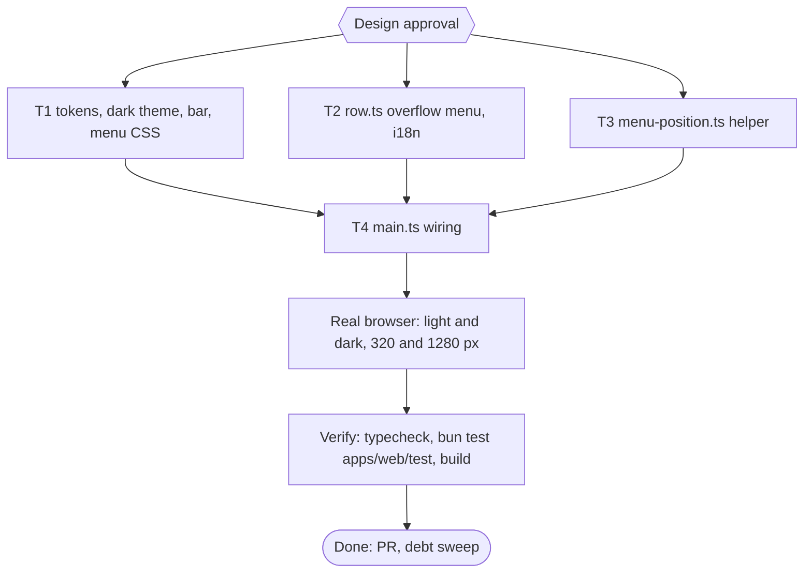

# pubmy web overflow menu and dark theme Implementation Plan

> For agentic workers: REQUIRED EXECUTION METHOD: delegated task execution. Steps use checkbox syntax.

**Goal:** Shorten the queue rows with an overflow menu for the secondary actions, add a dark theme, and fix the empty-looking indeterminate progress bar, then prove all of it in a real browser in both themes.

**Architecture:** T1 owns `index.html`: every colour moves behind a token, a dark token block under `prefers-color-scheme: dark`, the indeterminate bar style, and the CSS for the menu classes T2 emits. T2 changes `row.ts` (and the one new string in `i18n.ts`): a ready row keeps Download and Preview visible and puts Extend and Remove in a native popover opened by a "More actions" button. T3 adds a pure placement function (no dependency on the others). T4 wires the popover's position and its close-on-scroll in `main.ts`. Verification in a real browser runs after T4.

**Tech Stack:** Bun 1.4.4 (`bun:test`, linkedom), TypeScript, native Popover API, CSS custom properties. No new dependency.

**Active Project Profile:** repo `/home/belajarcarabelajar/Proyek/pubmy`, `main` at the merge of PR #17 (`eecf5d3`). Bun monorepo; web app `apps/web`. Verified from files read: `apps/web/index.html`, `src/row.ts`, `src/main.ts`, `src/i18n.ts`, `test/{theme,theme-tints,row,row-progress,wiring}.test.ts`, `public/_headers`. Commands: `bun run typecheck`, `bun test <file>` through `colab-test -C <worktree> -- <cmd>` (A47), build `bun build.ts <dir>`; real-browser harness: Chromium 156 with puppeteer-core, scratch only.

**Protected Boundaries:** `packages/core`, `skills/pubmy/scripts/*` (generated), `apps/web/vendor/foliate`, deploy.

**Spec:** none (Bounded path); decisions recorded below.

**Scope:** (1) dark theme via tokens and `prefers-color-scheme`, `color-scheme: light dark`; (2) overflow menu for Extend and Remove on ready rows; (3) a visible indeterminate state for the progress bar; (4) real-browser proof in light and dark.

**Non-Goals:** a manual theme toggle, new countdown wording, refusals inside rows, a Send to Kindle hint, a meta description change, any change to conversion or retention.

**Visual Map:**

**Reasoning Lenses:** intent (owner wants the overflow menu first, verified in both themes), user-centered and accessibility (focus, Esc, touch targets, contrast), systems (re-render closes the menu), test-first, verification.

**Acceptance Criteria:**
- [ ] AC-1: a dark token block exists under `@media (prefers-color-scheme: dark)`, `color-scheme: light dark` is set, and every text and background pair, including the badge tints, is at least 4.5:1 in both themes. (evidence: `bun test apps/web/test/theme-dark.test.ts` exit 0)
- [ ] AC-2: badge tints, chips, bar track, drop-over, disabled and button colours come from tokens (no literal hex outside `:root` and the dark block, except the reader dialog). (evidence: `bun test apps/web/test/theme-dark.test.ts`, `theme-tints.test.ts` exit 0)
- [ ] AC-3: an indeterminate `progress.bar` has an animated style that is off under `prefers-reduced-motion`. (evidence: `bun test apps/web/test/theme-dark.test.ts` exit 0)
- [ ] AC-4: a ready, unexpired row shows Download and Preview, a `.more` button named "More actions <file>", and Extend and Remove inside a `.menu` popover; a row with fewer than two menu items shows Remove inline. (evidence: `bun test apps/web/test/row-menu.test.ts` exit 0)
- [ ] AC-5: every control keeps its file-named `aria-label` and `data-action`; when the focused control is inside a closed menu, `renderRow` returns the `.more` button, never a hidden control. (evidence: `bun test apps/web/test/row.test.ts apps/web/test/row-menu.test.ts` exit 0)
- [ ] AC-6: `placeMenu` right-aligns the menu to its trigger, flips above when there is no room below, and never leaves the viewport. (evidence: `bun test apps/web/test/menu-position.test.ts` exit 0)
- [ ] AC-8: `main.ts` positions the popover on toggle and closes open menus on scroll and resize; the ids it reads exist. (evidence: `bun test apps/web/test/menu-wiring.test.ts apps/web/test/wiring.test.ts` exit 0, `bun run typecheck` exit 0)
- [ ] AC-7: in real Chromium at 320 and 1280 px, in light and dark: the menu opens by keyboard; Esc closes it and returns focus to the trigger; an outside click closes it; Extend resets the countdown and closes the menu; Remove deletes the row; the menu stays inside the viewport on the first painted frame and does not drift when the page scrolls (it closes instead); no console or CSP error; and every visible text node except disabled controls (`aria-disabled` and `:disabled`, which WCAG exempts) has at least 4.5:1 contrast against its effective background. (evidence: harness report with exit codes, screenshots read)

**Traceability:**

| AC | Task | Check | Evidence |
|---|---|---|---|
| AC-1 | T1 | `bun test apps/web/test/theme-dark.test.ts` | exit 0 |
| AC-2 | T1 | `bun test apps/web/test/theme-dark.test.ts apps/web/test/theme-tints.test.ts` | exit 0 |
| AC-3 | T1 | `bun test apps/web/test/theme-dark.test.ts` | exit 0 |
| AC-4 | T2 | `bun test apps/web/test/row-menu.test.ts` | exit 0 |
| AC-5 | T2 | `bun test apps/web/test/row.test.ts apps/web/test/row-menu.test.ts` | exit 0 |
| AC-6 | T3 | `bun test apps/web/test/menu-position.test.ts` | exit 0 |
| AC-7 | T4 | Chromium harness in both themes, run after T4 | report with exit codes, screenshots |
| AC-8 | T4 | `bun test apps/web/test/menu-wiring.test.ts apps/web/test/wiring.test.ts`, `bun run typecheck` | exit 0 |

**Assumptions & Open Questions:**
- Owner message 2026-11-09: "start with the overflow menu, then verify it renders and works in both light and dark themes". Dark theme is therefore in scope; it follows the OS setting only (no toggle).
- Assumption (my judgment): the menu holds Extend and Remove; Download and Preview stay visible; the countdown text stays visible.
- Assumption (my judgment): a native popover (`popover` and `popovertarget`) opened by a button, disclosure semantics (Tab moves into the menu, Esc closes), not an ARIA `menu` role, so no arrow-key code is needed.
- Measured in the real browser on 2026-11-09 (light theme): a ready row at 320 px wraps its actions onto three lines, about 370 px per row; a converting row with progress 0 shows an empty grey bar.
- Re-render (expiry, language change) closes an open menu; focus goes to the `.more` button.
- Extend does not re-render the row (`updateClock` handles the tick), so the Extend handler in `row.ts` closes its menu itself with `hidePopover()` before calling the action; Remove does the same. `hidePopover()` returns focus to the trigger when focus was inside the menu.
- Native popover behaviour, stated so the tests do not assert more: Esc with focus inside the menu closes it and returns focus to the trigger; an outside click light-dismisses it and focus goes where the user clicked.
- Contrast sweep excludes disabled controls, which WCAG exempts; the pair the reviewer measured at 4.49:1 (`--muted` on the disabled grey) is one of them, so it is documented, not changed.

**Dependencies & Impact:** `row.test.ts` focus-restoration case changes on purpose (Remove is inside the menu). `theme.test.ts`, `theme-tints.test.ts` and `readme`-style text checks must stay green.

**Risks & Rollback:** visual and interaction change only; rollback = revert the PR. Risks: popover unsupported in an old browser (the content then renders inline and still works); a hidden control receiving focus (guarded by the `renderRow` return value and a test).

**Security & Compatibility:** no new network use; popover positioning uses CSSOM (`element.style`), which a strict `style-src` still allows; no inline `style=` attributes in markup.

**Operations & Rollout:** PR, owner merge; deploy only on request.

**CI/Review Gate:** parent diff audit and an independent reviewer before the PR.

**Documentation:** none expected; `README.md` line about the website stays accurate (checked at the end with `rg -n 'Website' README.md`).

**Definition of Done:** AC-1..AC-8 checked with evidence, typecheck exit 0, `bun test apps/web/test` exit 0, build exit 0, browser report in both themes, PR opened, debt sweep run.

**Plan Status & Version:** Draft, v1.

**Reproducibility:** Bun 1.4.4; Chromium 156.0.8078.79 headless via puppeteer-core 24 from the Snipset checkout; page served with the CSP from `_headers`.

**Test Reliability:** DOM tests use linkedom (no `activeElement`, so focus is asserted through recorded stubs, as in `batch-bar.test.ts`); colour tests read the shipped CSS.

**Privacy & Data Governance:** none; the page uploads nothing.

**Dependencies & Supply Chain:** no new package.

**UX States:** converting (bar, indeterminate and determinate), ready (menu closed, menu open), expired (inline Remove), failed, waiting; light and dark; 320 and 1280 px; keyboard and pointer.

**Persistent State & Artifact Storage:** none.

**Entity & Sourcing Verification:** WCAG 2.2 contrast thresholds computed in tests; Popover API behaviour verified in the real browser run, not from documentation.

**Verification:** `bun run typecheck`; `bun test apps/web/test`; `bun build.ts <dir>`; the browser harness in both themes.

## Global Constraints

- No em dash in new copy or code comments.
- Git is parent-only; subagents edit files and run tests only.
- Commit messages conventional, no attribution lines.
- A new test file starts every task's `skip_if` and RED step (M15).

## Session checklist

- [ ] Plan validated and Design approved
- [ ] Worktree claimed via `pr-registry claim --worktree` from `origin/main`
- [ ] T1 tokens, dark theme, bar, menu CSS: RED then GREEN
- [ ] T2 row overflow menu: RED then GREEN
- [ ] T3 placement helper: RED then GREEN
- [ ] T4 main.ts wiring: RED then GREEN
- [ ] Real-browser check in light and dark (320 and 1280 px)
- [ ] Parent diff audit and independent review
- [ ] PR opened
- [ ] Debt sweep

## Task T1: tokens, dark theme, indeterminate bar, menu CSS

**Files:** Create `apps/web/test/theme-dark.test.ts`; Modify `apps/web/index.html`; keep `theme.test.ts`, `theme-tints.test.ts`, `build-output.test.ts` green (adjust only if a token rename breaks one).
**Interfaces (the contract T2 and T3 rely on):**
- Tokens on `:root`: existing `--accent`, `--bg`, `--surface`, `--text`, `--muted`, `--border`, `--ok`, `--err`; new `--accent-ink` (accent as text, border and icon colour on a surface), `--tint-accent`, `--tint-ok`, `--tint-err`, `--tint-neutral`, `--track`, `--over-bg`, `--disabled-bg`. `--accent` stays the fill of filled buttons (white text).
- A dark block `@media (prefers-color-scheme: dark){:root{...}}` overriding every colour token. Pinned for the existing tests, which take the first `:root` rule: exactly one light `:root` rule comes first in the style block and holds all light tokens plus `color-scheme:light dark`; dark values appear only inside the media block, never in a second plain `:root` rule.
- Classes T2 emits that T1 styles: `.more` (the trigger, a ghost button with an ellipsis glyph), `.menu` (the popover: surface background, border, shadow, column of ghost buttons, `position:fixed; margin:0; inset:auto`), `.menu button` (44 px targets).
- `progress.bar:not([value])` shows an animated stripe, disabled under `@media (prefers-reduced-motion: reduce)`.
**Behavior & Acceptance:** AC-1 to AC-3.
**Edge Cases:** the reader dialog keeps its own dark colours; `.btn[aria-disabled]` and `button:disabled` stay readable in dark; `.drop.over` and chips use tokens.
**Deliberate Shortcuts:** None.
**Test Data & Determinism:** `theme-dark.test.ts` reads `index.html`, resolves tokens for light and for dark, and asserts the pairs and the token-only rule.

## Task T2: row overflow menu

**Files:** Create `apps/web/test/row-menu.test.ts`; Modify `apps/web/src/row.ts`, `apps/web/src/i18n.ts`, `apps/web/test/row.test.ts` (the focus-contract case).
**Interfaces:** i18n key `more-actions` (id "Aksi lainnya", en "More actions"). For a ready, unexpired row: `.row-actions` holds Download (`.btn`), Preview, the clock, and `<button class="ghost more" data-action="more" popovertarget="menu-<n>" aria-label="More actions <file>">` plus `
" popover>` holding Extend and Remove (same `data-action`, `ghost`, file-named aria-labels). `<n>` is unique per render pass of the page (a module counter). A row with fewer than two menu items (waiting, converting, failed, expired) shows Remove inline as today. `renderRow` returns the `.more` button when the focused action was inside the menu and its control is gone or hidden.
**Behavior & Acceptance:** AC-4, AC-5.
**Edge Cases:** `updateClock` still finds `.clock`; Extend and Remove clicks call the same actions after closing their menu (`menu.hidePopover()`, guarded by `typeof === "function"` for browsers without the Popover API); the test stubs `hidePopover` on the menu element and asserts it ran before the action.
**Deliberate Shortcuts:** None.
**Test Data & Determinism:** linkedom, as in `row.test.ts`; `popover` and `popovertarget` are plain attributes.

## Task T3: placement helper

**Files:** Create `apps/web/src/menu-position.ts`, `apps/web/test/menu-position.test.ts`.
**Interfaces:** `placeMenu(trigger: Rect, menu: { width: number; height: number }, viewport: { width: number; height: number }, gap = 4): { left: number; top: number }` with `Rect = { left: number; top: number; right: number; bottom: number }`. The menu's right edge aligns to the trigger's right edge and sits below the trigger; when it would pass the viewport bottom and there is room above, it flips above; then it is clamped inside the viewport with a 4 px margin.
**Behavior & Acceptance:** AC-6.
**Edge Cases:** a 320 px viewport (menu wider than the space left of the trigger is clamped to 4 px from the left edge); a trigger near the bottom flips the menu above; a menu taller than the viewport sticks to the top margin.
**Deliberate Shortcuts:** None.
**Test Data & Determinism:** literal rectangles and viewports with literal expected positions.

## Task T4: wire placement and close-on-scroll

**Files:** Create `apps/web/test/menu-wiring.test.ts`; Modify `apps/web/src/main.ts`, `apps/web/test/wiring.test.ts` (only if a text check moves).
**Interfaces:** `main.ts` listens for `toggle` in the capture phase on `#queue` (the event does not bubble). When `newState === "open"` it measures the trigger (`[popovertarget="<menu id>"]`) and the menu, calls `placeMenu` and sets `menu.style.left` and `menu.style.top`; it also registers a one-shot `scroll` (capture, passive) and `resize` listener on `window` that calls `hidePopover()` on every open menu, because a `position:fixed` menu would drift from its row.
**Behavior & Acceptance:** AC-8. If the real-browser run shows a painted frame at the default position before the placement, T4 is reopened to hide the menu (`visibility:hidden`) until placed.
**Edge Cases:** a menu closed before the scroll fires; two rows opened in turn (the first closes by light dismiss).
**Deliberate Shortcuts:** the DOM glue is proven by `menu-wiring.test.ts` text checks (anchored on the new calls, red when the line is deleted) plus the real-browser run (AC-7), not a unit test.
**Test Data & Determinism:** text of `main.ts` and `index.html`.
