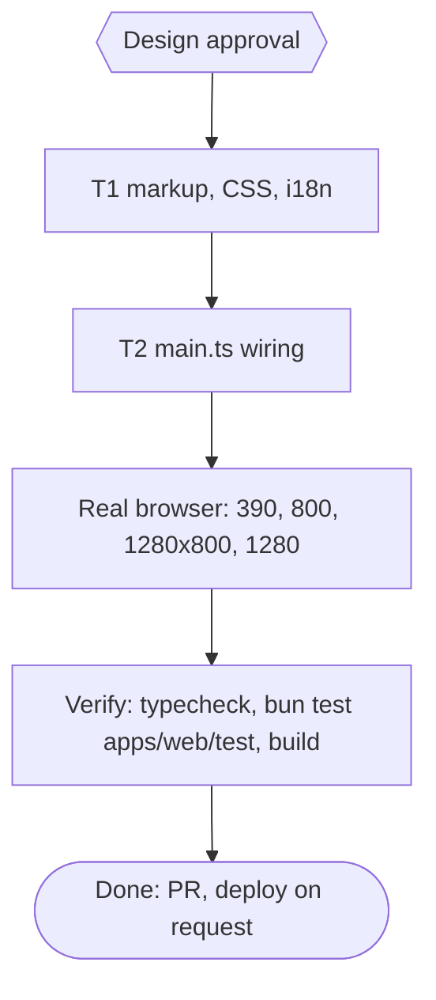

# pubmy web preview: reading on tablet and phone Implementation Plan

> For agentic workers: REQUIRED EXECUTION METHOD: delegated task execution. Steps use checkbox syntax.

**Goal:** Let people read the preview with the full screen: the contents list starts closed and slides over the page on phones and portrait tablets, its button is easy to see, and a Full screen button hides the browser chrome. Prove it in a real touch browser at tablet and phone sizes.

**Architecture:** T1 owns `index.html` and `i18n.ts`: the drawer breakpoint moves from 40rem to 60rem (the header rules stay at 40rem), a tap-away layer over the page while the drawer is open (a `::after` on the stage, no new element), the contents button gets an icon, a hidden `#pv-fullscreen` button with an SVG icon joins the bar, and the key `preview-fullscreen`. T2 owns `main.ts`: `narrow()` follows the same 60rem, the Full screen button drives the Fullscreen API on the dialog, and a click on the stage closes an open drawer. `reader.ts` is unchanged: it already opens the list only when `narrow()` is false and closes it after a pick.

**Tech Stack:** Bun 1.4.4 (`bun:test`, linkedom), TypeScript, Fullscreen API, CSS media queries. No new dependency.

**Active Project Profile:** repo `/home/belajarcarabelajar/Proyek/pubmy`, `main` at `021b213` (PR #18 merged and deployed). Web app `apps/web`. Verified from files read: `index.html` lines 76 to 91 and 141 to 156, `src/main.ts` lines 98 to 135, `src/reader.ts` lines 1 to 135, `test/i18n.test.ts` (the only test that names a preview key). Commands: `bun run typecheck`, `bun test <file>` through `colab-test -C <worktree> -- <cmd>` (A47).

**Protected Boundaries:** `packages/core`, `skills/pubmy/scripts/*`, `apps/web/vendor/foliate`, `src/reader.ts`.

**Spec:** none (Bounded path). Design approved by the owner 2026-11-09 ("Setuju").

**Scope:** (1) drawer below 60rem, closed by default there; (2) a clearer contents button; (3) a Full screen button; (4) tap-away closes the drawer; (5) real-browser proof at 390, 800 (portrait tablet), 1280x800 (landscape tablet) and 1280 px.

**Non-Goals:** auto-hiding the title bar, swipe gestures, changing the book's own column width, iPhone fullscreen (the API does not exist there, the button stays hidden), any change to conversion.

**Visual Map:**

**Reasoning Lenses:** intent (owner reports the preview is not tablet or phone friendly), user-centered and accessibility (touch targets, aria-expanded, aria-pressed, focus), systems (a drawer over an iframe), test-first, verification.

**Traceability:**

| AC | Task | Check | Evidence |
|---|---|---|---|
| AC-1 | T1 | `bun test apps/web/test/preview-layout.test.ts` | exit 0 |
| AC-2 | T1 | `bun test apps/web/test/preview-layout.test.ts` | exit 0 |
| AC-3 | T1 | `bun test apps/web/test/preview-layout.test.ts apps/web/test/i18n.test.ts` | exit 0 |
| AC-4 | T2 | `bun test apps/web/test/preview-wiring.test.ts` | exit 0 |
| AC-5 | T2 | `bun test apps/web/test/preview-wiring.test.ts` | exit 0 |
| AC-6 | T1, T2 | `bun test apps/web/test/preview-layout.test.ts apps/web/test/preview-wiring.test.ts` | exit 0 |
| AC-7 | T2 | Chromium touch harness after T2 | report with counts, screenshots |

**Assumptions & Open Questions:**
- Measured 2026-11-09 on the live page in Chromium with touch emulation: at 800 px the contents list opens by default and takes 256 px, leaving a 456 px page; one tap on the button hides it and the page becomes 712 px. At 390 px the list starts closed and opens as a 288 px drawer over a 302 px page. The Fullscreen API exists in that Chromium. So the toggle already worked; the gaps are the default at tablet width, how easy the button is to see, and the missing full screen.
- Owner reading (my judgment): "debar" means the sidebar, here the contents list.
- Fullscreen request goes to the `<dialog>` element (it is in the top layer, so it covers the page); the button is hidden when `dialog.requestFullscreen` is not a function.
- The button's label stays "Layar penuh" / "Full screen" and its state is `aria-pressed`, so a language switch never leaves a stale label.
- Esc in fullscreen exits fullscreen first (the browser keeps that key); the dialog stays open.
- The drawer breakpoint is `max-width:60rem` in both the CSS and `matchMedia`, and a test pins that they match.

**Dependencies & Impact:** `reader.ts` reads `ui.narrow()`; only the value changes. `i18n.test.ts` lists the preview keys and gains the new one.

**Risks & Rollback:** visual and interaction change only; rollback = revert the PR. Risks: a landscape phone (about 850 px wide) now gets the drawer instead of the side list; a fullscreen request rejected by the browser (caught, nothing happens).

**Security & Compatibility:** no new network use; no inline script or style attribute; the CSP is unchanged.

**Operations & Rollout:** PR, merge and deploy only on the owner's request.

**CI/Review Gate:** parent diff audit and an independent reviewer before the PR.

**Documentation:** none expected.

**Definition of Done:** AC-1..AC-7 checked with evidence, typecheck exit 0, `bun test apps/web/test` exit 0, build exit 0, browser report at the four sizes, PR opened, debt sweep run.

**Plan Status & Version:** Draft, v1.

**Reproducibility:** Bun 1.4.4; Chromium 156 headless via puppeteer-core from the Snipset checkout, touch and mobile emulation; page served with the CSP from `_headers`.

**Test Reliability:** DOM and text tests only in the suite; browser behaviour is proven by the harness, not by unit tests.

**Privacy & Data Governance:** none.

**Dependencies & Supply Chain:** no new package.

**UX States:** list closed, list open as drawer, list open beside the page; fullscreen off and on; unsupported fullscreen (button hidden); phone, portrait tablet, landscape tablet, desktop; touch and keyboard.

**Persistent State & Artifact Storage:** none.

**Entity & Sourcing Verification:** sizes and behaviour measured in the real browser, not assumed.

**Verification:** `bun run typecheck`; `bun test apps/web/test`; `bun build.ts <dir>`; the touch harness at four sizes.

## Acceptance Criteria

- [x] AC-1: the contents list is an overlay drawer at `max-width:60rem` (the `header` rules stay at 40rem), and while it is open a tap-away layer covers the page. (evidence: `bun test apps/web/test/preview-layout.test.ts` exit 0)
- [x] AC-2: the contents button shows an icon and its text, and every button in the preview bar is at least 44 px square. (evidence: `bun test apps/web/test/preview-layout.test.ts` exit 0)
- [x] AC-3: `#pv-fullscreen` exists, is hidden in the markup, names itself through `preview-fullscreen` in both languages, and is a toggle (`aria-pressed`). (evidence: `bun test apps/web/test/preview-layout.test.ts apps/web/test/i18n.test.ts` exit 0)
- [x] AC-4: `main.ts` decides `narrow()` with the same 60rem as the CSS, so the list starts closed on phones and portrait tablets. (evidence: `bun test apps/web/test/preview-wiring.test.ts` exit 0)
- [x] AC-5: the Full screen button is shown only where the Fullscreen API exists, toggles it on the dialog, keeps `aria-pressed` in step with `fullscreenchange`, and fullscreen ends when the dialog closes. (evidence: `bun test apps/web/test/preview-wiring.test.ts` exit 0)
- [x] AC-6: a click on the stage closes the open drawer and does nothing otherwise. (evidence: `bun test apps/web/test/preview-layout.test.ts apps/web/test/preview-wiring.test.ts` exit 0)
- [x] AC-7: in real touch Chromium at 390x844, 800x1280, 1280x800 and 1280x900: the list starts closed below 60rem and open above it; the button opens and closes it; tapping the page closes the drawer; Full screen enters and leaves fullscreen and the page grows; no horizontal overflow; bar buttons at least 44 px; no console or CSP error. (evidence: harness report, screenshots read)

## Global Constraints

- No em dash in new copy or code comments.
- Git is parent-only; subagents edit files and run tests only.
- Commit messages conventional, no attribution lines.
- A new test file starts every task's `skip_if` and RED step (M15).

## Session checklist

- [x] Plan validated and Design approved
- [x] Worktree claimed via `pr-registry claim --worktree` from `origin/main`
- [x] T1 markup, CSS, i18n: RED then GREEN
- [x] T2 main.ts wiring: RED then GREEN
- [x] Real-browser check at four sizes
- [x] Parent diff audit and independent review
- [ ] PR opened
- [ ] Debt sweep

## Task T1: markup, CSS, i18n

**Files:** Create `apps/web/test/preview-layout.test.ts`; Modify `apps/web/index.html`, `apps/web/src/i18n.ts`, `apps/web/test/i18n.test.ts` (add `preview-fullscreen` to `PREVIEW_KEYS`).
**Interfaces (the contract T2 relies on):**
- `#pv-toc-toggle` stays a `button` with `aria-controls="pv-toc"` and `aria-expanded`; its content becomes `&#x2630;` (the text span is empty in the source; `build.ts` fills empty `data-i18n` elements and `applyLang` writes `textContent`, so the icon must be a sibling).
- New `<button type="button" id="pv-fullscreen" aria-pressed="false" data-i18n-label="preview-fullscreen" hidden>` with an inline `<svg aria-hidden="true">` icon (four corner brackets), placed in `.pv-bar` between `#pv-title` and `#pv-close`. `button[hidden]{display:none}` already exists in the style block.
- i18n key `preview-fullscreen`: `"Layar penuh"` (id), `"Full screen"` (en).
- CSS: `.pv-bar button{min-width:44px;min-height:44px}`; the drawer rules (`.pv-toc{position:absolute;inset:0 auto 0 0;width:min(85%,18rem);z-index:2;background:#17181c}`) move into `@media (max-width:60rem)`; the `header{flex-direction:column-reverse;align-items:stretch}#lang{align-self:flex-end}` rules stay in their own `@media (max-width:40rem)`; inside the 60rem query `.pv-toc:not([hidden])~.pv-stage{position:relative}` and `.pv-toc:not([hidden])~.pv-stage::after{content:"";position:absolute;inset:0;z-index:1;background:#0006}`; a drawer shadow on `.pv-toc`.
- The preview keeps its own hex colours (it is exempt from the token rule, as before).
**Behavior & Acceptance:** AC-1 to AC-3, the CSS half of AC-6.
**Edge Cases:** one light `:root` rule stays first (existing tests); `theme-dark.test.ts` whitelists `.preview` and `.pv*` hex, so new preview hex lives in `.pv*` rules; the page still has exactly one `<style>` block.
**Deliberate Shortcuts:** None.
**Test Data & Determinism:** `preview-layout.test.ts` reads `index.html` as text and `i18n.ts` through `t`.

## Task T2: main.ts wiring

**Files:** Create `apps/web/test/preview-wiring.test.ts`; Modify `apps/web/src/main.ts`.
**Interfaces:**
- `const PREVIEW_NARROW = "(max-width: 60rem)"` used by `narrow: () => matchMedia(PREVIEW_NARROW).matches`.
- `#pv-fullscreen` handling: hidden unless `typeof dialog.requestFullscreen === "function"`; click calls `document.exitFullscreen()` when `document.fullscreenElement` is set, else `dialog.requestFullscreen()` with a `.catch(() => {})`; a `fullscreenchange` listener sets `aria-pressed` to whether `document.fullscreenElement === dialog`; the dialog `close` handler leaves fullscreen if it is on.
- `readerUi.stage.addEventListener("click", ...)`: when `readerUi.narrow()` and `readerUi.toc.hidden === false`, call `readerUi.tocToggle.click()` (the reader's own handler keeps `aria-expanded` right).
**Behavior & Acceptance:** AC-4 to AC-6.
**Edge Cases:** the stage click must not fire while the list is closed or on a wide screen; `fullscreenchange` after the dialog closed; a rejected request.
**Deliberate Shortcuts:** the DOM glue is proven by `preview-wiring.test.ts` text checks (anchored on the new calls) plus the real-browser run (AC-7), not a unit test, as for the overflow menu.
**Test Data & Determinism:** text of `main.ts` and `index.html`.

## Evidence

- Unit gate at `d73826f`: `colab-test -- bun test apps/web/test` exit 0, 268 pass, 0 fail; `bun run typecheck` exit 0; `bun build.ts <scratch>` exit 0; `check-copy-rules.mjs --diff origin/main` exit 0 (run at `441b12c`).
- Real touch Chromium 156 (puppeteer-core, `isMobile` and `hasTouch`, CSP from `dist/_headers`), harness `check.mjs`, report counts (the harness exit code was not captured): 390x844 17 pass, 0 fail; 800x1280 17 pass, 0 fail; 1280x800 14 pass, 0 fail; 1280x900 14 pass, 0 fail. Checked: list closed below 960 px and open above it; the button flips it; the drawer sits over the page and tapping beside it closes it; choosing a chapter closes it; keyboard Tab and Enter; Full screen enters and leaves fullscreen and closing the preview leaves it; bar buttons at least 44 px; no horizontal overflow; no console or CSP error. A separate rotation run (landscape to portrait and back, preview open) kept the state consistent. Screenshots read for the tablet portrait default, the drawer and fullscreen.
- Measured before designing (live page, Chromium touch): at 800 px the list opened by default and left a 456 px page; the toggle already worked. The owner's report was about the default at tablet width, discoverability and the missing full screen, not a missing toggle.
- Defect found only in the browser: `dialog.requestFullscreen()` rejects with `TypeError: Dialog elements are invalid`. The plan, the tests and the first implementation all targeted the dialog, and the `typeof` guard hid nothing because the method exists. Fixed by requesting fullscreen on the `.pv` frame inside the dialog, with a CSS rule for `.pv:fullscreen`; the tests now assert the frame and forbid the dialog.
- Independent review (`staid`, read-only): no blocking defect. F1 (medium) a drawer left open when the preview closed showed, with its dark layer, while the next book loaded: fixed (the close handler resets the list), with a browser check that is red on the pre-fix build (`tocHidden:false, expanded:"true"`) and green after. F3 (low) the pressed Full screen state was invisible: fixed (`.pv-bar button[aria-pressed="true"]` background), with a browser check red before, green after. F4 (low) three wiring tests would stay green after a regression: tightened to exact lines. F2 (low) Esc closes the whole preview, not the drawer, and the covered arrows stay in the tab order: recorded as debt, not fixed.
