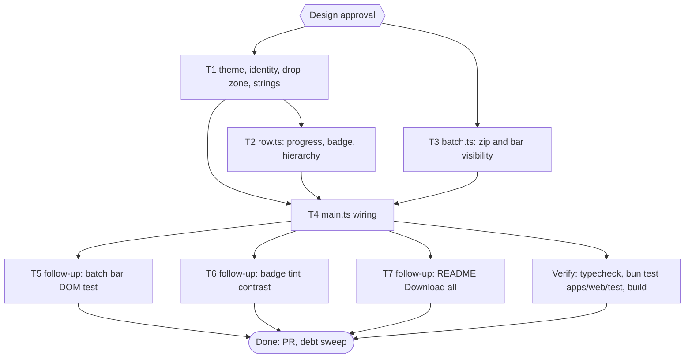

# pubmy web UI polish Implementation Plan

> For agentic workers: REQUIRED EXECUTION METHOD: delegated task execution. Steps use checkbox syntax.

**Goal:** Give the pubmy web page a recognisable look and a clearer upload and queue flow (items 1 to 4 and 6 of the owner-approved review of 2026-11-09), without touching conversion code.

**Architecture:** The page is one HTML file with an authored `<style>` block (shipped as `style.css` by `build.ts`), a small i18n table, a pure row renderer (`row.ts`) and a DOM glue file (`main.ts`). T1 owns `index.html` and `i18n.ts` (theme, identity, drop zone, batch bar markup, every new string). T2 changes only `row.ts`. T3 adds a pure `batch.ts` (zip of ready EPUBs, batch bar visibility). T4 wires them in `main.ts`.

**Tech Stack:** Bun 1.4.4 (`bun:test`, linkedom for DOM tests), TypeScript, fflate 0.8 (already in `apps/web`), no UI framework.

**Active Project Profile:** repo `/home/belajarcarabelajar/Proyek/pubmy`, `main` clean at `02cf578`. Bun monorepo (`packages/core`, `apps/cli`, `apps/web`). Verified from files read: `apps/web/index.html`, `build.ts`, `src/{main,row,i18n,queue}.ts`, `public/_headers`, `test/{row,i18n,build-output}.test.ts`, `assets/icon.svg`. Commands: `bun run typecheck`, `bun test <file>` through `colab-test -C ~/Proyek/pubmy -- <cmd>` (A47), build `bun run --cwd apps/web build`.

**Protected Boundaries:** `packages/core` (conversion), `skills/pubmy/scripts/*` (generated), the live deploy (out of scope, no deploy here), `apps/web/vendor/foliate`.

**Spec:** none (Bounded path); decisions recorded below.

**Scope:** (1) identity: favicon and logo from `assets/icon.svg`, accent colour from the icon, short headline; (2) privacy line as a badge; (3) drop zone with icon, format chips, limits as secondary text; (4) queue rows: real `<progress>` bar, status badges, Download as the only filled button; (6) "Download all" (ZIP) and "Clear all".

**Non-Goals:** dark mode, overflow menu or new countdown wording, refusals shown inside rows, Send to Kindle hint, e2e or browser tests (A42), any change to conversion, queue limits or retention (180 s).

**Visual Map:**

**Reasoning Lenses:** intent (owner wants a better look now, short turns), investigative (CSS, build regex and CSP read), user-centered and accessibility (touch targets, focus, live regions kept), systems (state flows main.ts to row.ts), test-first, verification.

**Acceptance Criteria:**
- [x] AC-1: `index.html` links a favicon (`icon.svg`) and the build ships `icon.svg`; the accent is the icon's teal `#0f5c63`. (evidence: `bun test apps/web/test/build-output.test.ts` exit 0)
- [x] AC-2: every text and background colour pair in the authored CSS tokens is at least 4.5:1 (WCAG AA), and focus outlines at least 3:1. (evidence: `bun test apps/web/test/theme.test.ts` exit 0)
- [x] AC-3: the privacy line is a badge with a lock icon, and the new strings exist in id and en with parity. (evidence: `bun test apps/web/test/i18n.test.ts` exit 0)
- [x] AC-4: the drop zone shows an icon and format chips; the hint strings `drop-hint` and `drop-hint-touch` stay as they are (limits stay in the hint, `id="drop-hint"` stays the text-bearing element); the chip set matches the `accept` attribute (aliases and archive types excluded, listed in the test); the build still fills `data-i18n` elements without erasing the icon (the label sits in its own span). (evidence: `bun test apps/web/test/theme.test.ts apps/web/test/build-output.test.ts` exit 0)
- [x] AC-5: a converting row has a `<progress class="bar">` with its value, each status has a `.badge` with an `aria-hidden` glyph, and Download is the only filled control; every control keeps its file-named `aria-label` and focus restoration. (evidence: `bun test apps/web/test/row-progress.test.ts apps/web/test/row.test.ts` exit 0)
- [x] AC-6: `zipEpubs` resolves to a ZIP of the given EPUBs with unique entry names; `batchView` shows Download all from 2 ready rows and Clear all from 1 row. (evidence: `bun test apps/web/test/batch.test.ts` exit 0)
- [x] AC-7: every element id that `main.ts` reads exists in `index.html`; `main.ts` wires progress, Download all (blob URL revoked after use) and Clear all, with a live-region announcement; typecheck and the whole `apps/web/test` folder pass. (evidence: `bun test apps/web/test/wiring.test.ts` exit 0, `bun run typecheck` exit 0, `bun test apps/web/test` exit 0)
- [x] AC-8: the batch bar's visibility and its focus fallback live in `batch.ts` and are tested on a DOM: Download all hides below 2 ready rows, and hiding a focused button moves focus to the Choose button. (evidence: `bun test apps/web/test/batch-bar.test.ts` exit 0)
- [x] AC-9: the badge tint pairs read from the shipped CSS are at least 4.5:1. (evidence: `bun test apps/web/test/theme-tints.test.ts` exit 0)
- [x] AC-10: `README.md` says the website can download all files as a ZIP. (evidence: `bun test apps/web/test/readme-web.test.ts` exit 0, `bun test apps/cli/test/bundle.test.ts -t readme` exit 0)

**Traceability:**

| AC | Task | Check | Evidence |
|---|---|---|---|
| AC-1 | T1 | `bun test apps/web/test/build-output.test.ts` | exit 0 |
| AC-2 | T1 | `bun test apps/web/test/theme.test.ts` | exit 0 |
| AC-3 | T1 | `bun test apps/web/test/i18n.test.ts` | exit 0 |
| AC-4 | T1 | `bun test apps/web/test/theme.test.ts apps/web/test/build-output.test.ts` | exit 0 |
| AC-5 | T2 | `bun test apps/web/test/row-progress.test.ts apps/web/test/row.test.ts` | exit 0 |
| AC-6 | T3 | `bun test apps/web/test/batch.test.ts` | exit 0 |
| AC-7 | T4 | `bun test apps/web/test/wiring.test.ts`, `bun run typecheck`, `bun test apps/web/test` | exit 0 |
| AC-8 | T5 | `bun test apps/web/test/batch-bar.test.ts` | exit 0 |
| AC-9 | T6 | `bun test apps/web/test/theme-tints.test.ts` | exit 0 |
| AC-10 | T7 | `bun test apps/web/test/readme-web.test.ts` | exit 0 |

**Assumptions & Open Questions:**
- Owner approved items 1 to 4 and 6 ("agreed, do it now", 2026-11-09). Items 5, 7, 8, 9, 10 are not in scope.
- Assumption (my judgment): the accent is the icon's teal, so the page matches the logo; a different brand colour is a one-line token change.
- Assumption (my judgment): "Download all" is a stored (level 0) ZIP named `pubmy-epub.zip`, because EPUBs are already compressed. It uses fflate's async `zip` (off the main thread; `worker-src 'self' blob:` allows its worker), not `zipSync`.
- Measured before design (colab-test ct2, exit 0): `bun test` of a missing test file exits 1, so the four new test files make every `skip_if` fail on `main`.
- Correction to the review: failed conversions already show their reason inside the row (`statusText` in `main.ts`); only queue refusals (limit, size) use the separate red list. `document.title` is already localised; only the meta description is static.
- `applyLang` sets `textContent` on `[data-i18n]` elements, so an icon must be a sibling of the labelled span, never a child.

**Dependencies & Impact:** `row.test.ts` asserts aria-labels and the clock text, and `i18n.test.ts` asserts required keys; both stay green. `build.ts` pulls only `<style>` and empty `data-i18n` elements from `index.html`.

**Risks & Rollback:** visual only; rollback = revert the PR. Risk: the build regex mishandles the new markup (caught by `build-output.test.ts`); focus loss when rows re-render (caught by `row.test.ts`). Download all holds the EPUBs plus the ZIP in memory at once (up to about 10 x 50 MB input, EPUBs are usually smaller); the async zip keeps the page responsive, and the 180 s retention window already bounds how long the bytes live.

**Security & Compatibility:** no new network use; the favicon and inline SVG are covered by `img-src 'self' data:`; no inline `style=""` attributes (a `<progress>` element needs none).

**Operations & Rollout:** PR, CI, merge by owner, deploy only on explicit request.

**CI/Review Gate:** parent diff audit and an independent reviewer before the PR.

**Documentation:** none (README has no UI description to update; checked by `rg -n -i 'drop zone|queue' README.md` at T4).

**Definition of Done:** AC-1..AC-7 checked with evidence, typecheck exit 0, `bun test apps/web/test` exit 0, build exit 0, PR opened, debt sweep run.

**Plan Status & Version:** Draft, v1.

**Reproducibility:** Bun 1.4.4; tests run through `colab-test` (A47), local fallback targeted (A12).

**Test Reliability:** DOM tests use linkedom, no browser; colour tokens are parsed from `index.html`, so they cannot drift from the shipped CSS.

**Privacy & Data Governance:** no user data; the page still uploads nothing.

**Dependencies & Supply Chain:** no new package.

**UX States:** empty (drop zone only), waiting, converting (progress), ready, failed, expired (Deleted), refused, batch bar hidden below its thresholds.

**Persistent State & Artifact Storage:** none; ZIP blob URL is revoked right after the click.

**Entity & Sourcing Verification:** WCAG 2.2 AA contrast ratios (4.5:1 text, 3:1 non-text) computed in the test from the CSS values; icon colour read from `assets/icon.svg` (`#0f5c63`).

**Verification:** `bun run typecheck`; `bun test apps/web/test`; `bun run --cwd apps/web build`.

## Global Constraints

- No em dash in new copy or code comments.
- Git is parent-only; subagents edit files and run tests only.
- No e2e or browser runs unless the owner asks (A42).
- Commit messages conventional, no attribution lines.

## Session checklist

- [x] Plan validated (`ultra-plan-runner.mjs` exit 0, Validation: OK) and Design approved (owner, 2026-11-09)
- [x] Worktree claimed: `/mnt/belajarcarabelajar/pubmy-wt/pubmy-web-ui-polish`, branch `2026-11-09-pubmy-web-ui-polish/pubmy-web-ui-polish`
- [x] T1: RED `bun test apps/web/test/theme.test.ts` exit 1 (16 fail); GREEN four test files exit 0 (56 pass, 1 skip), typecheck exit 0 (commit d28f1f1)
- [x] T3: RED exit 1 (module missing); GREEN `bun test apps/web/test/batch.test.ts` exit 0 (7 pass); three mutations each failed one test (commit fd175f8)
- [x] T2: RED exit 1 (10 fail, 3 pass); GREEN row-progress + row tests exit 0 (20 pass), typecheck exit 0 (commit 497ef52)
- [x] T4: RED `bun test apps/web/test/wiring.test.ts` exit 1 (4 fail, 1 pass), `theme.test.ts` hidden-button case exit 1 (1 fail); GREEN `bun run typecheck` exit 0, `bun test apps/web/test` exit 0 (142 pass, 1 skip, 0 fail); added `button[hidden]{display:none}` because `button{display:inline-flex}` overrode `hidden`
- [x] Parent diff audit and independent review: reviewer `staid` verdict `correct` (no P0/P1; `colab-test -- bun test apps/web/test` exit 0, 142 pass); P2 R1 (expired row painted green), P2 R2 (revoke test vacuous), P3 R3 (focus loss), P3 R4 (progress read twice) fixed test-first: RED exit 1 (3 fail; R2 proven by deleting the revoke line in a scratch copy), GREEN `bun run typecheck` exit 0, `bun test apps/web/test` exit 0 (143 pass, 1 skip, 0 fail); `check-copy-rules.mjs --diff origin/main` exit 0; `bun run --cwd apps/web build` exit 0
- [x] PR opened: PR #17 https://github.com/belajarcarabelajar/pubmy/pull/17 (registry state open)
- [x] Debt sweep follow-ups: T5 RED `bun test apps/web/test/batch-bar.test.ts` exit 1 (export missing), GREEN `bun test apps/web/test` exit 0 (165 pass, 1 skip, 0 fail), `bun run typecheck` exit 0, focus-removal mutation fails 2 tests (commit see git log); T6 `bun test apps/web/test/theme-tints.test.ts` exit 0 (7 pass), two scratch mutations exit 1 (commit ef437a7); T7 RED `bun test apps/web/test/readme-web.test.ts` exit 1 (2 fail), GREEN exit 0 (5 pass), `bundle.test.ts -t readme` exit 0, copy-rules exit 0 (commit 7f0a10e)
- [x] Debt sweep closed: 3 follow-ups selected and closed (T5 to T7), 5 deferred to the backlog below; learning ledger `docs/code-plan/2026-11-09-pubmy-web-ui-polish-learning-ledger.md`, MEMORY.md M14 and M15

## Follow-up tasks (debt sweep, owner selected 2026-11-09)

- **T5** batch bar DOM test: move the bar's visibility and focus fallback into `batch.ts` as `applyBatchBar`, test it with linkedom in `batch-bar.test.ts`.
- **T6** badge tint contrast: `theme-tints.test.ts` reads `li.<status> .badge` rules from the shipped CSS.
- **T7** `README.md:5` mentions Download all (ZIP); `readme-web.test.ts` asserts it.

## Task T1: theme, identity, drop zone, strings

**Files:** Create `apps/web/public/icon.svg` (copy of `assets/icon.svg`), `apps/web/test/theme.test.ts`; Modify `apps/web/index.html`, `apps/web/src/i18n.ts`, `apps/web/test/i18n.test.ts`, `apps/web/test/build-output.test.ts`.
**Interfaces (the contract T2 and T4 rely on, so T1 owns all CSS and markup):**
- CSS custom properties on `:root`: `--accent` (`#0f5c63`), `--bg`, `--surface`, `--text`, `--muted`, `--border`, `--ok`, `--err`.
- Class names T1 styles and T2 emits: `li .badge` (coloured by the row class `li.waiting|converting|ready|failed|deleted`), `.badge-icon` (the glyph, `aria-hidden`), `progress.bar`, `.row-actions button.ghost` (lighter weight than `.btn`), `.chip`, `.chips`, `.batch` (the batch bar).
- Markup ids T4 reads: `batch` (bar, `hidden` by default), `download-all`, `clear-all`.
- New i18n keys (id and en): `download-all`, `clear-all`. The `privacy` text stays. The ZIP file name `pubmy-epub.zip` is fixed in code, not a string.
- `drop-hint` and `drop-hint-touch` keep their current text; `id="drop-hint"` stays the text-bearing element (`aria-labelledby` and `main.ts` depend on it).
**Behavior & Acceptance:** AC-1 to AC-4. Header shows the logo beside the title; the privacy line is a badge (lock SVG, label in its own `data-i18n` span); the drop zone has an upload icon and format chips (static text).
**Edge Cases:** `build.ts` fills only empty `<tag data-i18n></tag>`, and `applyLang` sets `textContent`, so every labelled element is empty in source and icons are siblings. No inline `style=""`.
**Deliberate Shortcuts:** None.
**Test Data & Determinism:** `theme.test.ts` reads `index.html`, extracts the custom properties, computes relative luminance and asserts text pairs at least 4.5:1 and the focus outline at least 3:1; it also asserts the chip set equals the `accept` extensions, excluding the aliases `markdown`, `htm`, `azw` and the types `zip`, `rar`, `epub` (listed in the test).

## Task T2: row progress, badge, hierarchy

**Files:** Create `apps/web/test/row-progress.test.ts`; Modify `apps/web/src/row.ts`; existing `apps/web/test/row.test.ts` must stay green unchanged.
**Interfaces:** `RowView` gains `progress?: number` (0 to 1). Output uses only the class names T1 pinned: `<progress class="bar">` while `status === "converting"` (with `value` and `max="1"` when progress > 0, indeterminate otherwise); a `` holding a `` glyph (waiting "o", converting "~", ready "+", failed "x", deleted "-") plus the status text; Download stays `.btn`, the other actions stay `ghost`. No CSS is edited here.
**Behavior & Acceptance:** AC-5. Existing aria-labels, `data-action` names, clock text and focus-restoration contract unchanged.
**Edge Cases:** progress 0 renders an indeterminate bar; expired rows keep no clock and no extend.
**Deliberate Shortcuts:** None.
**Test Data & Determinism:** linkedom document, as in `row.test.ts`.

## Task T3: batch helpers

**Files:** Create `apps/web/src/batch.ts`, `apps/web/test/batch.test.ts`.
**Interfaces:** `zipEpubs(entries: { name: string; epub: Uint8Array }[]): Promise<Uint8Array>` (fflate async `zip`, level 0, duplicate names get ` (2)` before the extension); `batchView(rows: number, ready: number): { downloadAll: boolean; clearAll: boolean }`.
**Behavior & Acceptance:** AC-6.
**Edge Cases:** empty list resolves to a valid empty ZIP; two files named `a.epub` become `a.epub` and `a (2).epub`.
**Deliberate Shortcuts:** None.
**Test Data & Determinism:** `unzipSync` round trip on small byte arrays.

## Task T4: wire progress and batch actions

**Files:** Create `apps/web/test/wiring.test.ts`; Modify `apps/web/src/main.ts`.
**Interfaces:** `render` passes `progress` to the view; `refreshBatch()` shows or hides `#batch` from `batchView`; Download all builds the ZIP (`pubmy-epub.zip`) from rows whose `ready` is set and not expired, clicks a temporary link and revokes the URL; Clear all calls `removeRow` for every row.
**Behavior & Acceptance:** AC-7. Each batch action announces through `announce`; focus returns to the Choose button after Clear all.
**Edge Cases:** a row expiring while the ZIP is built is skipped; the bar refreshes on every `onChange`, expiry and removal.
**Deliberate Shortcuts:** the DOM glue in `main.ts` is not exercised in a browser (A42); `wiring.test.ts` is the RED step and asserts that every `$("id")` and `getElementById` id in `main.ts` exists in `index.html`, and that `main.ts` references `pubmy-epub.zip`.
**Test Data & Determinism:** text of `main.ts` and `index.html`, no build.

## Task T5: batch bar DOM test (follow-up)

**Files:** Create `apps/web/test/batch-bar.test.ts`; Modify `apps/web/src/batch.ts`, `apps/web/src/main.ts`, `apps/web/test/wiring.test.ts` (only if a text check moves).
**Interfaces:** `applyBatchBar(doc: Document, bar: { batch: HTMLElement; downloadAll: HTMLButtonElement; clearAll: HTMLButtonElement; choose: HTMLButtonElement }, rows: number, ready: number): void` sets the three `hidden` flags from `batchView` and, when a batch button that had focus becomes hidden, focuses `choose`. `main.ts` `refreshBatch` calls it.
**Behavior & Acceptance:** AC-8. Same behaviour as today, now tested on a linkedom DOM.
**Edge Cases:** focus on a row button is left alone; focus on Clear all stays when it stays visible.
**Deliberate Shortcuts:** None.
**Test Data & Determinism:** linkedom document with the three buttons and `choose`; `focus()` and `activeElement` support in linkedom is checked first, and if absent the test injects the active element through a small `getActive` parameter (documented in the test).

## Task T6: badge tint contrast (follow-up)

**Files:** Create `apps/web/test/theme-tints.test.ts`.
**Behavior & Acceptance:** AC-9. Reads every `li.<status> .badge{background:X;color:Y}` and the base `li .badge` rule from the `<style>` of `index.html` and asserts contrast of Y on X is at least 4.5:1 (luminance computed in the test, threshold a literal).
**Edge Cases:** colours given as `var(--x)` are resolved from `:root`.
**Deliberate Shortcuts:** None. A test over already compliant CSS passes at once, so its RED is proven by lightening one tint in a scratch copy of `index.html` and showing the test fails (diff proves the mutation landed).
**Test Data & Determinism:** the shipped CSS only.

## Task T7: README Download all (follow-up)

**Files:** Create `apps/web/test/readme-web.test.ts`; Modify `README.md`.
**Behavior & Acceptance:** AC-10. The Website line says that files can also be downloaded together as a ZIP; no em dash. `bundle.test.ts` README assertions stay green.
**Edge Cases:** none.
**Deliberate Shortcuts:** None.
**Test Data & Determinism:** text of `README.md`.

## Follow-up backlog (debt sweep)

- Dark mode: `defer: next UI pass, when the owner asks for it` (non-goal of this plan).
- Overflow menu for the secondary row actions and clearer countdown wording: `defer: next UI pass, when the owner asks for it`.
- Refusals (queue limit, size) shown inside rows instead of the red list: `defer: next UI pass, when the owner asks for it`.
- Static Indonesian `<meta name="description">`: `defer: low value for crawlers, when localised metadata is wanted`.
- Send to Kindle hint after a download: `defer: next UI pass, when the owner asks for it`.
- Real-browser check (owner asked for it 2026-11-09, done in Chromium 156.0.8078.79 headless, 320x700 and 1280x800 at 2x, page served with the CSP from `_headers`, light theme): 18 of 18 checks pass. 320 px has no horizontal overflow even with a 100-character file name and every button is at least 44 px; the favicon link answers 200 `image/svg+xml` and the header logo decodes; one Tab pass reaches 16 stops (header, drop zone, batch bar, 4 controls in each of 3 rows), each with a 3 px outline inside the viewport; Enter on Download all saves `pubmy-epub.zip` with 3 EPUBs and keeps focus on the button; hiding the focused Download all moves focus to Choose files; Enter on Clear all empties the queue and focuses Choose files; an expired row shows the neutral Deleted badge; no console or CSP errors. Not covered: the favicon drawn in a browser tab strip (headless has none), Firefox and Safari, touch devices, screen readers, dark theme (no dark theme yet).
- Finding from the browser run: a converting row whose progress is still 0 shows an empty grey bar, because the indeterminate state has no visible animation once `appearance:none` is set. `defer: next UI pass, fix with a striped or animated :not([value]) style when the row CSS is next touched`.
- Finding from the browser run: at 320 px a ready row wraps its actions onto three lines (about 370 px per row), so ten files make a very long page. `defer: the overflow menu in the next UI pass closes it`.
- Graph sync (`graphify update .`, then `graphify-sync.mjs --root`): `defer: run in the main checkout after PR #17 merges, because the session worktree has no graphify-out and the plan documents are not in the main checkout until then`.

## Closeout status

Kept open at the owner's choice at the debt sweep (2026-11-09). Verdict from `bun scripts/plan-closeout.mjs --readiness <plan.md> --cwd <worktree>` after the follow-ups: `READY`, exit 0, tasks T1 to T7 all `DONE`, 0 open `NOW` follow-ups, 0 open step boxes. What remains: the PR is open (#17) and not merged, and nothing has been deployed. Reopen the question when PR #17 merges: run `--readiness` again, then mark `status: Complete` (a status flip after the merge needs a later PR, so the owner may prefer to decide before the merge).
