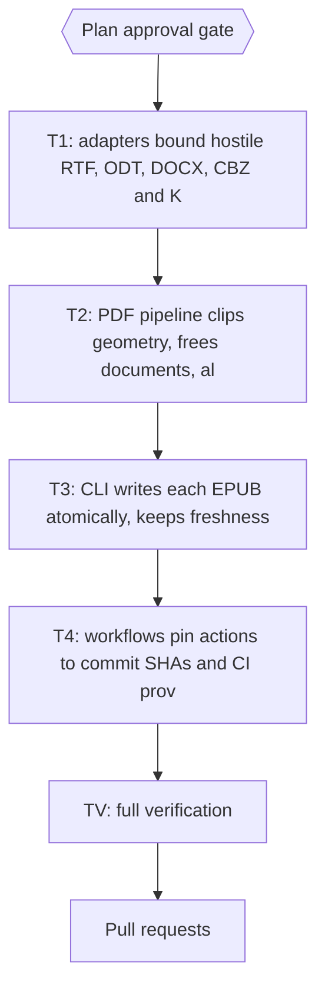

# Plan pubmy: bound hostile input in the adapters and the PDF pipeline, make CLI output writes safe, pin the workflows (audit 2026-11-09, closing wave)

> Spec: `docs/code-plan/specs/2026-11-11-audit-tuntas-pubmy-design.md`. Findings, fix notes and test notes per id: `docs/code-plan/plans/2026-11-11-audit-tuntas-pubmy-temuan.json` (sibling file, the detail lives there). The YAML frontmatter is the source of truth; where the checklist below differs from `run[]`, `run[]` wins. Commands run from the repository root; on this machine `SUCP_REMOTE_RUNNER='colab-test --'` runs them on the remote pool.

## Session checklist

- [x] Grounding: every finding re-read in code at the base commit; baseline: not measured yet; the parent runs the gates on the base commit
- [x] Plan validated: `bun scripts/ultra-plan-runner.mjs <plan>` exit 0, `Validation: OK`
- [x] Plan published as Draft, then approved (gate `Plan`)
- [x] T1 green: adapters bound hostile RTF, ODT, DOCX, CBZ and KF8 input (8 findings)
- [x] T2 green: PDF pipeline clips geometry, frees documents, aligns coordinates and caps images and crops (5 findings)
- [x] T3 green: CLI writes each EPUB atomically, keeps freshness honest and stops retrying a failed renderer download (4 findings)
- [x] T4 green: workflows pin actions to commit SHAs and CI proves the committed bundle matches the source (2 findings)
- [x] TV green: every gate command exit 0
- [x] Review: independent reviewer on the diff, findings resolved
- [x] Deliver: commits on the session branch, pull request opened
- [x] Sweep: session-close debt sweep and plan closeout

## 1. Intent and scope

- **Goal:** close the 19 findings of the 2026-11-09 Batch API audit that were confirmed real in code on 2026-11-11 and are still open in this repository.
- **Not in scope:** the 2 findings re-verified as not a problem or already fixed, and the 1 items that need an owner decision or a production change (sections 6 and 7). No production deploy, no database write, no secret change.
- **Active project profile:** Bun 1.4.4 workspace (packages/core, apps/cli, apps/web), TypeScript 7, no lint or formatter. Tests are bun:test files in packages/core/test, apps/cli/test, apps/web/test and scripts/*.test.ts; typecheck is `bun run typecheck`. skills/pubmy/scripts/pubmy.js is a committed bundle built by `bun apps/cli/build.ts`. Base origin/main 69025e7.
- **Sessions:** `at-pubmy`. One writer per session worktree at a time; tasks in one session run in order.
- **Acceptance criteria:**
  - [x] AC-1: adapters bound hostile RTF, ODT, DOCX, CBZ and KF8 input; the 8 findings listed under T1 can no longer happen.
  - [x] AC-2: PDF pipeline clips geometry, frees documents, aligns coordinates and caps images and crops; the 5 findings listed under T2 can no longer happen.
  - [x] AC-3: CLI writes each EPUB atomically, keeps freshness honest and stops retrying a failed renderer download; the 4 findings listed under T3 can no longer happen.
  - [x] AC-4: workflows pin actions to commit SHAs and CI proves the committed bundle matches the source; the 2 findings listed under T4 can no longer happen.
  - [x] AC-5: the gate commands of TV exit 0, so nothing that passed on the base commit regressed.
- **Traceability:** one row per AC.

| AC | Task | Check | Evidence |
|---|---|---|---|
| AC-1 | T1 | `timeout 300 bun test packages/core/test/adapter-guards.test.ts && timeout 600 bun test packages/core/test/builtin-adapters.test.ts packages/core/test/docx.test.ts packages/core/test/odt.test.ts packages/core/test/rtf.test.ts packages/core/test/zip-caps.test.ts` | exit 0 after the fix |
| AC-2 | T2 | `timeout 300 bun test packages/core/test/pdf-guards.test.ts && timeout 600 bun test packages/core/test/pdf-math.test.ts packages/core/test/pdf-images.test.ts` | exit 0 after the fix |
| AC-3 | T3 | `timeout 300 bun test apps/cli/test/cli-run.test.ts && timeout 300 bun test apps/cli/test/cli.test.ts` | exit 0 after the fix |
| AC-4 | T4 | `timeout 300 bun test scripts/workflow-pins.test.ts && timeout 600 bun test scripts/workflows.test.ts scripts/pack-skill.test.ts scripts/release-check.test.ts` | exit 0 after the fix |
| AC-5 | TV | `timeout 600 bun test packages/core/test/adapter-guards.test.ts packages/core/test/pdf-guards.test.ts apps/cli/test/cli-run.test.ts scripts/workflow-pins.test.ts` and the other TV steps | each exit 0 |

## 2. Visual implementation map

## 2b. Impacted surfaces

| Task | Impacted surface and the command that shows it |
|---|---|
| T1 | web worker and EPUB opener share the zip readers - rg -n 'unzipBounded\|unzipCapped\|checkZipCaps' packages apps -g '*.ts' |
| T1 | network-bound suites that exercise the CBZ reader and the KF8 filter on real books, outside every gate - bun test packages/core/test/comics.test.ts packages/core/test/mobi-kf8.test.ts |
| T1 | KF8 chapters that carry local res and flow assets - rg -n 'nodeToXhtml\|svgToXhtml\|isLocal' packages/core -g '*.ts' |
| T2 | callers of findMathAreas and extractPageImages - rg -n 'findMathAreas\|extractPageImages\|renderCrops' packages apps -g '*.ts' |
| T2 | layout, running-head and title code that reads item x, y and page top - rg -n 'toItem\|altFor\|applyCrop\|stripRunning' packages/core/src -g '*.ts' |
| T2 | network-bound suite that exercises adapters/pdf.ts end to end, outside every gate - bun test packages/core/test/pdf.test.ts |
| T3 | documents that describe --force and --rtl - rg -n 'rtl\|--force' README.md skills/pubmy/SKILL.md apps/cli/src |
| T3 | tests that read README.md or SKILL.md text - rg -l 'README\|SKILL.md' scripts apps -g '*.test.ts' |
| T3 | walk must never pick up a leftover temporary output - rg -n 'OUT_DIR\|tmp' apps/cli/src |
| T4 | workflow shape pinned by tests - rg -n 'uses\|startsWith\|toEqual' scripts/workflows.test.ts |
| T4 | tests and scripts that run the committed bundle - rg -n 'pubmy.js' scripts apps/cli/test README.md skills/pubmy/SKILL.md |
| T4 | generated files tracked in the skill folder - git ls-files skills/pubmy/scripts |
| TV | web app builds on the same core adapters - rg -n '@pubmy/core' apps/web/src |
| TV | network-bound suites left out of the gates - rg -l 'fetchFixtures' packages/core/test apps/cli/test |

## 3. Global constraints

- Use bun only (bun test, bun run, bunx); heavy commands go through `colab-test -C <worktree> -- <command>`, never the whole test folder.
- No network in tests: mobi-kf8.test.ts, comics.test.ts, pdf.test.ts, scan.test.ts and apps/cli/test/bundle.test.ts download fixtures or OCR data, so they stay out of verify and gates. New tests for kf8 and CBZ go in packages/core/test/adapter-guards.test.ts (nodeToXhtml is exported, makeCbz is local); new tests for adapters/pdf.ts (CropBox offset, crop pixel cap) go in packages/core/test/pdf-guards.test.ts with pdf-lib fixtures; new CLI tests go in apps/cli/test/cli-run.test.ts; new workflow assertions go in scripts/workflow-pins.test.ts.
- Each task's verify is also its skip_if, so it must be red on the base commit: the new test file of the task runs first and alone (repo MEMORY M15).
- Hang-shaped bugs (RTF \bin with a negative count, ODT text:c of 1e9, a PDF path at 1e12) loop or allocate before the fix, so their tests need a wall-clock bound set between the two costs with room for a loaded machine, each cost named in a comment (repo MEMORY M20); the `timeout` prefix in verify is the backstop for a synchronous loop. These tests stay in the existing files the findings name (rtf.test.ts, odt.test.ts, pdf-math.test.ts), never in a task's new red file: a red step expects exit 1 and a hang under timeout exits 124.
- Each new test file carries positive controls beside the refusals: an honest CBZ still converts, a local `res0001.jpg` src and a local `s0001.xhtml` href survive nodeToXhtml, a PDF whose CropBox starts at 0 gives the same order as before, a normal-size crop is still rendered. scripts/workflow-pins.test.ts also checks, without building, that the committed skills/pubmy/scripts/pubmy.js prints the same usage text as the source `run([])`, so a stale bundle fails T4.
- A throwaway harness gives pdf.js `new Uint8Array(readFileSync(p))`, never a Buffer (repo MEMORY M9). Fixture generators outside packages/* and apps/* import only root devDependencies (M2). No dependency is added; package.json and bun.lock stay untouched (M1).
- T4 rebuilds the bundle after T1 to T3 are committed (the parent does it, or the implementer if the worktree guard lets it create the temporary worktree): `HEAVY_LOCAL=bundle-needed-on-this-pc bun apps/cli/build.ts`, run twice to prove the output is identical (cmp), in a temporary detached worktree under ~/.cache/tmp with its own `bun install --frozen-lockfile` (repo MEMORY M19, home rule A44), then copy skills/pubmy/scripts/pubmy.js and tesseract-worker.js back. If the two builds differ, or a .wasm file changes, drop the CI rebuild step and report instead. `git diff --exit-code -- skills/pubmy/scripts` is a check the parent runs after the commit, not a verify step.
- T4 pins three actions (actions/checkout, oven-sh/setup-bun, actions/setup-node) to full commit SHAs with a version comment. Implementers cannot run gh: resolve each SHA with `git ls-remote https://github.com/<owner>/<repo> refs/tags/<tag>` or take it from the parent; never write a SHA from memory. Release permissions stay exactly `contents: write` (scripts/workflows.test.ts pins it). T4 also adds apps/cli/test/cli-run.test.ts and scripts/workflow-pins.test.ts to the dev-setup job so the new tests run in CI.
- RAR extraction (libarchive WASM) and ODT hidden-text elements are left as they are; packages/core/src/render/bun.ts and browser.ts are not edited (the crop cap sits in adapters/pdf.ts).
- No em dashes in code, comments, README.md or SKILL.md (apps/cli/test/bundle.test.ts checks both documents). Comments explain a non-obvious reason only. Test names use GLOSSARY.md terms.
- Subagents never write git state. The parent stages explicit paths and commits.
- Each fix follows RED, GREEN: a failing test first where a harness exists, otherwise the manual check named in the findings file.

## 4. Work breakdown

### Task T1: adapters bound hostile RTF, ODT, DOCX, CBZ and KF8 input

- **Session:** `at-pubmy`. **Labels:** `adapter-input-guards`.
- **Create:** `packages/core/test/adapter-guards.test.ts`
- **Modify:** `packages/core/src/adapters/builtin.ts`, `packages/core/src/adapters/comics.ts`, `packages/core/src/adapters/docx.ts`, `packages/core/src/adapters/mobi/kf8.ts`, `packages/core/src/adapters/odt.ts`, `packages/core/src/adapters/rtf.ts`, `packages/core/test/builtin-adapters.test.ts`, `packages/core/test/comics.test.ts`, `packages/core/test/docx.test.ts`, `packages/core/test/mobi-kf8.test.ts`, `packages/core/test/odt.test.ts`, `packages/core/test/rtf.test.ts`, `packages/core/test/zip-caps.test.ts`
- **Preconditions:** none.
- **Findings closed (fix and test notes per id are in the findings file):**
  - `l2:pubmy-1--dos-biaya-2` (medium): Elemen ODT `<text:s text:c="…">` memicu alokasi string bergigabyte dari beberapa byte masukan
  - `r1:pubmy-1--masukan-1` (medium): RTF dengan \bin bernilai negatif membuat parser berputar tanpa henti dan memori terus membengkak
  - `r1:pubmy-1--logika-1` (medium): RTF dengan \bin bernilai negatif membuat parser berputar tanpa henti dan memori terus membengkak
  - `l2:pubmy-1--kontrak-2` (low): detect() mengenali DOCX dari isi, tetapi adapter DOCX hanya menerima ekstensi .docx
  - `r1:pubmy-1--masukan-3` (low): Penjaga bom zip DOCX (dan RAR) hanya memeriksa ukuran yang dideklarasikan sebelum pustaka pihak ketiga mengekstrak semuanya
  - `r1:pubmy-1--logika-5` (low): Pemeriksaan zip-bomb DOCX dan CBR hanya memakai ukuran yang dideklarasikan; ukuran hasil ekstraksi sebenarnya tidak dibatasi
  - `r1:pubmy-1--masukan-2` (low): Adapter KF8/AZW3 meneruskan URL src dan href SVG tanpa saringan skema ke EPUB keluaran
  - `l2:pubmy-1--privasi-1` (low): Teks tersembunyi dan teks hapusan (revisi) di RTF/ODT muncul terbuka di EPUB
- [x] Step 1 (RED): write the failing tests, run `timeout 300 bun test packages/core/test/adapter-guards.test.ts` | expect exit 1 | retry 0
- [x] Step 2 (GREEN): apply the smallest change per finding as described in the findings file
- [x] Step 3 (Verify): `timeout 300 bun test packages/core/test/adapter-guards.test.ts && timeout 600 bun test packages/core/test/builtin-adapters.test.ts packages/core/test/docx.test.ts packages/core/test/odt.test.ts packages/core/test/rtf.test.ts packages/core/test/zip-caps.test.ts` | expect exit 0 | retry 1
- [x] Step 4 (Commit): the parent stages the files above by path and commits

### Task T2: PDF pipeline clips geometry, frees documents, aligns coordinates and caps images and crops

- **Session:** `at-pubmy`. **Labels:** `pdf-pipeline`.
- **Create:** `packages/core/test/pdf-guards.test.ts`
- **Modify:** `packages/core/src/adapters/pdf.ts`, `packages/core/src/adapters/scan.ts`, `packages/core/src/pdf/geometry.ts`, `packages/core/src/pdf/images.ts`, `packages/core/src/pdf/math.ts`, `packages/core/test/pdf-images.test.ts`, `packages/core/test/pdf-math.test.ts`, `packages/core/test/pdf.test.ts`
- **Preconditions:** task T1 finished (else `E_PRECOND_UPSTREAM`).
- **Findings closed (fix and test notes per id are in the findings file):**
  - `l2:pubmy-1--dos-biaya-1` (medium): Kotak path PDF yang tidak dipangkas ke halaman membuat grid `touching()` berputar hampir tanpa batas dan menghabiskan memori
  - `r1:pubmy-1--logika-6` (low): Dokumen pdf.js tidak pernah di-destroy, sehingga memori menumpuk sepanjang batch
  - `l2:pubmy-1--kontrak-1` (low): Koordinat 'top' teks dan gambar PDF memakai titik acuan berbeda saat page.view tidak berawal di 0
  - `l2:pubmy-1--dos-biaya-3` (low): Satu gambar PDF yang digambar berulang kali di-encode ulang menjadi PNG dan aset baru setiap kali (tanpa dedup atau batas)
  - `l2:pubmy-1--dos-biaya-4` (low): Ukuran kanvas crop rumus/diagram tidak dibatasi; MediaBox besar pada 300 dpi menghabiskan memori
- [x] Step 1 (RED): write the failing tests, run `timeout 300 bun test packages/core/test/pdf-guards.test.ts` | expect exit 1 | retry 0
- [x] Step 2 (GREEN): apply the smallest change per finding as described in the findings file
- [x] Step 3 (Verify): `timeout 300 bun test packages/core/test/pdf-guards.test.ts && timeout 600 bun test packages/core/test/pdf-math.test.ts packages/core/test/pdf-images.test.ts` | expect exit 0 | retry 1
- [x] Step 4 (Commit): the parent stages the files above by path and commits

### Task T3: CLI writes each EPUB atomically, keeps freshness honest and stops retrying a failed renderer download

- **Session:** `at-pubmy`. **Labels:** `cli-run`.
- **Create:** `apps/cli/test/cli-run.test.ts`
- **Modify:** `README.md`, `apps/cli/src/main.ts`, `apps/cli/test/cli.test.ts`, `skills/pubmy/SKILL.md`
- **Preconditions:** task T2 finished (else `E_PRECOND_UPSTREAM`).
- **Findings closed (fix and test notes per id are in the findings file):**
  - `r1:pubmy-1--logika-2` (low): Penulisan EPUB tidak atomik; file terpotong dianggap mutakhir dan dilewati pada run berikutnya
  - `r1:pubmy-1--logika-3` (low): Opsi --rtl tidak ikut menentukan kesegaran output, sehingga komik yang sudah dikonversi tetap LTR
  - `l2:pubmy-1--konkurensi-1` (low): Sumber yang diubah selama konversi tidak pernah dikonversi ulang karena mtime output lebih baru
  - `r1:pubmy-1--logika-4` (low): Unduhan renderer kanvas tanpa cache kegagalan: setiap PDF berformula bisa menunggu hingga 180 detik
- [x] Step 1 (RED): write the failing tests, run `timeout 300 bun test apps/cli/test/cli-run.test.ts` | expect exit 1 | retry 0
- [x] Step 2 (GREEN): apply the smallest change per finding as described in the findings file
- [x] Step 3 (Verify): `timeout 300 bun test apps/cli/test/cli-run.test.ts && timeout 300 bun test apps/cli/test/cli.test.ts` | expect exit 0 | retry 1
- [x] Step 4 (Commit): the parent stages the files above by path and commits

### Task T4: workflows pin actions to commit SHAs and CI proves the committed bundle matches the source

- **Session:** `at-pubmy`. **Labels:** `ci-workflows`.
- **Create:** `scripts/workflow-pins.test.ts`
- **Modify:** `.github/workflows/install-check.yml`, `.github/workflows/release-skill.yml`, `scripts/workflows.test.ts`, `skills/pubmy/scripts/pubmy.js`, `skills/pubmy/scripts/tesseract-worker.js`
- **Preconditions:** task T3 finished (else `E_PRECOND_UPSTREAM`).
- **Findings closed (fix and test notes per id are in the findings file):**
  - `l2:pubmy-1--rantai-pasok-1` (low): Workflow rilis berizin contents: write memakai action yang di-pin ke tag yang bisa digeser, bukan ke SHA
  - `l2:pubmy-1--rantai-pasok-2` (low): Rilis mengemas bundle pubmy.js yang sudah ter-commit tanpa membangun ulang atau memverifikasinya terhadap sumber
- [x] Step 1 (RED): write the failing tests, run `timeout 300 bun test scripts/workflow-pins.test.ts` | expect exit 1 | retry 0
- [x] Step 2 (GREEN): apply the smallest change per finding as described in the findings file
- [x] Step 3 (Verify): `timeout 300 bun test scripts/workflow-pins.test.ts && timeout 600 bun test scripts/workflows.test.ts scripts/pack-skill.test.ts scripts/release-check.test.ts` | expect exit 0 | retry 1
- [x] Step 4 (Commit): the parent stages the files above by path and commits

### Task TV: full verification

- **Preconditions:** tasks T4 finished (else `E_PRECOND_UPSTREAM`).
- [x] Step 1: `timeout 600 bun test packages/core/test/adapter-guards.test.ts packages/core/test/pdf-guards.test.ts apps/cli/test/cli-run.test.ts scripts/workflow-pins.test.ts` | expect exit 0 | retry 1
- [x] Step 2: `bun run typecheck` | expect exit 0 | retry 1
- [x] Step 3: `timeout 900 bun test packages/core/test/builtin-adapters.test.ts packages/core/test/docx.test.ts packages/core/test/odt.test.ts packages/core/test/rtf.test.ts packages/core/test/zip-caps.test.ts packages/core/test/detect.test.ts packages/core/test/convert-errors.test.ts` | expect exit 0 | retry 1
- [x] Step 4: `timeout 900 bun test packages/core/test/pdf-math.test.ts packages/core/test/pdf-images.test.ts packages/core/test/pdf-layout.test.ts packages/core/test/pdf-rotated.test.ts packages/core/test/pdf-running.test.ts packages/core/test/pdf-title.test.ts` | expect exit 0 | retry 1
- [x] Step 5: `timeout 600 bun test apps/cli/test/cli.test.ts` | expect exit 0 | retry 1
- [x] Step 6: `timeout 900 bun test scripts/workflows.test.ts scripts/pack-skill.test.ts scripts/release-check.test.ts` | expect exit 0 | retry 1
- [x] Step 7: `timeout 600 bun test apps/web/test/epub-loader.test.ts apps/web/test/libarchive-loader.test.ts apps/web/test/worker-client.test.ts` | expect exit 0 | retry 1

## 5. Risks and rollback

- Each task is its own commit, so a bad fix is reverted alone with `git revert <sha>`.
- Findings came from a language model and were re-read by one reader; an implementer who finds a finding is not real stops, reports it, and does not invent a change.

## 6. Waiting on the owner

- `l2:pubmy-1--rantai-pasok-3` (low): Data bahasa OCR diunduh dari CDN tanpa verifikasi checksum, berbeda dengan renderer kanvas. Needed: Putuskan: sertakan ind+eng traineddata di zip skill (zip membesar ~10 MB, web sudah menyajikannya) atau tetap percaya CDN. Perbaikan butuh keputusan produk.

## 7. Closed without a change

- `l2:pubmy-1--privasi-2` (bukan-masalah): main.ts:258 blob ZIP dicabut 30 detik; pengguna sudah mengunduh ZIP itu ke disk lewat a.click() sehingga salinan di memori tab bukan kebocoran tambahan.
- `l2:pubmy-1--konkurensi-2` (bukan-masalah): load.ts:63-64 menyerahkan cache ke tesseract.js; butuh proses mati di tengah tulis 7 MB, perilaku pustaka tak terverifikasi (tesseract.js tidak terpasang lokal), obatnya menghapus ~/.cache/pubmy/tesseract.

## 8. Session-close debt sweep and follow-up backlog

- Filled at session close.

## Closeout status

- 2026-11-11: owner chose `Mark Complete` at the `Close plan` gate. Session PR merged; gates and an independent review passed (gate logs `gate-*.rc` in the session scratch). `plan-closeout --readiness` was not run: every `skip_if` runs the full suite locally, which the machine rule A47 forbids; task and checklist ticks are asserted from the merged PR and the gate logs.
