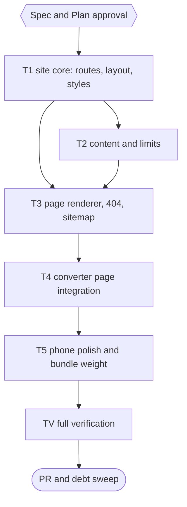
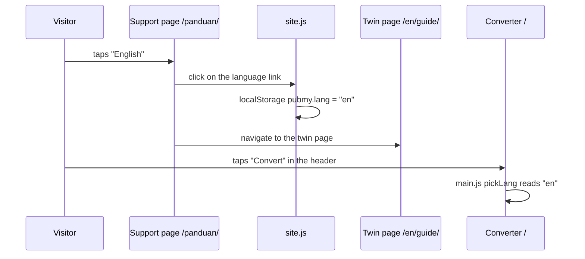

# pubmy site pages, global header and footer Implementation Plan

> For agentic workers: REQUIRED EXECUTION METHOD: delegated task execution. Steps use checkbox syntax. Subagents edit files and run tests; the parent owns every git write.

## Session checklist

- [x] Classify and ground: Architectural; read `apps/web` (index.html 183 lines, build.ts 96, main.ts 451, i18n.ts 141), tests, wrangler, README; live 404 is a bare 404 (curl 2026-11-16), repo public (`gh repo view` isPrivate false)
- [x] Preferences: all pages, per-language URLs, header not sticky, extend teal (AskUserQuestion 2026-11-16)
- [x] Intent locked, approach A, URL map approved (AskUserQuestion 2026-11-16)
- [x] Spec written: `docs/code-plan/specs/2026-11-16-pubmy-site-pages-design.md`
- [x] Plan validated (`ultra-plan-runner.mjs` Validation: OK) and published at Draft (`plan-sync.mjs`: publish exit 0, issue-sync exit 0, belajarcarabelajar/pubmy#38)
- [x] Spec and plan approved (`Spec` and `Plan` gates: owner chose "Approve spec and plan", AskUserQuestion 2026-11-16)
- [x] Workspace ready: `bun install --frozen-lockfile` exit 0 in the session worktree (121 packages, 2026-11-16)
- [x] T1 site core: route and layout tests exit 0 (parent re-run: 77 pass, 0 fail, exit 0; typecheck exit 0; commit e5377c3)
- [x] T2 content and limits: content test exit 0, converter tests exit 0 (parent re-run of content, epub-open-wiring, wiring, countdown, queue: 113 pass, 0 fail, exit 0; commit 2165865)
- [x] T3 page renderer: build and sitemap tests exit 0 (parent re-run: site-build + sitemap 127 pass, 0 fail, exit 0; build-output, headers, modulepreload, assets 30 pass, 1 skip (live-only), 0 fail, exit 0; `site/pages.ts` added to files.create)
- [x] T4 converter integration: converter, front-page, first-paint, layout tests exit 0 (parent re-run: 71 pass + 88 pass, exit 0; whole web folder 839 pass, 1 skip, 0 fail, exit 0; wiring.test.ts fixed by the parent; commit 6ba506c)
- [x] T5 phone polish and bundle weight (+1 item, from the screenshot check and the T4 report): polish test exit 0, built main.js back near its pre-T4 size (parent re-run of the six T5 test files: 245 pass, 0 fail, exit 0; built main.js 23,380 bytes vs 21,898 before T4 and 30,661 after; commit 73ee02c)
- [x] TV verification: web suite, typecheck, build, asset check exit 0 (`ultra-plan-runner.mjs --execute` exit 0: T1-T5 SKIPPED-IDEMPOTENT on skip_if exit 0, TV PASSED; log kept as runner evidence)
- [x] Visual check: headless Chromium screenshots of the built site at phone, tablet and desktop widths, viewed by the parent (owner opted in at the Plan gate, A42). Chromium 156 headless: guide 1280, formats 390, 404 1280, privacy 768, converter 1280 and 390, before and after T5; the T3 shots found the phone header wrap, squeezed table and floating footer that T5 fixed
- [x] Parent diff audit and independent review (reviewer subagent report, findings resolved): staid verdict "correct", no blocking finding; should-fix (converter link did not carry the page language) and the CLI report nit fixed in fc8a754 with a RED test first (exit 1, then exit 0); whole web folder 864 tests, 1 skip, 0 fail, exit 0; typecheck exit 0; copy rules clean (exit 0, merge-base 5e5feb2); remaining nits go to the debt sweep
- [ ] Commit on the session branch and PR opened (`Refs #<issue>`)
- [ ] Session-close debt sweep

**Goal:** turn the pubmy website from one converter page into a multi-page site with seven bilingual support pages, 404 pages, and one site header and footer shared by every page.
**Architecture:** a route table and a pure layout module render the site header, the site footer and each support page; `build.ts` renders every route in both languages from Markdown content, writes the 404 pages and a generated sitemap, and injects the same header and footer into the converter page, whose client-side language toggle switches them with the rest of the page.
**Tech Stack:** Bun 1.4.4, TypeScript 7, Bun.build, markdown-it 15 (already in `bun.lock` through `@pubmy/core`), linkedom for tests, Cloudflare Workers static assets (wrangler 4.162.0).
**Active Project Profile:** repository `~/Proyek/pubmy` (session worktree `/mnt/belajarcarabelajar/wt/pubmy-wt/pubmy-site-pages`, branch `2026-11-16-pubmy-site-pages/pubmy-site-pages` from `origin/main` 5e5feb2); target `apps/web`; config read from `package.json`, `apps/web/package.json`, `apps/web/build.ts`, `apps/web/wrangler.jsonc`, `apps/web/public/_headers`, `tsconfig.json`, `MEMORY.md`, `GLOSSARY.md`.
**Project Commands:** test `bun test <file>` (bun:test); typecheck `bun run typecheck` (root, `tsc --noEmit`); build `bun run --cwd apps/web build` (`bun build.ts [outdir]`); asset check `bun run --cwd apps/web check:assets`; deploy `bunx wrangler deploy` from `apps/web` (not part of this plan). No lint script exists. Heavy commands run locally with `HEAVY_LOCAL=pubmy-site-pages` (the instabox box is Snipset-only since 2026-11-14, so `colab-test` refuses this repo; MEMORY.md M1's colab note is stale here).
**Protected Boundaries:** `packages/core`, `apps/cli`, `skills/pubmy` are not touched (TV checks with `git diff --quiet`); `apps/web/public/_headers` CSP unchanged; the first `:root` and the dark block in `index.html` stay the single source of colour tokens (theme tests); `html:not(.ready) main` hide rule and its 1.5 s timer stay; no inline `<script>`, no stylesheet link, no web font.
**Spec:** `docs/code-plan/specs/2026-11-16-pubmy-site-pages-design.md`
**Scope:** route table, layout, site styles, 16 content files, limits module, page renderer, site script, generated sitemap, 404 pages, `not_found_handling: 404-page`, converter page header and footer, README website section, `GLOSSARY.md`.
**Non-Goals:** production deploy, contact form, analytics, new palette or fonts, README translation, browser end-to-end tests (A42: only on the owner's explicit request).

**Visual Map:**

**Reasoning Lenses:** intent (owner's four answers drive scope), investigative (tests that pin the header, first-paint rule, CSP), systems (route table as the single source for nav, footer, sitemap, twins), user-centred and accessibility (skip link, landmarks, 44 px targets, tap-only disclosure), compatibility (`pubmy.lang` key, URL shape, existing tests), security (CSP unchanged, no inline script), trade-off (approach matrix: SSG 4.8, Astro 3.0, SPA 2.2), verification (each AC maps to a test).

**Acceptance Criteria:**

- [ ] AC-1: every route exists in Indonesian and English with the paths in the spec table, and each path resolves to its twin.
- [ ] AC-2: the site header (logo, name, navigation with `aria-current="page"`, language switch, skip link) and the site footer (product, help and legal columns, GitHub, licence, version) come from one layout module and appear on every built page.
- [ ] AC-3: phone navigation is a native disclosure whose toggle is at least 44 px; no hover-only menu; the header is not sticky.
- [ ] AC-4: every support page and 404 page is built to disk with a canonical link, `hreflang` alternates for both languages and `x-default`, no inline script, no stylesheet link, and every internal link in the built site resolves to a built file.
- [ ] AC-5: content facts that live in code (file count, file size, retention minutes, version) are written as tokens and no unreplaced token remains in the build.
- [ ] AC-6: `sitemap.xml` is generated from the route table and lists every support page in both languages plus the root, with `hreflang` links; `robots.txt` still points to it.
- [ ] AC-7: `wrangler.jsonc` sets `not_found_handling` to `404-page`, and `404.html` and `en/404.html` ship with the header and footer.
- [ ] AC-8: the converter page carries the same site header and footer; its first paint stays hidden until `main.js` applies the language, now including header and footer, and the static page is complete with Indonesian labels when the script never runs.
- [ ] AC-9: the language switch on a support page links to the twin page and `site.js` stores the choice under `pubmy.lang`; on the converter page `applyLang` switches header and footer labels and link targets.
- [ ] AC-11: on a phone the language control shares the header row with the menu button, tables stack into labelled rows, the footer sits at the bottom of short pages and carries the brand, and the converter bundle carries neither the site CSS nor the route descriptions.
- [ ] AC-10: the whole web suite, typecheck, build and asset check exit 0, and `packages`, `apps/cli`, `skills` are unchanged.

**Traceability:**

| AC | Task | Check | Evidence |
|---|---|---|---|
| AC-1 | T1 | `bun test apps/web/test/site-routes.test.ts` | twin and path assertions pass |
| AC-2, AC-3 | T1 | `bun test apps/web/test/site-layout.test.ts` | header, footer, disclosure, skip link assertions pass |
| AC-5 | T2 | `bun test apps/web/test/site-content.test.ts` | every page in both languages, allowed tokens only |
| AC-4, AC-6, AC-7 | T3 | `bun test apps/web/test/site-build.test.ts apps/web/test/sitemap.test.ts` | built files, links, sitemap, 404s, wrangler key |
| AC-8, AC-9 | T4 | `bun test apps/web/test/site-converter.test.ts apps/web/test/first-paint.test.ts` | converter header, hide rule, applyLang wiring |
| AC-11 | T5 | `bun test apps/web/test/site-polish.test.ts` | built main.js free of site CSS and descriptions, data-label cells, compact language control, footer brand |
| AC-10 | TV | `bun test apps/web/test` and `bun run typecheck` | exit 0 for each command |

**Assumptions & Open Questions:**
- Content copy is drafted from the README and verified code facts; the owner reviews the wording on the PR. Assumption recorded: no new claims beyond the README, the code and the release notes.
- Corrected during T2 (2026-11-16): the site's own code stores only `pubmy.lang` and sets no cookies, but tesseract.js keeps its OCR language data in IndexedDB on the first scanned PDF (`packages/core/src/ocr/load.ts:86-87` passes no `cacheMethod`; `apps/web/src/job.ts:44`). The privacy page states both; it is read from code, not checked in a browser. No analytics beacon was found in the live HTML (curl 2026-11-16); the CSP still allows Cloudflare Web Analytics, so the page says no analytics script is loaded by the page and does not promise more.
- `@types/markdown-it` is not in `bun.lock`; if `tsc` needs types for the build-time import, T3 adds a local module declaration rather than a new package.

**Dependencies & Impact:** listed per task under `impacts`. The converter tests `front-page`, `first-paint` and `preview-layout` change on purpose in T4. `apps/web/public/sitemap.xml` is removed because the build generates it (T3).
**Risks & Rollback:** risk of a first-paint regression on the converter page (covered by `first-paint.test.ts` and a new check that the hide rule names the site header and footer); risk of drift between languages (structure parity check in T2). Rollback: revert the merge commit.
**Security & Compatibility:** CSP unchanged and checked by `headers.test.ts`; external links use `rel="noopener"`; `pubmy.lang` keeps its values; old URL `/` unchanged.
**Operations & Rollout:** deploy is a separate owner-requested step (`bun run --cwd apps/web build`, `bunx wrangler deploy --dry-run`, then `bunx wrangler deploy`); post-deploy check: `curl -sI` on `/panduan/`, `/en/guide/` (200) and `/nope` (404 with the custom body). MEMORY.md M5: zone transform rules rewrite live headers.
**CI/Review Gate:** no web CI workflow exists (`install-check.yml` and `release-skill.yml` cover the skill); the gate is TV plus the reviewer subagent and the parent diff audit.
**Documentation:** README "Website" bullet names the support pages; `GLOSSARY.md` gains four terms.
**Definition of Done:** every AC checked with its command and exit code, PR open with `Refs` to the plan issue, debt sweep run.
**Plan Status & Version:** Approved, version 1.
**Reproducibility:** Bun 1.4.4 (`packageManager`), `bun install --frozen-lockfile`; each build test builds into its own `mkdtemp` directory.
**Test Reliability:** no network in the new tests; temporary directories are removed in `afterAll`; no clock dependence.
**Privacy & Data Governance:** no new data collected; `localStorage` holds only `pubmy.lang`.
**Dependencies & Supply Chain:** markdown-it 15.0.3 is already locked (sha512 in `bun.lock`); `apps/web` declares it as a devDependency (M2: the isolated linker links only a workspace's own deps) and `bun.lock` is committed with `package.json` (M1).
**UX States:** support pages have no loading state (static); 404 offers links home and to the guide; phone, tablet and desktop widths from the CSS: header nav collapses where the links stop fitting on one row (measured on the built page, not a device width), footer columns wrap with `repeat(auto-fit, minmax(10rem, 1fr))`; focus outlines reuse `:focus-visible`; dark theme reuses the existing tokens.
**Persistent State & Artifact Storage:** `localStorage["pubmy.lang"]` = `"id" | "en"` (existing key).
**Entity & Sourcing Verification:** Cloudflare Workers static assets `html_handling` and `404-page` read from developers.cloudflare.com (HTML handling, updated 2026-04-23; Static Site Generation, updated 2026-08-25), fetched with TinyFish on 2026-11-16. Release notes from `gh release view v0.2.0` and `v0.1.0`.
**Verification:** TV `run[]`, each with its exit code recorded in the session log.

## Global Constraints

- Support page paths: `/panduan/ /format/ /privasi/ /drm/ /cli/ /tentang/ /rilis/`; English: `/en/guide/ /en/formats/ /en/privacy/ /en/drm/ /en/cli/ /en/about/ /en/releases/`; not found: `/404.html`, `/en/404.html`.
- Route keys (content file names): `guide formats privacy drm cli about releases notfound`.
- Content tokens: `{{MAX_FILES}}` (10), `{{MAX_MB}}` (50), `{{RETENTION_MIN}}` (3), `{{VERSION}}` (`apps/web/package.json` version, now 0.2.0). No other `{{...}}` is allowed.
- Asset URLs on support pages are root-absolute (`/icon.svg`, `/site.js`), because pages live in folders.
- Header navigation order: Konversi/Convert, Panduan/Guide, Format/Formats, Privasi/Privacy, CLI. Footer columns: Produk/Product (Konversi, Format, Skill & CLI, Rilis), Bantuan/Help (Panduan, FAQ `#faq`, Laporkan masalah → GitHub Issues), Legal (Privasi, DRM, Tentang & lisensi). Bottom line: `pubmy v{{VERSION}} · MIT · GitHub`.
- Copy rules: no em dash (repo copy rule), plain language, Indonesian pages in the informal "kamu" voice the converter already uses, first person singular is never needed (no "kami").
- Tap targets at least 44 px; no hover-only affordance; no `100vh`; fluid type via `clamp()` for page titles.

### Task T1: Site core (routes, layout, styles)

**Files:**
- Create: `apps/web/site/routes.ts`, `apps/web/site/layout.ts`, `apps/web/site/styles.ts`
- Modify: `GLOSSARY.md` (add Support page, Twin page, Site header, Site footer)
- Test: `apps/web/test/site-routes.test.ts`, `apps/web/test/site-layout.test.ts`

**Interfaces:**
- Produces:
  - `type RouteKey = "home" | "guide" | "formats" | "privacy" | "drm" | "cli" | "about" | "releases" | "notfound"`
  - `interface Route { key: RouteKey; path: Record<Lang, string>; nav: Record<Lang, string>; title: Record<Lang, string>; description: Record<Lang, string>; inHeader: boolean }`
  - `ROUTES: readonly Route[]`, `routeByPath(path: string): { route: Route; lang: Lang } | undefined`, `twinPath(path: string): string | undefined`
  - `siteHeader(opts: { lang: Lang; current: RouteKey; converter: boolean }): string` (converter: the language control is the existing `<button id="lang">` with `data-i18n` labels and nav links carry `data-href-id`/`data-href-en`; otherwise an `<a id="lang">` to the twin page)
  - `siteFooter(opts: { lang: Lang; version: string; converter: boolean }): string`
  - `renderPage(opts: { route: Route; lang: Lang; bodyHtml: string; version: string; tokensCss: string }): string` (full document: `<html lang>`, title, description, canonical, `hreflang` id/en/x-default, inline style = tokens + `SITE_CSS`, skip link, header, `<main id="content">`, footer, `<script type="module" src="/site.js">`)
  - `SITE_CSS: string` (header, footer, prose, disclosure nav)
- Consumes: `Lang` from `apps/web/src/i18n.ts`.

**Preconditions:** the worktree has `node_modules` (`bun install --frozen-lockfile` exit 0) else `E_PRECOND_DEP`.
**Behavior & Acceptance:** AC-1, AC-2, AC-3.
**Edge Cases & Failure Behavior:** `routeByPath` accepts paths with and without trailing slash and `index.html`; an unknown path returns `undefined`; `notfound` is not in the header, footer or sitemap.
**Deliberate Shortcuts & Deferrals:** None.
**Dependencies & Risks:** the converter variant must keep `id="lang"`, `id="lang-label"` and `data-i18n="lang-toggle"` because `main.ts` and `first-paint.test.ts` use them.
**Review & Evidence:** both test files exit 0; reviewer checks the HTML for landmarks and labels.
**Reasoning Output:** the route table is the only list of pages; header, footer, sitemap and twins derive from it, so a new page is one entry plus two Markdown files.
**Test Data & Determinism:** pure functions, parsed with linkedom; no I/O.

- [ ] Step 1: write `site-routes.test.ts` (every key has both paths, paths unique, English under `/en/`, `twinPath` round-trips, header order) and `site-layout.test.ts` (skip link targets `#content`, `nav` has `aria-label`, current link has `aria-current="page"`, disclosure is `
` with a `
`, every header and footer href is a route path, an anchor of one, or https GitHub, external links have `rel="noopener"`, converter variant keeps `id="lang"`, `SITE_CSS` has no `position:sticky`, no `100vh`, `min-height:44px` on the summary)
- [ ] Step 2: Run RED | cmd: `HEAVY_LOCAL=pubmy-site-pages timeout 300 bun test apps/web/test/site-routes.test.ts apps/web/test/site-layout.test.ts` | expect: exit 1 | retry: 0 | on_fail: n/a
- [ ] Step 3: implement `routes.ts`, `layout.ts`, `styles.ts`; add the four terms to `GLOSSARY.md`
- [ ] Step 4: Run GREEN | cmd: same as Step 2 | expect: exit 0 | retry: 1 | on_fail: FAILED, halt T2, T3, T4
- [ ] Step 5: parent stages the T1 paths by name and commits `feat(web): route table and shared site header and footer`

### Task T2: Content and limits

**Files:**
- Create: `apps/web/src/limits.ts`, 16 files `apps/web/content/{id,en}/{guide,formats,privacy,drm,cli,about,releases,notfound}.md`
- Modify: `apps/web/src/main.ts:12-14` (import `RETENTION_MS`, `MAX_FILES`, `MAX_BYTES` from `./limits.ts`), `apps/web/test/epub-open-wiring.test.ts:38-43` (it pinned `const MAX_FILES = 10;` in `main.ts`; now pins the import; found while executing, added 2026-11-16)
- Test: `apps/web/test/site-content.test.ts`

**Interfaces:**
- Produces: `export const RETENTION_MS = 180_000; export const MAX_FILES = 10; export const MAX_BYTES = 50 * 1024 * 1024;`; content files whose body starts below the title (no `# ` heading; the title comes from the route).
- Consumes: `ROUTES` (T1).

**Preconditions:** T1 green; `rg -n 'localStorage' apps/web/src` shows only `pubmy.lang` (privacy claim) else stop and report.
**Behavior & Acceptance:** AC-5 and the content half of AC-1.
**Content outline (each page in both languages, same `##` section count):**
- guide: three steps (choose or drop files, wait for conversion and preview, download or Download all), send to Kindle (email, web, app), the retention window and Extend, opening an EPUB to read, `## FAQ` with an `{#faq}`-free anchor produced by the renderer from the heading id `faq` (at least 6 questions: is it free, are files uploaded, why did my file fail, scanned PDFs, DRM, phone use)
- formats: the README formats table (input, extensions, notes), EPUB 3 with table of contents, validated before download
- privacy: in-browser conversion, no upload, retention window `{{RETENTION_MIN}}` minutes and the reading hold, what the browser stores (`pubmy.lang` only), the 2026-11-09 CSP check, CLI paths (`<folder>/pubmy-epub/`, `~/.cache/pubmy`)
- drm: the README DRM policy, what the refusal looks like, what to do instead
- cli: requirements (Bun 1.4+), the skills CLI command, the Claude Code plugin commands, the ZIP download link, the harness folder table, a usage example
- about: what pubmy is, both forms (website, skill), MIT licence, foliate-js licence (`/licenses/foliate-js.txt`), source on GitHub
- releases: v0.2.0 (2026-11-14) and v0.1.0 (2026-11-07) summarised from `gh release view`, newest first; the current version line uses `{{VERSION}}`
- notfound: one sentence and links to `/` and the guide
**Edge Cases & Failure Behavior:** a page missing in one language fails the test; a token outside the allowed set fails; an empty body fails.
**Deliberate Shortcuts & Deferrals:** None.
**Dependencies & Risks:** wording accuracy; every limit is a token, so a later change to `limits.ts` updates the pages.
**Review & Evidence:** content test exit 0; converter wiring, countdown and queue tests exit 0 after the `main.ts` import change.
**Reasoning Output:** facts are sourced from code at build time instead of copied, so pages cannot drift from the converter.
**Test Data & Determinism:** reads files from `apps/web/content`; no network.
**Fan-out:** four content subagents with disjoint files: (a) guide, notfound; (b) formats, drm; (c) privacy, about; (d) cli, releases. The parent writes `limits.ts`, the `main.ts` import and `site-content.test.ts` first, so every subagent runs the same test.

- [ ] Step 1: write `site-content.test.ts` (both files exist for every route key, non-empty, no `# ` heading, `##` count equal across languages, tokens only from the allowed set, `limits.ts` values 180000, 10, 52428800)
- [ ] Step 2: Run RED | cmd: `HEAVY_LOCAL=pubmy-site-pages timeout 300 bun test apps/web/test/site-content.test.ts` | expect: exit 1 | retry: 0
- [ ] Step 3: write `limits.ts`, change the `main.ts` import, dispatch the four content subagents
- [ ] Step 4: Run GREEN | cmd: same as Step 2 | expect: exit 0 | retry: 1
- [ ] Step 5: Run converter regression | cmd: `HEAVY_LOCAL=pubmy-site-pages timeout 600 bun test apps/web/test/wiring.test.ts apps/web/test/countdown.test.ts apps/web/test/queue.test.ts` | expect: exit 0 | retry: 1
- [ ] Step 6: parent commits `feat(web): bilingual support page content and shared limits`

### Task T3: Page renderer, 404 pages, sitemap, site script

**Files:**
- Create: `apps/web/site/render.ts` (pure: `renderContent(md: string, tokens: Record<string,string>): string` with markdown-it, heading ids, external link `rel`), `apps/web/src/site.ts` (entry built to `site.js`: on click of `#lang[hreflang]` store `pubmy.lang`), `apps/web/test/site-build.test.ts`
- Modify: `apps/web/build.ts` (add `src/site.ts` entrypoint; render every route except `home` to `<path>/index.html`, `notfound` to `404.html` and `en/404.html`; generate `sitemap.xml`), `apps/web/package.json` (devDependency `"markdown-it": "15"`), `bun.lock`, `apps/web/wrangler.jsonc` (`"not_found_handling": "404-page"`), `apps/web/test/sitemap.test.ts` (generated sitemap: root plus 14 pages, `xhtml:link` alternates), `apps/web/public/sitemap.xml` (deleted: the build writes it)
- Test: `apps/web/test/site-build.test.ts`

**Interfaces:**
- Consumes: `ROUTES`, `renderPage`, `SITE_CSS` (T1), content files and `limits.ts` (T2).
- Produces: built pages, `site.js`, `sitemap.xml` for T4 and TV.

**Behavior & Acceptance:** AC-4, AC-6, AC-7, the support-page half of AC-9.
**Edge Cases & Failure Behavior:** an unreplaced `{{` in any built page fails the build; a dead internal link fails the test; `site.js` must not import the converter code (test: `site.js` size under 2 KB and no `modulepreload` on support pages).
**Deliberate Shortcuts & Deferrals:** None.
**Dependencies & Risks:** M1 (`bun.lock` with `package.json`); M2 (workspace declares its own deps); markdown-it types (see Assumptions).
**Review & Evidence:** build and sitemap tests exit 0; existing build, headers, modulepreload and assets tests exit 0.
**Reasoning Output:** the build owns every generated SEO file, so a page added to the route table appears in the sitemap with no second edit.
**Test Data & Determinism:** one real build per test file into `mkdtemp`, removed in `afterAll`.

- [ ] Step 1: write `site-build.test.ts` and update `sitemap.test.ts`
- [ ] Step 2: Run RED | cmd: `HEAVY_LOCAL=pubmy-site-pages timeout 600 bun test apps/web/test/site-build.test.ts` | expect: exit 1 | retry: 0
- [ ] Step 3: implement `render.ts`, `site.ts`, build changes, devDependency (`bun install` updates `bun.lock`), wrangler key, delete `public/sitemap.xml`
- [ ] Step 4: Run GREEN | cmd: `HEAVY_LOCAL=pubmy-site-pages timeout 600 bun test apps/web/test/site-build.test.ts apps/web/test/sitemap.test.ts` | expect: exit 0 | retry: 1
- [ ] Step 5: Run build regression | cmd: `HEAVY_LOCAL=pubmy-site-pages timeout 600 bun test apps/web/test/build-output.test.ts apps/web/test/headers.test.ts apps/web/test/modulepreload.test.ts apps/web/test/assets.test.ts` | expect: exit 0 | retry: 1
- [ ] Step 6: parent commits `feat(web): render support pages, 404 pages and the sitemap at build time`

### Task T4: Converter page integration

**Files:**
- Create: `apps/web/test/site-converter.test.ts`, `apps/web/src/site-links.ts` (`applySiteLinks(root: ParentNode, lang: Lang): void` sets every `[data-href-id]` link's `href` to `data-href-<lang>`; kept out of `main.ts`, which is 19,910 bytes against the 20,000-byte size warning)
- Modify: `apps/web/index.html` (placeholders `<!--site-header-->` before `main` and `<!--site-footer-->` after it; old `<header>` becomes `
` inside `main` with logo, `h1`, tagline; `#lang` leaves the hero; hide rule becomes `html:not(.ready) main,html:not(.ready) .site-header,html:not(.ready) .site-footer{...}`; old `header` and `.brand` rules move to `.hero`), `apps/web/build.ts` (fill both placeholders with `siteHeader`/`siteFooter` converter variants and `SITE_CSS`, then run the existing `data-i18n` fill), `apps/web/src/i18n.ts` (nav and footer label keys in both languages, derived from `ROUTES` where possible), `apps/web/src/main.ts` (`applyLang` calls `applySiteLinks(document, lang)`: one import and one call, so the file stays under 20,000 bytes), `apps/web/test/front-page.test.ts`, `apps/web/test/first-paint.test.ts`, `apps/web/test/preview-layout.test.ts` (selectors follow the hero; the language button assertions read the built page), `README.md` (Website bullet names the support pages)
- Test: `apps/web/test/site-converter.test.ts`

**Interfaces:**
- Consumes: `siteHeader`, `siteFooter`, `SITE_CSS` (T1), build pipeline (T3).
**Behavior & Acceptance:** AC-8, the converter half of AC-9.
**Edge Cases & Failure Behavior:** the built page without `main.js` shows the Indonesian header and footer after the 1.5 s timer; `applyLang("en")` gives English labels and `/en/...` hrefs; the `h1` stays the only `h1`.
**Deliberate Shortcuts & Deferrals:** None.
**Dependencies & Risks:** `main.ts` size: T2 removes three constant lines and T4 adds two lines, so the file shrinks overall (runner warning, MEMORY.md L79); the three pinned tests change on purpose; each changed assertion keeps the behaviour it protected (the reviewer compares old and new assertions).
**Review & Evidence:** listed tests exit 0; theme, i18n and README tests exit 0.
**Reasoning Output:** one header source for all pages; the converter differs only in its language control and link targets.
**Test Data & Determinism:** one real build into `mkdtemp`; `main.ts` read as text like the existing tests.

- [ ] Step 1: write `site-converter.test.ts` (built `index.html` has `.site-header` and `.site-footer`, `#lang` inside the site header with the static label "English", every nav link has `data-href-id` and `data-href-en` that are route paths, hide rule names `.site-header` and `.site-footer`, `main.ts` `applyLang` reads `data-href-`)
- [ ] Step 2: Run RED | cmd: `HEAVY_LOCAL=pubmy-site-pages timeout 600 bun test apps/web/test/site-converter.test.ts` | expect: exit 1 | retry: 0
- [ ] Step 3: implement the changes listed under Files and update the three pinned tests
- [ ] Step 4: Run GREEN | cmd: `HEAVY_LOCAL=pubmy-site-pages timeout 600 bun test apps/web/test/site-converter.test.ts apps/web/test/front-page.test.ts apps/web/test/first-paint.test.ts apps/web/test/preview-layout.test.ts` | expect: exit 0 | retry: 1
- [ ] Step 5: Run regression | cmd: `HEAVY_LOCAL=pubmy-site-pages timeout 600 bun test apps/web/test/theme.test.ts apps/web/test/theme-dark.test.ts apps/web/test/theme-tints.test.ts apps/web/test/i18n.test.ts apps/web/test/readme-web.test.ts` | expect: exit 0 | retry: 1
- [ ] Step 6: parent commits `feat(web): site header and footer on the converter page`

### Task T5: Phone polish and converter bundle weight

Added 2026-11-16 during execution: the parent's screenshot check of the T3 build (Chromium 156 headless, 390 px and 1280 px) showed the language control wrapping to a second header row on a phone, the formats table squeezed into thin columns, and the footer floating mid-screen on the short 404 page; the T4 report measured the built `main.js` at 30,661 bytes against 21,898 before T4, because `i18n.ts` now imports `site/layout.ts` (site CSS) and `site/routes.ts` (titles and descriptions).

**Files:**
- Create: `apps/web/site/labels.ts` (`SITE_LABELS` and the nav labels only, no CSS, no titles or descriptions), `apps/web/test/site-polish.test.ts`
- Modify: `apps/web/site/layout.ts`, `apps/web/site/styles.ts`, `apps/web/site/render.ts`, `apps/web/site/routes.ts`, `apps/web/src/i18n.ts`, `apps/web/test/site-layout.test.ts`, `apps/web/test/site-build.test.ts`
**Behavior & Acceptance:** AC-11.
**Edge Cases & Failure Behavior:** the language control keeps its full accessible name when its visible text is the short code; a table without a header row keeps its plain layout.
**Deliberate Shortcuts & Deferrals:** None.
**Review & Evidence:** polish test exit 0, the listed regression tests exit 0, built `main.js` size reported before and after, screenshots repeated by the parent.
- [ ] Step 1: write `site-polish.test.ts`
- [ ] Step 2: Run RED | cmd: `HEAVY_LOCAL=pubmy-site-pages timeout 600 bun test apps/web/test/site-polish.test.ts` | expect: exit 1 | retry: 0
- [ ] Step 3: implement
- [ ] Step 4: Run GREEN | cmd: `HEAVY_LOCAL=pubmy-site-pages timeout 600 bun test apps/web/test/site-polish.test.ts apps/web/test/site-layout.test.ts apps/web/test/site-build.test.ts apps/web/test/site-converter.test.ts apps/web/test/first-paint.test.ts apps/web/test/front-page.test.ts` | expect: exit 0 | retry: 1
- [ ] Step 5: parent commits `fix(web): phone header, stacked tables, footer placement and converter bundle weight`

### Task TV: Full verification

**Files:** none.
**Behavior & Acceptance:** AC-10.
- [ ] Step 1: Run | cmd: `HEAVY_LOCAL=pubmy-site-pages timeout 900 bun test apps/web/test` | expect: exit 0 | retry: 1
- [ ] Step 2: Run | cmd: `HEAVY_LOCAL=pubmy-site-pages timeout 300 bun run typecheck` | expect: exit 0 | retry: 0
- [ ] Step 3: Run | cmd: `HEAVY_LOCAL=pubmy-site-pages timeout 300 bun run --cwd apps/web build` | expect: exit 0 | retry: 0
- [ ] Step 4: Run | cmd: `HEAVY_LOCAL=pubmy-site-pages timeout 120 bun run --cwd apps/web check:assets` | expect: exit 0 | retry: 0
- [ ] Step 5: Run | cmd: `git diff --quiet origin/main -- packages apps/cli skills` | expect: exit 0 | retry: 0

## Batch manifest

| Chunk | Owner | Target files | Expected output | Verification |
|---|---|---|---|---|
| T1 | chef subagent | `apps/web/site/{routes,layout,styles}.ts`, `apps/web/test/site-{routes,layout}.test.ts`, `GLOSSARY.md` | route table, layout, site CSS, glossary terms | `bun test apps/web/test/site-routes.test.ts apps/web/test/site-layout.test.ts` exit 0, typecheck |
| T2-parent | parent | `apps/web/src/limits.ts`, `apps/web/src/main.ts` import, `apps/web/test/site-content.test.ts`, `apps/web/test/epub-open-wiring.test.ts` | shared limits, content contract test | RED exit 1 on missing content (run 2026-11-16); wiring test 43 pass 0 fail |
| T2-a | hoggy subagent | `apps/web/content/{id,en}/{guide,notfound}.md` | guide with FAQ, 404 copy | `bun test apps/web/test/site-content.test.ts -t 'guide\|notfound'` |
| T2-b | nappy subagent | `apps/web/content/{id,en}/{formats,drm}.md` | formats table, DRM policy | same, `-t 'formats\|drm'` |
| T2-c | general-purpose subagent | `apps/web/content/{id,en}/{privacy,about}.md` | privacy facts, about and licences | same, `-t 'privacy\|about'` |
| T2-d | claude subagent | `apps/web/content/{id,en}/{cli,releases}.md` | install guide, release notes | same, `-t 'cli\|releases'` |
| T3 | implementer subagent (after T1, T2) | per Task T3 files | renderer, 404s, sitemap, site.js | Task T3 run[] |
| T4 | implementer subagent (after T3) | per Task T4 files | converter integration | Task T4 run[] |

Note: the T2 content writers were dispatched in parallel with T1 because their files are disjoint and the paths are fixed in Global Constraints; the T2 test still runs only after T1 is green, so the DAG's verification order holds.

## Approval

- Intent: locked 2026-11-16 (owner: Lock intent; approach A; URL map as proposed).
- Spec: approved 2026-11-16 (owner, Plan gate call, together with the plan).
- Plan: approved 2026-11-16 (owner: "Approve spec and plan"). Owner also opted in to a headless-browser screenshot check after TV (A42 opt-in for this session).

## Follow-up backlog

(empty)
