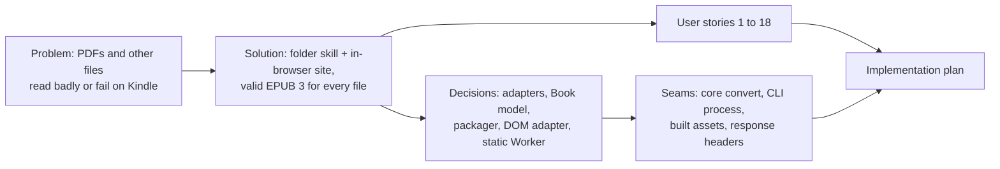

# Spec: pubmy, any file to Kindle-ready EPUB

> Design doc for the Architectural path, written at brainstorm step 6. It stays at the level of behaviour and decisions; the implementation plan carries exact paths and commands.

- **Status:** Approved (`Spec` gate, 2026-11-07)
- **Date:** 2026-11-07
- **Path:** Architectural. pubmy is a new project with no existing flow: a shared conversion core, a CLI agent skill, and a public static website.
- **Related:**
  - Intent Lock `docs/code-plan/intent-locks/2026-11-07-pubmy-intent-lock.md`.
  - Spike report `docs/code-plan/spikes/2026-11-07-pubmy-core/REPORT.md`.
  - Session log `docs/code-plan/sessions/2026-11-07-pubmy-brainstorm/brainstorm-checklist.md`.

## Problem Statement

A Kindle Paperwhite shows PDFs as fixed pages with tiny text, and many files (DOCX, scans, MOBI, comics) either fail at Send to Kindle or read poorly. Amazon converts some formats, but it does not reflow hard PDFs well, it cannot batch a folder, and it rejects EPUBs that carry validation errors (error e999). Readers who keep files in many formats have no simple way to turn all of them into EPUBs that Amazon accepts and the Kindle reflows.

## Solution

Two ways in, one result:

1. **Agent skill.** The user names a folder in Claude Code, Antigravity, Cursor, OpenCode or Codex. The skill converts every supported file in it, subfolders included, into a validated EPUB in a mirrored `pubmy-epub` folder. Running it again converts only new or changed files.
2. **Website.** At `pubmy.belajarcarabelajar.com` a visitor drops up to 10 files of up to 50 MB each and gets an EPUB per file. Conversion runs in their own browser: no file is uploaded. Each result disappears 3 minutes after it is ready.

The user then sends the EPUBs to their Kindle through Send to Kindle.

## User Stories

1. As a Kindle reader, I want to point the skill at a folder of mixed files, so that I get one EPUB per file without handling them one by one.
2. As a Kindle reader, I want subfolders converted into a mirrored output tree, so that my folder structure survives.
3. As a Kindle reader, I want a second run to skip files already converted, so that re-running on a growing folder is fast and safe.
4. As a Kindle reader, I want a per-file report and a non-zero exit code when something fails, so that I know which files need attention.
5. As a reader with digital PDFs (papers, ebooks), I want headings, paragraphs and two-column text in the right order, so that the EPUB reflows like a real book.
6. As a reader with scanned PDFs, I want Indonesian and English text recognised automatically, so that scanned books become reflowable text.
7. As a reader with DOCX, ODT, RTF, HTML, Markdown or TXT files, I want them converted with headings, lists, tables and footnotes kept, so that documents read cleanly.
8. As a reader with DRM-free MOBI or AZW3 books, I want them repacked as EPUB, so that Send to Kindle accepts them now that MOBI is no longer listed.
9. As a reader with a DRM-protected book, I want a clear refusal, so that I know why it was not converted and nothing tries to break the DRM.
10. As a comics or manga reader, I want CBZ and CBR files turned into fixed-layout EPUBs, right-to-left for manga, so that pages display whole.
11. As a reader, I want every EPUB checked before I get it, and refused with the error list if it is invalid, so that I never send a file Amazon will reject with e999.
12. As a website visitor, I want to add files one at a time or up to 10 at once and watch each convert in turn, so that the page stays responsive.
13. As a website visitor, I want an 11th file or a file over 50 MB refused before it is read, with a message in my language, so that I understand the limits.
14. As a privacy-minded visitor, I want proof that my files never leave my device, and results wiped from the tab 3 minutes after they are ready, so that I can convert personal documents safely.
15. As an Indonesian or English speaker, I want the page in my language, switchable on the page, so that I can use it comfortably.
16. As a developer using any of the five harnesses, I want README steps that copy one self-contained skill folder into the right directory, so that the skill works without npm or extra installs beyond Bun.
17. As the owner, I want page views counted without cookies and without file data, so that I see usage while keeping the privacy promise.
18. As a contributor to the public MIT repo, I want tests that run on public-domain and generated fixtures, so that I can verify changes without copyrighted files.

## Implementation Decisions

- **Modules:**
  - **Core:** pure TypeScript, no I/O. Responsibilities: format detection, one adapter per format family, the Book model, the EPUB packager with Kindle fixes, and validation.
  - **CLI:** walks the folder, mirrors the tree, skips files already converted, reports, sets exit codes.
  - **Web app:** the single page, a Web Worker that runs the core, the queue, the countdown, and the ID/EN switch.
  - **Static Worker:** serves the built assets only.
  - **Skill folder:** `SKILL.md` plus the prebuilt CLI bundle.
- **Interfaces:** the core exposes one conversion entry point that takes an input file and a context, and returns either an EPUB with its check result or a typed failure. Adapters share one shape: `accepts` plus `read` into a Book. Prototype excerpt from 2026-11-07-pubmy-core (agreed in design section 2):

  ```ts
  interface Adapter { id: string; accepts(s: Sniff): boolean; read(f: InputFile, ctx: Ctx): Promise<Book> }
  interface Ctx { dom: DomAdapter; loadOcr(): Promise<Ocr>; progress(p: number): void; signal: AbortSignal }
  type Result =
    | { ok: true; epub: Uint8Array; check: { errors: 0; warnings: number } }
    | { ok: false; code: "DRM" | "UNSUPPORTED" | "TOO_LARGE" | "READ_FAILED" | "INVALID_EPUB"; message: string };
  ```

- **Schema:** the Book model holds:
  - metadata (title, creators, language, identifier, cover);
  - chapters as XHTML bodies;
  - binary assets;
  - a nested TOC;
  - layout (`reflow` or `fixed`) and direction (`ltr` or `rtl`).

  No storage and no database.
- **Contracts:**
  - **CLI:** `pubmy <folder> [--force]`. Output goes to `<folder>/pubmy-epub/` with the same tree, and the output folder is excluded from the scan. A file is skipped when its EPUB exists and is newer than the source. Exit codes: 0 when everything converted or was skipped, 1 when any file failed, 2 on a usage error. The OCR cache is created before use at `~/.cache/pubmy`.
  - **Website:**
    - 1 to 10 files, at most 50 MB each, checked before reading;
    - results kept in tab memory only, revoked 3 minutes after ready with a visible countdown;
    - CSP `connect-src` limited to the site itself and the analytics beacon.
  - **EPUB output:**
    - EPUB 3 with a nav document and a `toc.ncx`;
    - 0 errors in epubcheck-ts or no file at all;
    - fixed-layout rendition for comics.
- **Architecture:**
  - **Adapter → Book → own packager (approach A1).** Chosen 4.4/5 over A3 (3.4) and A2 (2.8). Kindle fixes live in one place.
  - **Document reader.** pandoc.wasm was dropped: 58,580,800 B exceeds the 25 MiB Workers static-asset limit, and it is GPL. DOCX is read by mammoth (BSD-2-Clause), Markdown by markdown-it (MIT); ODT and RTF use small own readers; HTML and TXT need no library.
  - **PDF.** unpdf (MIT), with text positions taken from pdf.js `getTextContent`, because unpdf items drop rotation (spike P4). Columns are found by the modal x-start, and a heading is any size above body text on a short line. A fixed 1.2× ratio failed: 11.96 against 10.91. MuPDF.js was rejected because it is AGPL.
  - **Scans.** A page is a scan when `inspectPages` reports no text and full image coverage. Only then does tesseract.js (Apache-2.0) load `ind+eng`, with one worker by default. Measured 1.9 s/page, about 7 MB downloaded once.
  - **MOBI/AZW3.** foliate-js `mobi.js` (MIT, pinned commit), with a DOM adapter: native DOMParser in the browser, linkedom (ISC) in Bun. Both formats are fully supported. Spike P2 got 4 of 4 Gutenberg files to 0 errors. The record-0 encryption field ≠ 0 means the file is refused as DRM.
  - **Comics.** CBZ via fflate (MIT), CBR via libarchive.js (MIT; upstream libarchive is BSD). RAR4 and RAR5 were read in the spike. Output is fixed layout, one image page per XHTML, with `rtl` page progression offered for manga.
  - **Validation.** `@likecoin/epubcheck-ts` (BSD-3-Clause) runs inside the core. Java EPUBCheck 5.x is a test-time cross-check only.
  - **Hosting.** Cloudflare Workers Free with static assets and no server code, at the custom domain `pubmy.belajarcarabelajar.com`, with Cloudflare Web Analytics. Workers Free cannot run conversion: 10 ms CPU and 128 MB per request (CF limits doc, 2026-10-29).
  - **Skill.** It ships a single prebuilt `pubmy.js` built by Bun inside the skill folder, so the manual copy from D17 is self-contained. No npm publish.
  - **Licence.** The repo is MIT. Every bundled dependency is permissive (MIT, BSD, ISC, Apache-2.0), checked on the npm registry 2026-11-07.

## Testing Decisions

- **What a good test is here:** it feeds a fixture file through the public conversion entry point, or the CLI, or the built site's response headers, and asserts on the observable result. That means the EPUB's validity, its TOC and text, the refusal code, the exit code, or the header. It does not assert on internal helper steps.
- **Seams:** core entry point (primary), CLI process, built asset folder, deployed or preview response headers.

| Seam | What it catches | What it misses |
|---|---|---|
| Core `convert()` on fixtures, then epubcheck-ts | invalid EPUB, lost chapters/TOC, wrong refusal code, DRM not refused | browser-only behaviour (Web Worker, DOMParser differences): covered by running the same adapter tests with both DOM adapters where feasible, and by the manual Kindle check |
| Java EPUBCheck 5.x on all fixture outputs via `colab-test` | errors epubcheck-ts misses (95.9 % agreement) | Amazon's converter quirks: covered by AC-3 manual Kindle test |
| CLI process on a temp folder tree | mirror layout, skip-on-rerun, exit codes 0/1/2 | harness skill loading: covered by AC-8 manual check per installed harness |
| Built site folder | asset over 25 MiB, missing language strings | runtime upload attempts: covered by the CSP seam |
| Response headers (`curl`) | CSP allowing outbound connections, missing analytics beacon allowance | UI countdown and queue: unit tests on the queue/countdown module with a fake clock; browser e2e only on explicit request (A42) |

- **Prior art:**
  - The spike prototypes: `p2-mobi-repack/core.test.ts` (4 tests) and `p4-unpdf-cbr/src/layout.test.ts` (5 tests).
  - The epubcheck control in `p1-pandoc-epub`: removing the PNG yields exit 1.
- **Fixtures:**
  - Generated by scripts: PDF, scanned PDF, DOCX/ODT/RTF, CBZ/CBR, and a synthetic DRM header.
  - Downloaded and pinned by sha256: Gutenberg #11 and #28885 in KF8 and MOBI6, arXiv 2302.13971v1 (CC BY 4.0), and libarchive's RAR test files.
  - No binaries are committed.
- **Runner:** `bun test` through `colab-test` (A47). Local runs are only the targeted fallback (A12).

## Glossary

- **Book model:** the format-neutral book every adapter produces and the packager consumes.
- **Adapter:** the reader for one format family that turns an input file into a Book model.
- **Packager:** the single module that writes EPUB 3 from a Book model and applies the Kindle fixes.
- **Kindle fixes:** output rules that avoid Send to Kindle rejection: NCX alongside nav, XHTML cleaned of control characters, `--` in comments, and unclosed void tags.
- **Scanned page:** a PDF page with no text layer and full image coverage, routed to OCR.
- **Retention window:** the 3 minutes a converted EPUB stays downloadable in the browser tab before it is revoked.

## Out of Scope

- Server-side conversion, uploads, R2 storage: the owner chose in-browser on Workers Free.
- Send-to-Kindle email delivery: the owner chose download only.
- DRM removal: refused by design.
- Login, Turnstile, rate limiting: no server endpoint to protect.
- EPUB as input: skipped with a message. Re-packing existing EPUBs was not requested.
- AI or LLM clean-up, KFX/AZW3/PDF output, pandoc.wasm: not requested, or dropped by the spike.
- Browser e2e tests as a gate, and GitHub Actions: per A42 and section 5.
- Tests on Paperwhite 11 and 12: only the owner's Paperwhite 10 is the device of record.

## Outcome Check (optional)

- **Metric:** share of the AC-3 sample set (one file per format group) that Send to Kindle accepts and the Paperwhite 10 opens with a working TOC.
- **Baseline:** N/A. There is no pubmy output yet. Amazon's own conversion is the reference the owner judges against.
- **Check after merge:** when the first release is deployed, the owner sends the 5+ samples.

## Further Notes

- **Effort hot spots:**
  - MOBI production work: about 4 to 6 days, by the spike P2 estimate.
  - PDF layout heuristics: tables stay best-effort.
- **Risks:**
  - Real scans OCR worse than the synthetic pages measured.
  - Cloudflare compression of large assets is unverified. It matters less now that pandoc is gone; the OCR core is 2.9 MB.
  - Browser memory with 10 × 50 MB files on low-RAM phones.
- **External, visible actions the plan must ask about separately:**
  - creating the public GitHub repo `belajarcarabelajar/pubmy`;
  - the first deploy and the custom-domain DNS record.

## Visual Map



## Approval

| Gate | Answer | Date |
|---|---|---|
| `Intent` | Approve, save in pubmy (Recommended) | 2026-11-07 |
| `Probe` | Run spike + git init (Recommended) | 2026-11-07 |
| `Section` 1 | A1 adapter + own packager (Recommended); Doc reader: Small permissive readers (Recommended) | 2026-11-07 |
| `Section` 2 | Approve section 2 (Recommended); Invalid EPUB: Refuse, show errors (Recommended) | 2026-11-07 |
| `Section` 3 | Approve section 3 (Recommended) | 2026-11-07 |
| `Section` 4 | Approve section 4 (Recommended) | 2026-11-07 |
| `Section` 5 | Approve section 5 (Recommended) | 2026-11-07 |
| `Spec` | Approve spec (Recommended) | 2026-11-07 |
