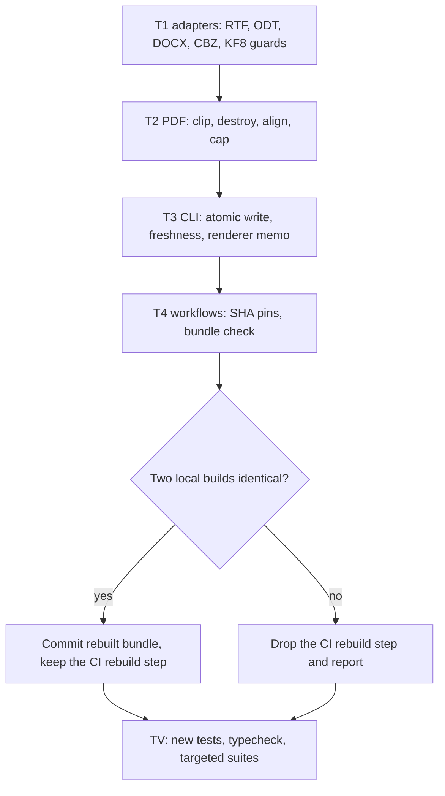

# Design: close the open audit findings in pubmy

- **Status:** Draft (plan `docs/code-plan/plans/2026-11-11-audit-tuntas-pubmy.md`)
- **Date:** 2026-11-11
- **Base:** `origin/main` 69025e7
- **Findings file:** `docs/code-plan/plans/2026-11-11-audit-tuntas-pubmy-temuan.json`

## Goal

Close the 19 findings of the 2026-11-09 audit that were confirmed in code on 2026-11-11. Seventeen are distinct changes and two are duplicates closed by the same change. All of them are about files a stranger can hand to pubmy (the website converts untrusted files in the browser, the skill converts whole folders), about the CLI losing or skipping work, or about the release chain.

## Approach per task

Tasks run in order in one session worktree (`at-pubmy`), one implementer each.

1. **T1, adapter input guards (8 findings, 3 medium).**
   - RTF: `\bin` with a negative or missing count no longer moves the cursor backwards; `\v` and `\deleted` text is not emitted, `\v0` and `\plain` turn it back on.
   - ODT: `text:s text:c` is capped at 1000 spaces.
   - DOCX, CBZ, ODT: the archive goes through `unzipBounded`, which stops an entry as soon as it inflates past its declared size. DOCX uses it as a validator before mammoth reads the same bytes.
   - DOCX is accepted by detected format as well as by extension.
   - KF8: `iframe`, `object`, `embed`, `form`, `input` are dropped; `src` is kept only for local book resources; SVG `href` and `xlink:href` are kept only for `#id`, local, or http(s) targets.
2. **T2, PDF pipeline (5 findings, 1 medium).**
   - Path and image boxes are clipped to the page view before the `touching()` grid sees them; boxes fully outside are dropped.
   - `read()` and `ocrScan` destroy their pdf.js document in a `finally`.
   - Layout text items are shifted by the page view origin so text and images share one `top` reference.
   - A page image drawn many times is encoded once per object, and a page yields at most 100 images.
   - A formula or diagram crop above about 25 million pixels at 300 dpi is not rendered and stays text.
3. **T3, CLI run (4 findings).**
   - Output is written to a temporary file in the same folder, then renamed; a failed write removes the temporary file and leaves the old EPUB alone. The symlink refusals stay.
   - After the rename the output takes the source mtime read before conversion, so a source edited during conversion is converted again next run.
   - `--rtl` implies `--force`; usage text, README and SKILL.md say so.
   - Once the canvas renderer fails to load, the rest of the run does not try again.
4. **T4, workflows and bundle (2 findings).**
   - Every `uses:` in both workflows is pinned to a full commit SHA with a version comment; the release checkout sets `persist-credentials: false`.
   - The `dev-setup` job rebuilds the bundle and fails when `skills/pubmy/scripts` differs from the commit. The same job runs the two new test files of T3 and T4.
   - The committed bundle is rebuilt here, after T1 to T3, so the fixes reach the shipped skill.

## Test seams

- Adapters are driven through their public `read()` or `convert()` with bytes built in the test; the KF8 filter through the exported `nodeToXhtml`.
- PDF fixes are driven with pdf-lib documents and hand-built operator lists; the crop renderer is a fake injected through `loadRenderer` (a system boundary).
- The CLI is driven through `run()` with an injected `convert`.
- Workflows are read as YAML, as `scripts/workflows.test.ts` already does.
- Each task gets one new test file that runs first in its verify command, because the existing files pass on the base commit and would make the task look done.

## Not done on purpose

- RAR archives: extraction runs inside libarchive WASM with no size limit API; the size check after extraction stays as is.
- ODT hidden text (`text:hidden-text`, `text:hidden-paragraph`): the condition is not evaluated, so hiding blindly could drop visible text.
- `render/bun.ts` and `render/browser.ts`: the crop cap sits in one place, `adapters/pdf.ts`.
- OCR language data checksum (`l2:pubmy-1--rantai-pasok-3`): needs an owner decision on shipping the data in the skill zip.
- Tests that need the network (`mobi-kf8`, `comics` RAR, `pdf` arXiv, `scan`, `bundle`) are not extended and are not part of the gates. They still exercise the changed code, so the parent runs `comics`, `mobi-kf8` and `pdf` once on a runner with network after T1 and T2.

## Behaviour changes the owner will notice

- **Fails closed:** a DOCX, ODT or CBZ whose entries inflate past their declared size, use ZIP64, or use a method other than stored or deflate is refused as `READ_FAILED`. That includes honest archives written with ZIP64 records or an unusual method, which some tools produce even for small files; they converted before and will not after. Other honest files are unaffected; DOCX is inflated twice, which costs some time on large files.
- **Content removed:** hidden and tracked-deletion text in RTF no longer appears in the EPUB. Remote images, frames and forms in AZW3 books are dropped. A PDF page keeps at most 100 images; an oversized formula area stays as text.
- **CLI contract:** `--rtl` now reconverts every file in the folder, not only comics. Output files carry the source modification time, so a file manager shows the source date, not the conversion date. A file without an extension that is a DOCX inside is now converted instead of reported unsupported.
- **CI contract:** a pull request that changes CLI or core source without committing a rebuilt bundle fails `dev-setup`. This holds only if the build is byte-identical between this machine and the Ubuntu runner, which T4 must prove locally (two builds, `cmp`) and the first CI run proves remotely; if it is not, the rebuild step is dropped and reported.
- **Maintenance:** action updates become manual SHA bumps.
- No production secret, deploy or public URL changes.

## Flow

