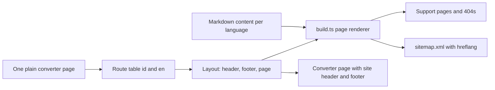

# Spec: pubmy site pages, global header and footer

- **Status:** Approved (`Spec` gate, 2026-11-16)
- **Date:** 2026-11-16
- **Path:** Architectural (the website goes from one page to a multi-page site: the build gains a page renderer, a shared layout and generated SEO files)
- **Related:** intent locked in session 2026-11-16 (owner answers: all pages, per-language URLs, header on every page but not sticky, extend the current teal design); approach A chosen (static pages rendered by `apps/web/build.ts`)

## Problem Statement

The website at pubmy.belajarcarabelajar.com is a single converter page. A visitor who wants to know how it works, which formats it reads, what happens to their files, why a DRM file is refused, how to install the agent skill, or what changed between releases has to leave for the GitHub README, which is in English only. Nothing on the page links anywhere, so the site reads as a small side project rather than a product. The owner wants supporting pages and a header and footer that stay the same on every page.

## Solution

Seven support pages, each in Indonesian and English, plus a 404 page in each language. Every page, the converter included, opens with the same site header (logo, name, navigation, language switch) and closes with the same site footer (product, help and legal links, GitHub, licence, version). The header scrolls away with the page; on a phone its navigation opens with a tap. Indonesian pages own the root (`/panduan/`), their English twins live under `/en/` (`/en/guide/`), and the language switch on a support page goes to its twin page. Support pages are plain static HTML: they load no converter code, show their content at once, and work without JavaScript. Search engines get every page from a generated sitemap with `hreflang` alternates.

| Page | Indonesian | English | Content source |
|---|---|---|---|
| Converter | `/` | `/` (client toggle, as today) | existing page |
| Guide and FAQ | `/panduan/` | `/en/guide/` | README, UI copy |
| Formats | `/format/` | `/en/formats/` | README "Supported formats" |
| Privacy | `/privasi/` | `/en/privacy/` | README "Privacy", code |
| DRM policy | `/drm/` | `/en/drm/` | README "DRM policy" |
| Skill and CLI | `/cli/` | `/en/cli/` | README "Install the skill" |
| About | `/tentang/` | `/en/about/` | LICENSE, vendor licences |
| Releases | `/rilis/` | `/en/releases/` | GitHub releases v0.1.0, v0.2.0 |
| Not found | `/404.html` | `/en/404.html` | new |

## User Stories

1. As a first-time visitor, I want a navigation bar on the converter page, so that I can learn what pubmy is before I drop a file.
2. As a visitor, I want a guide that walks me from choosing files to sending the EPUB to my Kindle, so that I finish the job without the README.
3. As a visitor with an unusual file, I want a formats page that says what each format becomes (columns, OCR, comics right to left), so that I know what to expect.
4. As a privacy-minded visitor, I want a privacy page that states files never leave my browser, how long a result stays in memory, and what the browser stores, so that I can trust the tool.
5. As a visitor whose MOBI was refused, I want a DRM page explaining why, so that I understand the refusal is deliberate.
6. As a developer, I want a Skill and CLI page with the install commands, so that I can convert folders with my coding agent.
7. As a returning visitor, I want a releases page, so that I see what changed.
8. As an Indonesian visitor, I want every support page in Indonesian, and as an English visitor in English, with one tap to the twin page.
9. As a phone visitor, I want the navigation behind a tap target of at least 44 px, so that the header does not crowd the drop zone.
10. As a keyboard or screen-reader user, I want a skip link, a labelled navigation landmark and the current page marked, so that I can move through the site.
11. As a visitor who follows a broken link, I want a 404 page in my language with the header and footer, so that I can find my way back.
12. As a search engine, I want each page at a stable URL with a canonical link and `hreflang` alternates in a sitemap, so that both languages are indexed.
13. As the owner, I want limits quoted on the pages (10 files, 50 MB, 3 minutes, the version) to come from the code, so that a change to a limit cannot leave a page out of date.
14. As the owner, I want the converter page to keep its first-paint behaviour (no flash of the wrong language), so that the new header does not reintroduce a fixed bug.

## Implementation Decisions

- **Modules:**
  - *Route table:* the single list of pages, each with its Indonesian and English path, navigation label, title and description, and its place in the header and footer. Every other module reads it.
  - *Layout:* pure functions that render the site header, the site footer and a whole support page from a route, a language and a body. No I/O.
  - *Site styles:* the CSS for the header, footer and prose, shared by the converter page and the support pages. The colour tokens stay in the converter page's own style block, which the theme tests read, and the build copies them into every support page.
  - *Content:* one Markdown file per page per language. A file starts with its body; the title and description come from the route table. Facts that live in code are written as tokens (`{{MAX_FILES}}`, `{{MAX_MB}}`, `{{RETENTION_MIN}}`, `{{VERSION}}`) and replaced at build time.
  - *Limits:* the converter's file count, file size and retention constants move into their own module, imported by the converter and by the build.
  - *Page renderer (in the build):* renders every route in both languages to `<path>/index.html`, the two 404 pages, and the sitemap.
  - *Site script:* a few lines served as `site.js` on support pages; it stores the visitor's chosen language under the existing `pubmy.lang` key when they use the language switch, so the converter page opens in the same language.
- **Interfaces:** the route table exports the routes and a lookup from a path to its twin; the layout exports `siteHeader`, `siteFooter` and `renderPage`.
- **Contracts:**
  - URL shape: folders with `index.html`, served with a trailing slash by Workers static assets (`html_handling` default `auto-trailing-slash`, checked in Cloudflare docs 2026-11-16).
  - Not-found: `not_found_handling` changes from `none` to `404-page`; Workers serve the nearest `404.html` with status 404, so `/en/...` gets the English one.
  - Content Security Policy unchanged: no inline script (the site script is a file), no web font, no form.
  - `localStorage` key `pubmy.lang` keeps its meaning (`"id"` or `"en"`).
- **Architecture:**
  - Static generation inside the existing `build.ts` and no framework, because the build already fills Indonesian text into the HTML, the CSP and first-paint rules are pinned by tests, and Markdown rendering is already a dependency of the core package (markdown-it 15).
  - The converter page keeps its client-side language toggle. Its site header and footer are filled in Indonesian at build time and switched by `main.js` with the rest of the page; the first-paint hide rule now also covers the site header and footer on that page only.
  - The converter's current header becomes a hero block inside `main` (logo, title, tagline); the language button moves into the site header. The rules for the old `header` selector move to the hero selector.
  - Header not sticky (owner's answer). Phone navigation uses a native disclosure element, so it opens by tap and keyboard with no script.
  - Visual direction: the current palette, system fonts, full-width header and footer bars on the surface colour with a border, a wider reading column for support pages, footer columns that wrap by available width.

## Testing Decisions

- **What a good test is here:** it reads the built output (HTML files on disk) or calls the pure layout and route functions, and fails when a visitor would see a broken page, a dead link or a missing twin.

| Seam | What it catches | What it misses |
|---|---|---|
| Route table and layout functions (unit) | missing twin, wrong `aria-current`, missing skip link, header or footer link to a non-route | how the CSS looks |
| Built output in a temporary directory (`build.ts <dir>`) | missing page file, unreplaced token, inline script, stylesheet link, dead internal link, missing canonical or `hreflang`, missing 404 | live Cloudflare routing |
| Converter page source and built HTML (existing tests, updated) | first-paint regression, the language button losing its static label | rendering in a real browser |
| Content files | page missing in one language, empty body | wording quality (owner review) |

- **Prior art:** `apps/web/test/first-paint.test.ts` and `sitemap.test.ts` (one real build per file into a temporary directory), `front-page.test.ts` (CSS rules read from the inline style).

## Glossary

- **Support page:** a static page of the website other than the converter (guide, formats, privacy, DRM, skill and CLI, about, releases, not found).
- **Twin page:** the same support page in the other language; the language switch links to it.
- **Site header:** the header shared by every page: logo, name, navigation and language switch.
- **Site footer:** the footer shared by every page: link columns, GitHub, licence and version.

## Out of Scope

- Production deploy: a separate step, run only when the owner asks.
- Contact form: the CSP forbids form submission and there is no backend; the footer links GitHub Issues.
- Analytics, newsletter, blog.
- A new palette or web fonts.
- Translating the README.

## Outcome Check (optional)

N/A: the site has no analytics, and the owner chose not to add any; success is judged by the owner reviewing the pages.

## Further Notes

- Risk: the converter page's header tests pin the old structure; they are changed on purpose in the converter integration task and listed in its `impacts`.
- Rollback: revert the merge commit; `wrangler.jsonc` returns to `not_found_handling: none` with it.

## Visual Map

