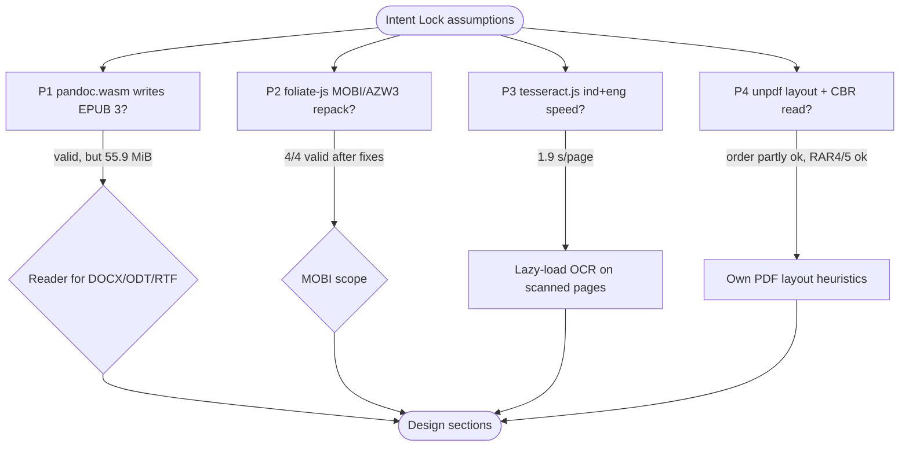

# Spike Exploration Report: pubmy shared core (browser + Bun)

## 1. Objective & Timebox
- **Question this prototype answers:** can every v1 format be converted to a valid EPUB 3 with JS/WASM code that runs in both a browser tab and Bun, inside the Cloudflare Workers Free static-asset limits?
- **Objective:** test the four risky assumptions of the Intent Lock (`docs/code-plan/intent-locks/2026-11-07-pubmy-intent-lock.md`, section 6) before the design.
- **Timebox Budget:** about 30 minutes per probe, four probes in parallel (2026-11-07).
- **Deliverable:** this report plus the prototypes in `p1-pandoc-epub/`, `p2-mobi-repack/`, `p3-ocr-speed/`, `p4-unpdf-cbr/`.

## 1b. Spike Flow

## 2. Hypothesis Matrix

| # | Hypothesis | Probe | Outcome | Confidence |
|---|---|---|---|---|
| H1 | pandoc.wasm writes a valid EPUB 3 under Bun | `bun main.ts` exit 0; parent re-ran `epubcheck.js out.epub` exit 0; control without the PNG exit 1 (RSC-001) | Confirmed (0 errors, 0 warnings; nav TOC, `dc:language id`) | High |
| H1b | pandoc.wasm fits one Workers static asset (25 MiB) | `stat` = 58,580,800 B (gzip -9 16.0 MB, brotli 10.8 MB) | Disproven | High |
| H2 | foliate-js `mobi.js` repacks AZW3 and MOBI6 into valid EPUB | Gutenberg #11 and #28885 in KF8 + MOBI6; `bun test core.test.ts` 4 pass exit 0 (parent re-run); parent ran epubcheck-ts on the 4 outputs, each exit 0 | Confirmed after 2 MOBI6 fixes (linkedom body-less sections, `<tt>`→`<code>`); MOBI6 loses presentational attributes; DRM refusal only unit-tested | Medium |
| H3 | tesseract.js `ind+eng` is usable in Bun | `run-warm-page.log` exit=0: 1.90 s/page mean, CER 0-0.07 % clean, 0.23-0.42 % degraded, peak RSS 197,960 kB; native baseline 1.32-1.42 s/page | Confirmed (synthetic pages, not real scans) | Medium |
| H4a | unpdf gives enough geometry for two-column order | arXiv 2302.13971v1 (CC BY 4.0), `bun src/pdf-layout.ts` exit 0; `bun test src/layout.test.ts` 5 pass exit 0 | Partly: column split by modal x-start works, rotated side stamp needs pdf.js `getTextContent` | Medium |
| H4b | headings detectable by font size ≥ 1.2 × body | body 10.91, section heading 11.96 (ratio 1.096) | Disproven: use "any size above body + short line" | High |
| H4c | scanned pages detectable | `inspectPages`: textLength 0, imageCoverage 1 vs 3422 / 0 | Confirmed | High |
| H4d | libarchive.js reads CBR (RAR) under Bun | parent decoded libarchive's own RAR4 + RAR5 test fixtures, `bun src/cbr-probe.ts` exit 0, entries listed and extracted (`cbr-rar-probe.out.txt`) | Confirmed (RAR4, RAR5 compressed) | Medium |

## 3. Discovered Epistemic Unknowns
- **Known unknowns addressed:** pandoc.wasm EPUB output, OCR speed and sizes (ind 1,194,182 B + eng 2,952,873 B compressed, core 2,862,266 B), scanned-page detection, RAR support.
- **Unknown unknowns discovered:**
  - pandoc.wasm is 55.9 MiB, too big for one static asset; npm package is GPL-2.0-or-later and ships no types.
  - unpdf drops text rotation.
  - tesseract.js silently re-downloads data when its cache folder is missing.
  - libarchive.js npm ships no licence for the bundled WASM; upstream libarchive `COPYING` is a 2-clause BSD style notice (fetched 2026-11-07).

## 4. Architectural Trade-offs
- **DOCX/ODT/RTF reader.** Option A: drop pandoc.wasm, use small permissive readers (mammoth.js for DOCX, own ODT `content.xml` reader, a small RTF reader, markdown-it for Markdown), all under 1 MB, repo stays permissive. Option B: keep pandoc.wasm split into 3 static assets under 25 MiB each, lazy-loaded only when a DOCX/ODT/RTF is queued (brotli about 10.8 MB transfer, if Cloudflare compresses `application/wasm`, unverified), best fidelity, ships a GPL-2.0+ file. Option C: pandoc.wasm on R2, needs a card on file and uncapped billing (AGENTS.md C3).
- **MOBI/AZW3.** Feasible in both formats; production effort estimated 4-6 days by the probe (HTML5 serializer, MOBI6 attributes to CSS, SVG/fonts, combo files, browser parity, corpus run). Bun needs a DOM shim (linkedom); the browser has a native DOMParser, so the core takes a DOM adapter.
- **PDF.** Positions from pdf.js `getTextContent` (rotation kept), columns by modal x-start, headings by "size above body and short line"; tables stay best-effort.

## 5. Decision & Next Steps
- **Recommended path:** adapter → book model → own EPUB packager (design A1), with the reader for DOCX/ODT/RTF decided at the design gate; OCR lazy-loaded only for pages `inspectPages` marks as image-only; one OCR worker by default.
- **Transition to plan:** Architectural path, design sections next.

## 6. Prototype Location
- **Path:** this folder; each probe has its own `package.json`.
- **Run:** `cd p1-pandoc-epub && bun main.ts`; `cd p3-ocr-speed && ./rss.sh page`; `cd p4-unpdf-cbr && bun src/pdf-layout.ts <pdf>` / `bun src/cbr-probe.ts <archive>`.
- **Kept:** primary evidence for this report, exempt from the temp-file purge. `node_modules/` and `cache/` are git-ignored.
